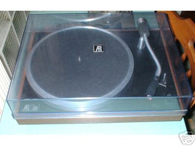

# AR XB77

> Archived copy, saved 2026-11-05. Original: <https://vinylnirvana.com/ar-turntable-resources/ar-models/ar-xb77>. Site: Vinyl Nirvana. Rights remain with the author and the original site.

The xb77 arrived in 1977 with a vinyl wrapped chipboard base, black metal headshell, and lighter aluminum counterweight. The logo changed to the more modern AR font but was just a printed metal square.

Specifications:

Belt Drive

Suspended aluminum platter-2 parts-in oil bearing – 3.9 lbs (1.8kg)

12″ S-Shaped tonearm in oil bearing with cueing

Plastic Headshell with brass inserts for cartridge screws-Black

Counterweight-Aluminum

AC synchronous motor 110-120 v 60 cycle

Wow and Flutter, Speed Accuracy, Rumble see [XA Technical Specifications](https://vinylnirvana.com/ar-models/ar-technical-specifications/)

Base Finishes: Vinyl Walnut-look Veneer

Metal Plinth Finishes: Textured black

Overall size: ?

Total Weight ?
