# A Photo Comparison of a “New” and “Old” AR XA

> Archived copy, saved 2026-11-05. Original: <https://vinylnirvana.com/ar-turntable-resources/ar-turntable-history/a-photo-comparison-of-a-new-and-old-ar-xa>. Site: Vinyl Nirvana. Rights remain with the author and the original site.

### A Photo Comparison of a “New” and “Old” AR XA

There seem to be three main “periods” in the manufacture of the AR XA.

This page will highlight the differences between the very early dual motor XA

and the later, better known, single motor design.

I hope that at some later point, I can include photos of the most recent period. (Vinyl Veneer).

Once you remove the outer platter, you can see right away whether your turntable is the single or dual motor design. The second motor was designed to start the main motor in the correct direction each time.

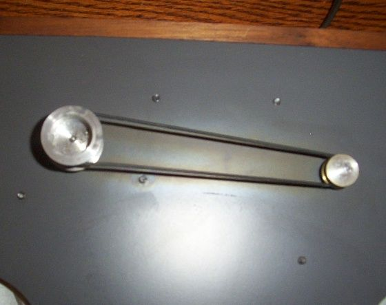

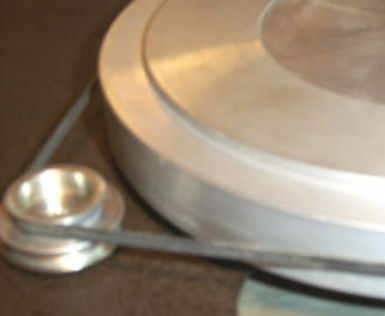

Here is the view of the motors from the underside.

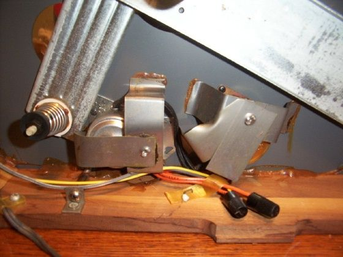

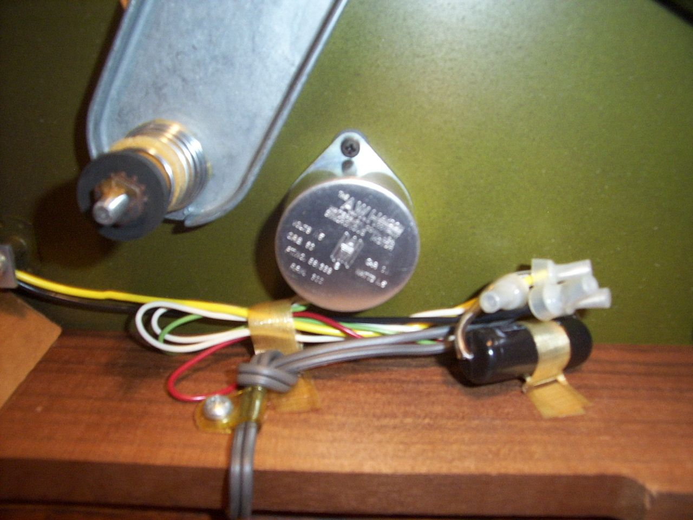

And this is the old dual motor design with the motor plates removed.

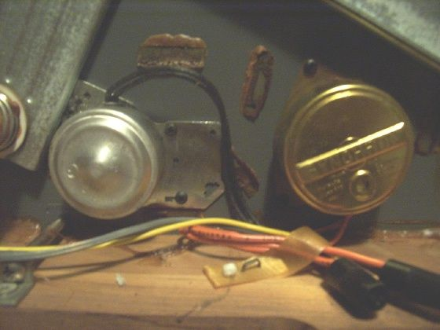

The subchassis is drastically changed, as these photos attest. Here is an old underside shot, followed by the new.

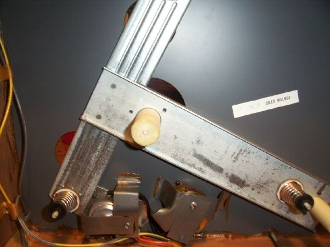

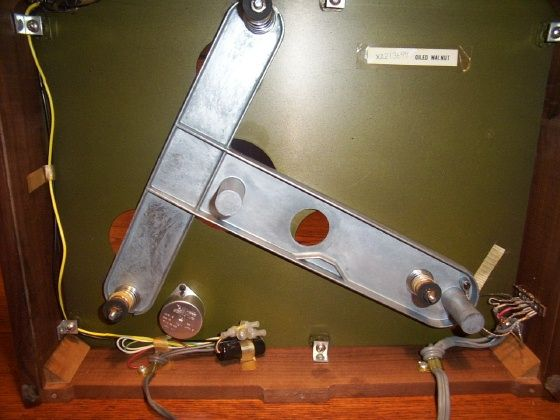

The topside photo of the old subchassis reveals the Delrin material used in the bearing well. As Roy Allison describes on the History page, this material was very problematic. Every older XA I have seen with this material has had a seized platter bearing.

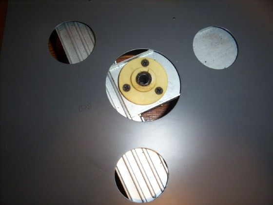

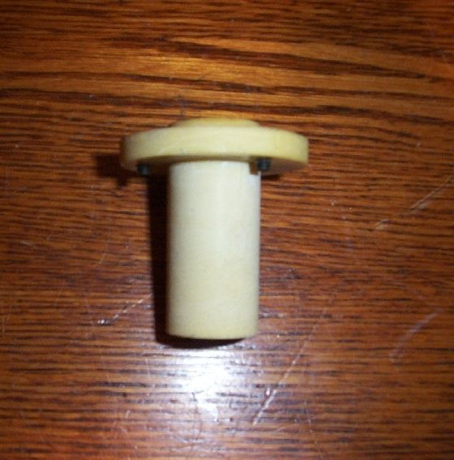

The newer wells were metal.

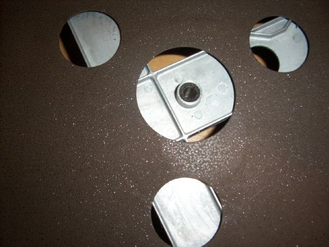

The early tonearm wells were also made of the delrin material, with the same result, a lot of seized posts. Note that even the inner parts of the arm were delrin.

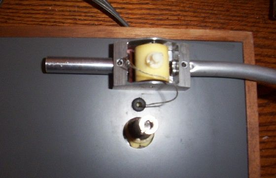

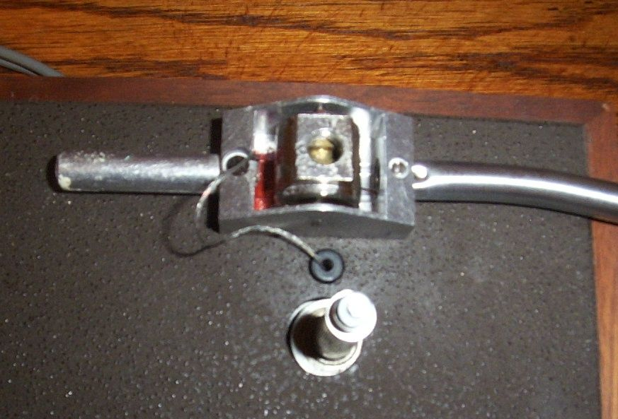

These last few pictures feature some of the design changes beneath the table. (The new pics begin with the photo of the higher serial number label.)

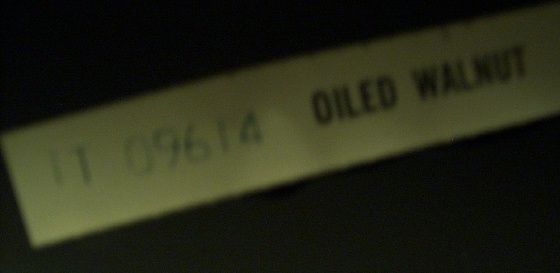

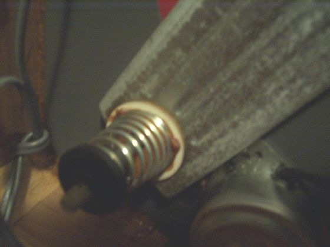

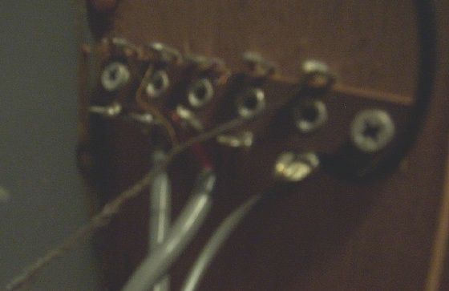

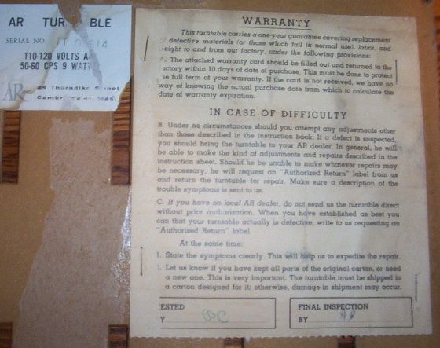

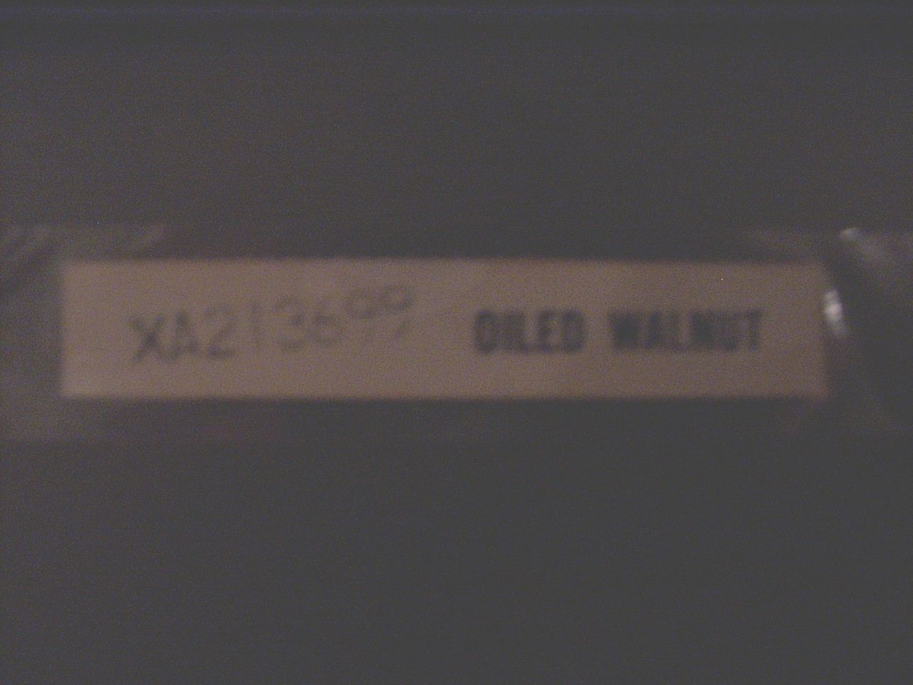

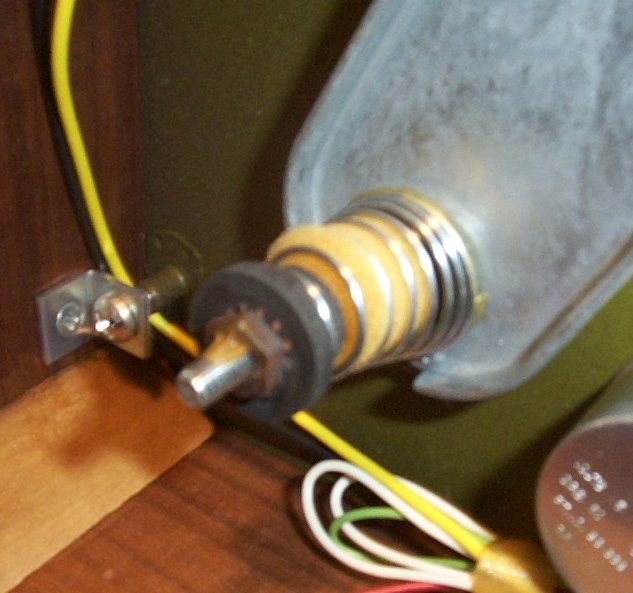

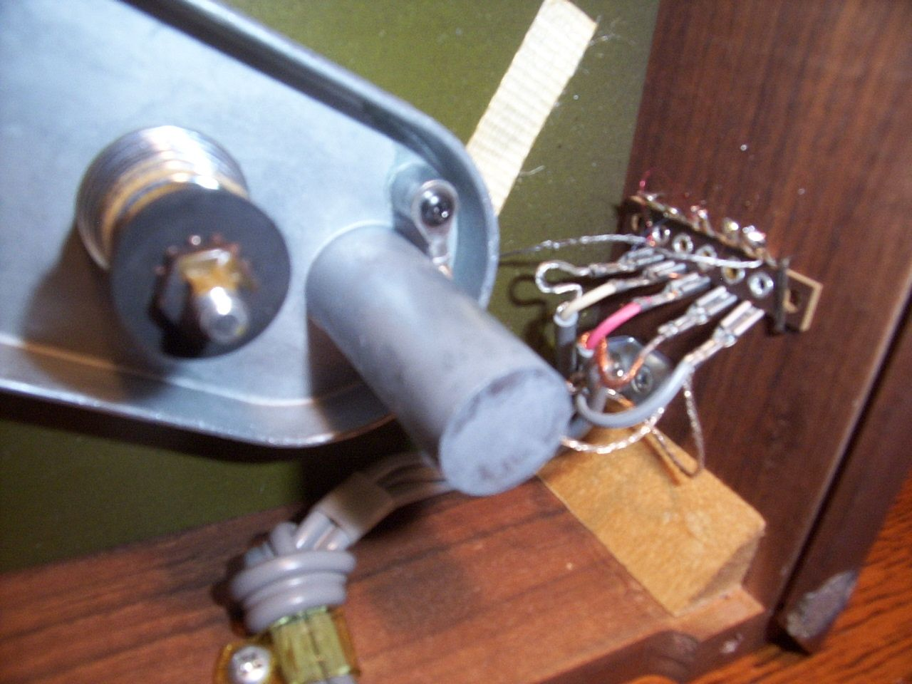

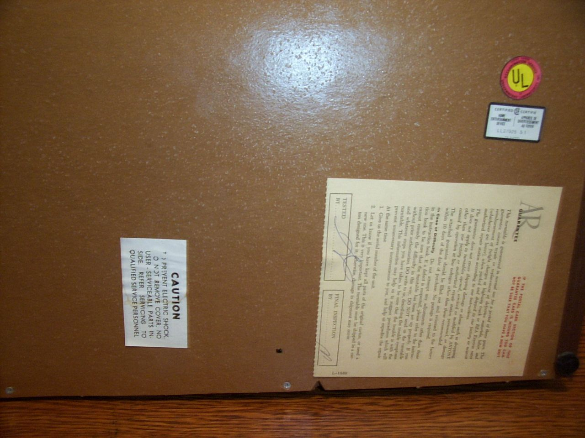
