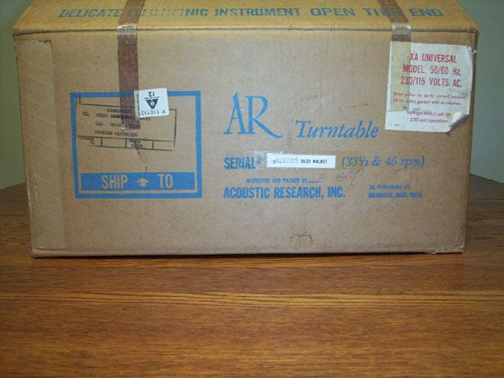
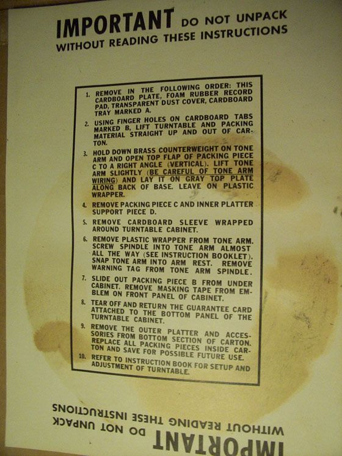
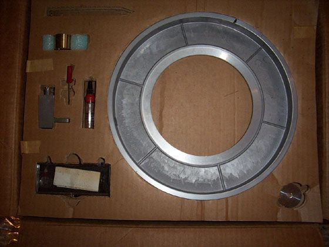
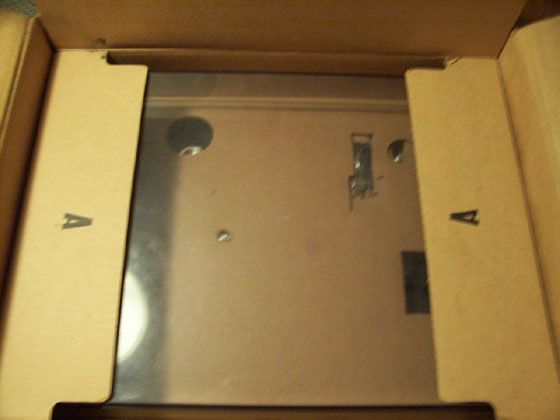
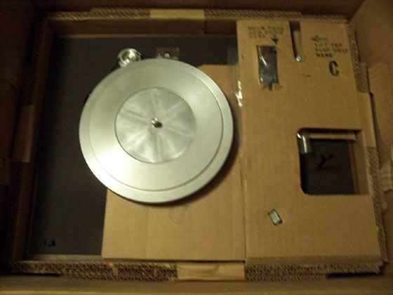
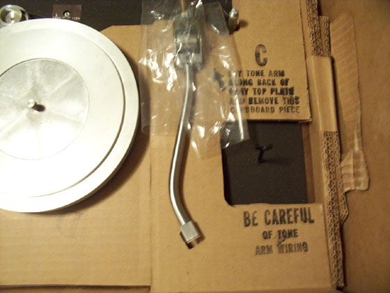

# An AR XA in its original packing

> Archived copy, saved 2026-11-05. Original: <https://vinylnirvana.com/ar-turntable-resources/ar-turntable-history/an-ar-xa-in-its-original-packing>. Site: Vinyl Nirvana. Rights remain with the author and the original site.

Back in the day, what did an AR XA look like when it arrived in its box?

Front view of the original box.

Paper which greeted the buyer on top.

The next layer…some parts missing.

The inner dustcover box.

Beneath the dustcover box…

Under the tonearm protection…
