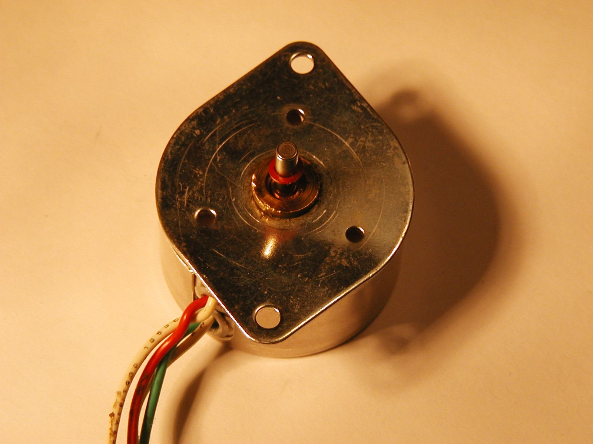
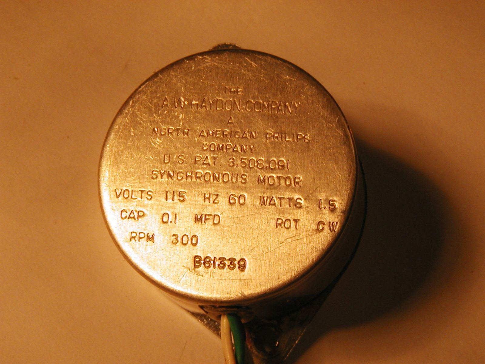
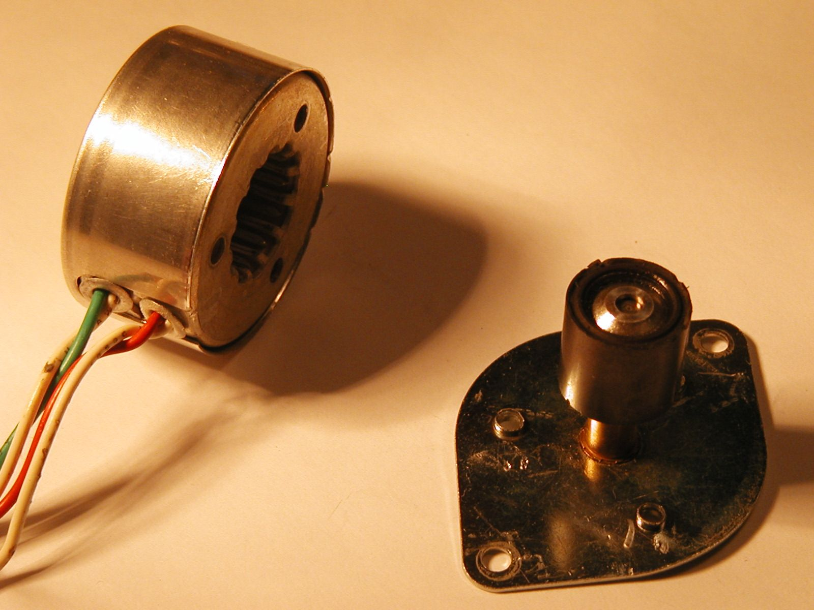
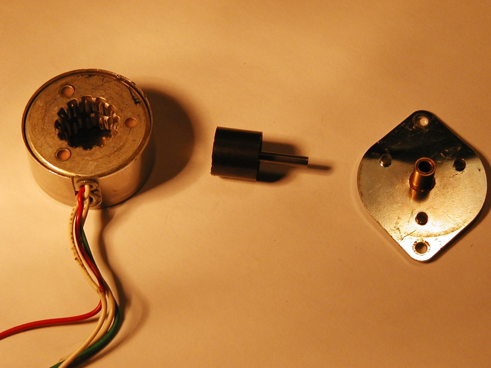
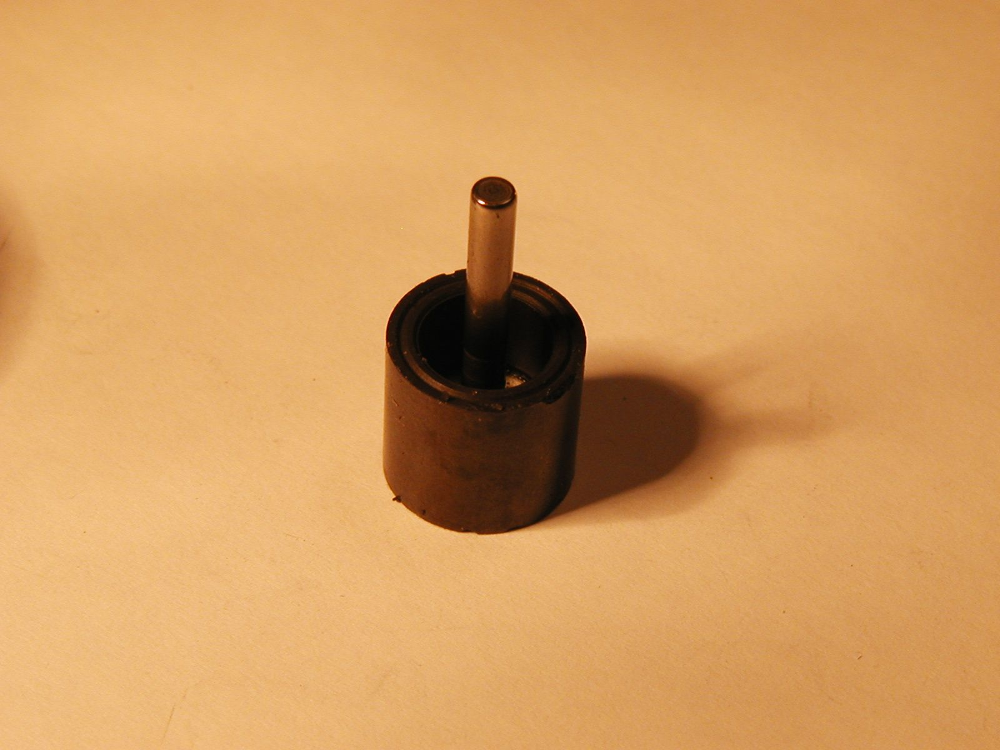
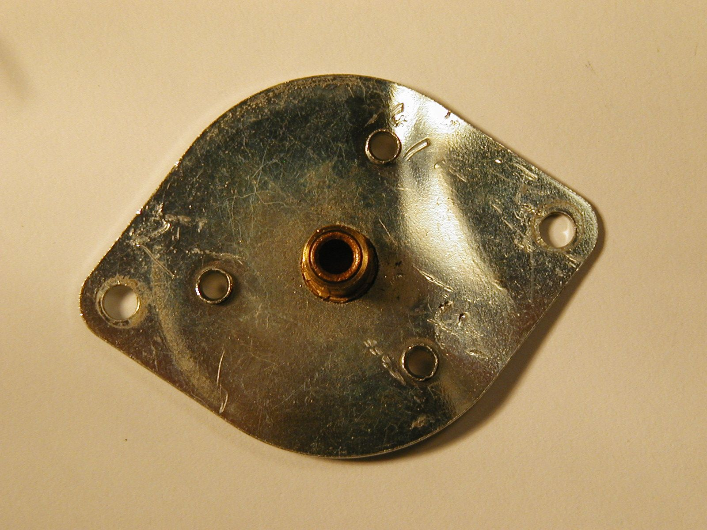
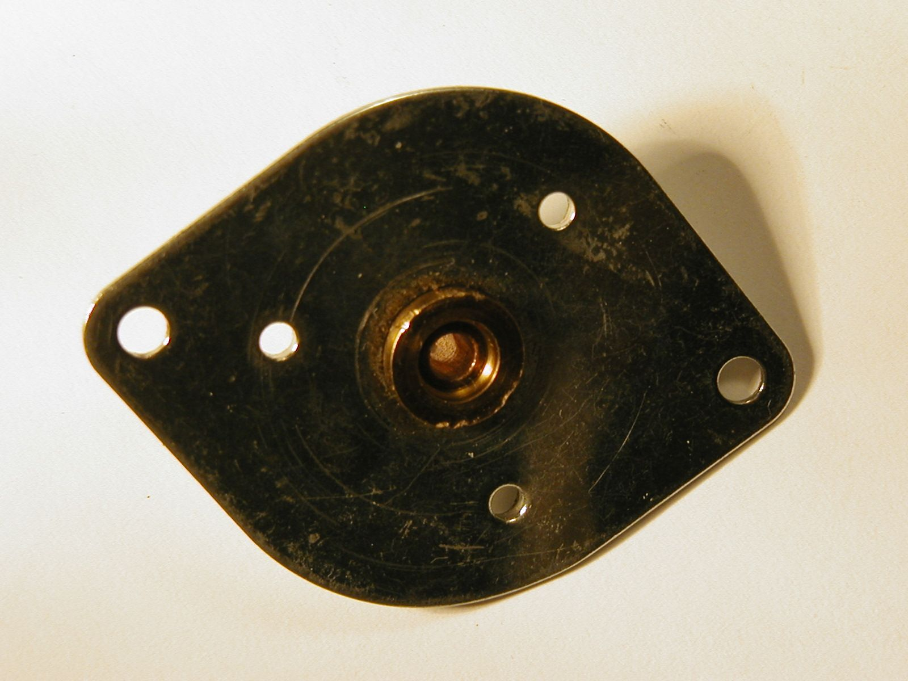
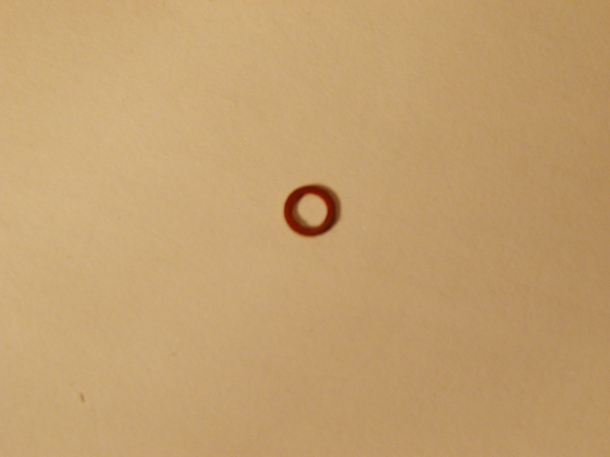

# Inside a Haydon Motor

> Archived copy, saved 2026-11-05. Original: <https://vinylnirvana.com/ar-turntable-resources/ar-turntable-history/inside-a-haydon-motor>. Site: Vinyl Nirvana. Rights remain with the author and the original site.

### Inside a Haydon Motor

Photos by Dave Cheek

These photos show a detailed view of the inside of a Haydon motor…the most common of the motors used in the AR XA and XB models.

