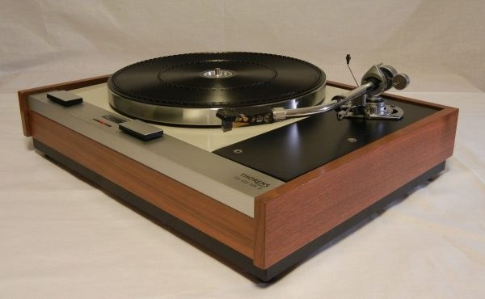
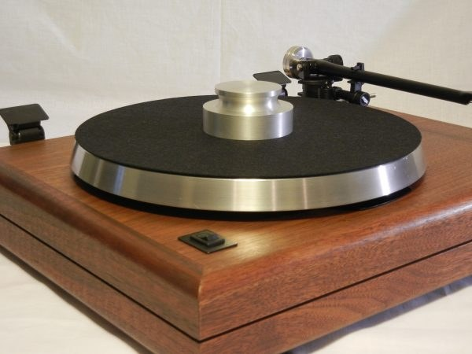

# Restoration Services: Thorens TD-125 & TD-125 MKII, AR the Turntable, EB-101, ES-1

> Archived copy, saved 2026-11-18. Original: <https://vinylnirvana.com/restoration-services>. Site: Vinyl Nirvana. Rights remain with the author and the original site.

See this page for referrals for other models of Thorens and AR turntables.

 **Thorens TD-125 MKII Restored to Its Former Glory**

It is my belief that the belt-driven, suspended subchassis models were the height of turntable design. To replicate the design today, along with their exceptional fit-n-finish, would literally cost several thousands of dollars. (Perhaps this is one reason why today’s turntables are primarily manufactured from plastic and mdf.) So, if you are asking, *Is it worth it to have this old Thorens or AR restored?* the answer is a resounding *YES!* These turntables have survived forty-some years, and after my restoration process, they will be ready for the *next* forty!

The process begins with you emailing me. As in all my transactions, I will give you frank advice as to what I would do in your shoes and with your budget. *Typical turnaround time is 8-10 weeks.*

Finally, to ease packing/shipping stress, I offer the option for you to be shipped original AR or Thorens packaging for a twenty dollar rental fee plus shipping. Many repair customers, once they realize the cost of a solid box and plenty of bubblewrap, have decided this is the safest option. Watch the videos [here](https://vinylnirvana.com/packing-a-mid-80s-ar-in-original-boxpacking-parts-1-2/) to see how easy it is to pack your AR or Thorens in original packing. I strongly recommend the packaging for the TD-125 models in particular, as those are very difficult to pack well.

#### **[Click here](https://vinylnirvana.com/restoration-services-ar-the-turntable-ar-eb-101-ar-es-1) to explore AR the Turntable, AR EB-101, and AR ES-1 services**

**What service customers have said out Vinyl Nirvana Restoration Services…**

“I just had Dave perform a checkup on my TD160 and it sounds fabulous. I was on the fence with this table and  
now that the suspension has been tuned it has become my favorite table. I think Dave does quality work and  
once I have the money together I intend to get the arm upgraded by Dave as well.” Shawn M, MA

“Dave, thanks for the great service and upgrade on my Thorens TD165. I’ve had the turntable since buying it new in the 70’s. Before your service, it had gotten quite tired, and the sound was muddy. Your service was terrific, and the results exactly as promised. The turntable was back to me right on schedule. The sound is now excellent, with a high range I haven’t heard on decades. It is great to be able to play baroque trumpet vinyl again. Thanks again, PW.”

[Feature on Vinyl Nirvana on local NH News Program](http://www.wmur.com/article/monday-february-4th-vinyl-nirvana-1/5179366)

Other [testimonials](https://vinylnirvana.com/customer-testimonials/).

 **Example of Restored (and Upgraded) AR ES-1 Turntable**
