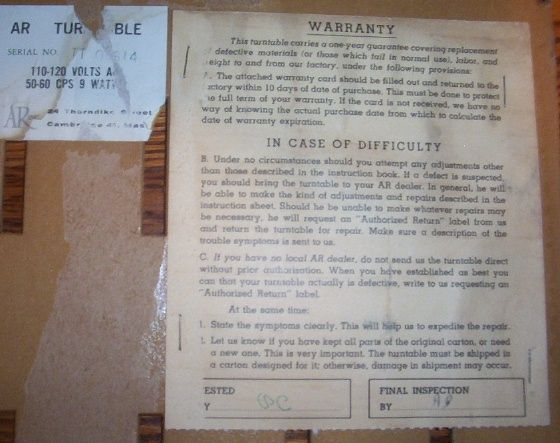
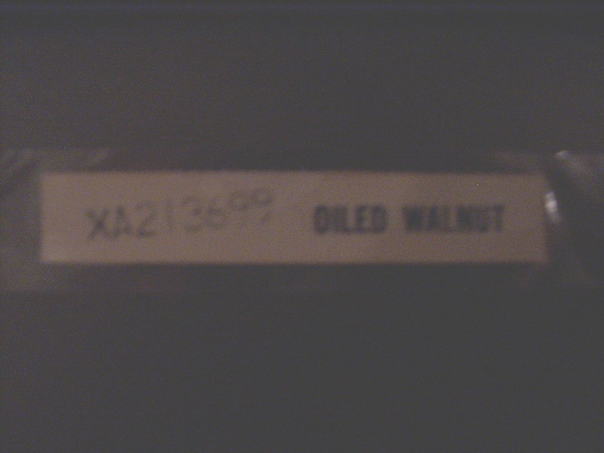

# Serial numbers, dates and the owner registry

[Home](../README.md) · [Document index](README.md) · [Things to confirm](../TO-CONFIRM.md) · [Adding information](../CONTRIBUTING.md)

AR changed motors, wiring and parts by serial number, but no factory list ties a serial to a date. Every table reported here narrows that gap. This page says where the serial is, what dates the sources give, and holds a table that any owner can add a row to.

## Where the serial number is

| Model | Where | Source |
| --- | --- | --- |
| XA | On the guarantee card attached to the bottom cover | Factory, [XA owner's manual, p. 12](transcripts/xa-owners-manual.md) |
| XA, as photographed | Under the base: a printed label headed "AR TURNTABLE" with a "SERIAL NO." box, the supply rating and the Cambridge address, beside the warranty sheet; and a strip label carrying the number and the base finish, "OILED WALNUT". Shown on an early two-motor table and on a later one | Specialist, [Vinyl Nirvana photo comparison](archive/vinyl-nirvana/ar-turntable-history/a-photo-comparison-of-a-new-and-old-ar-xa.md) |
| XB1 | On the guarantee card attached to the bottom cover | Factory, [XB1 manual, p. 13](transcripts/xb1-owners-manual.md) |
| XB, AR77XB | Unconfirmed. The XB1 location is the nearest, for comparison only. [MD18](../TO-CONFIRM.md#models-and-dates) | |
| The AR Turntable, The Legend, EB-101, ES-1, ETL-1 | Unconfirmed. No held source says. [MD19](../TO-CONFIRM.md#models-and-dates) | |

*Photo: Vinyl Nirvana, [A Photo Comparison of a "New" and "Old" AR XA](archive/vinyl-nirvana/ar-turntable-history/a-photo-comparison-of-a-new-and-old-ar-xa.md).*

On this early two-motor table the label reads "110-120 VOLTS A[C]" and "50-60 CPS 9 WATT[S]", the end of each line torn off. The serial is handwritten and faint. Its first two characters read as TT, not XA; the digits are not read with confidence from this photo. Whether early serials carried a TT prefix: Unconfirmed, [MD21](../TO-CONFIRM.md#models-and-dates).

*Photo: Vinyl Nirvana, same page.*

Photo wanted: `serial-label-xa.jpg`

Photo wanted: `serial-label-xb.jpg`

Photo wanted: `serial-label-ar77xb.jpg`

## What the serial tells you

Factory, [XA service manual](originals/xa-service-manual.pdf), pp. 1 and 3, serials as printed:

| Serial | What changes |
| --- | --- |
| Up to XA66866 | Two motors: a synchronous drive motor and a smaller starter motor |
| XA66866 to XA175235 | One Haydon motor, ⅛ in (3.2 mm) shaft |
| XA176235 to XA204462 | Philips motor, ¹⁄₁₆ in (1.6 mm) shaft. Motor wire colours are gray, blue, red, gray |
| Above XA204462 | Haydon motor again |
| From XA236534 | Arm damping omitted |

The printed ranges overlap at XA66866 and leave a gap from XA175235 to XA176235: [EL2](../TO-CONFIRM.md#motor-electrical-and-overall-size). No serial range has been published for the XB, the AR77XB or the second family.

## Dates

**No date code on a table is recorded in any held source.** Whether AR stamped a date on the base, the labels, the motor or the cover: Unconfirmed, [MD20](../TO-CONFIRM.md#models-and-dates). If you find any stamped or written date, add it to the Notes column below with where it was.

What the documents do date:

| Date | What | Source |
| --- | --- | --- |
| 1961 | First turntables shipped to dealers | Owner report, [Allison](archive/vinyl-nirvana/ar-turntable-history/acoustic-research-inc-the-golden-years-by-roy-allison.md) |
| July 1973 to March 1977 | XB assembly drawing 100012 drawn and revised | Factory, [drawing 112](drawings/xb-drawing-112.png), [drawing 119](drawings/xb-drawing-119.png) |
| 3/76 | XB1 manual printed, form 700039 | Factory, [XB1 manual, p. 16](transcripts/xb1-owners-manual.md) |
| 1979 | Production of the first family ceased | Factory, [1983 brochure](archive/vinyl-nirvana/ar-turntable-history/ar-the-turntable-brochure.md) |
| 10/83 | Relaunch brochure for The AR Turntable | Factory, same brochure |
| 14 December 1983 | Hurst motor schematics | Factory, [drawing 130](drawings/ar-turntable-drawing-130.png), [drawing 131](drawings/ar-turntable-drawing-131.png) |
| 13 September 1988 | EB101N schematics | Factory, [drawing 148](drawings/eb101n-drawing-148.png), [drawing 149](drawings/eb101n-drawing-149.png) |

These date the papers, not a given table. The full timeline is in the [model guide](../models/README.md#timeline).

## The registry

One row per table. Fill in what you can see without taking anything apart, and write "Not checked" for the rest. Never guess a figure: leave it blank instead.

| Column | What to write | How to find it |
| --- | --- | --- |
| Model | XA, TA, XB, XB1, AR77XB, The AR Turntable, The Legend, EB-101, ES-1, ETL-1, or what the label says | [Model guide](../models/README.md) |
| Serial | Exactly as written, letters included | See above |
| Motor label | Maker and every line of text on the motor | Lift off the outer platter; the motor sits by the pulley. Underneath for the full label |
| Shaft diameter | Motor shaft, in inches or mm, and how you measured it | Calipers on the shaft with the pulley off, or the bore of the pulley |
| Capacitor markings | Every marking on each capacitor: value, voltage, maker | Bottom cover off. Unplug the table first |
| Base material | Solid wood, veneer, or vinyl-wrapped board | Look at an edge or the underside |
| Headshell | Colour and material: plastic, metal | Look at it with the shell off the arm |
| Counterweight | Material and mass, if you weighed it | [Counterweight page](../parts/counterweight.md) procedure |
| Hinged cover | Yes or no | Look at the back of the cover and base |
| Mains voltage | As on the label, and 50 or 60 Hz | Label under the base |
| Notes | Anything else: a receipt date, a stamped date, a modification, a missing part | |
| Reported by, date | Your name or handle, and the date you checked | |

| Model | Serial | Motor label | Shaft diameter | Capacitor markings | Base material | Headshell | Counterweight | Hinged cover | Mains voltage | Notes | Reported by, date |
| --- | --- | --- | --- | --- | --- | --- | --- | --- | --- | --- | --- |
| XA | Not yet recorded | | | | | | | | | The repository owner's table | |
| XB | Not yet recorded | | | | | | | | | The repository owner's table | |
| AR77XB | Not yet recorded | | | | | | | | | The repository owner's table | |

To add your table, see [Adding information](../CONTRIBUTING.md). You do not need to know git.

## What the registry settles

| Open question | What closes it |
| --- | --- |
| [EL1](../TO-CONFIRM.md#motor-electrical-and-overall-size), motor and shaft by serial | Serial, motor label and shaft diameter from enough XA tables to confirm each printed range |
| [EL2](../TO-CONFIRM.md#motor-electrical-and-overall-size), the serial gap XA175235 to XA176235 | Any table with a serial in that gap, with its motor label |
| [MD3](../TO-CONFIRM.md#models-and-dates), what the TA is | A TA's label, serial and pulley: one step or two |
| [MD5](../TO-CONFIRM.md#models-and-dates), last year of the AR77XB | A late AR77XB serial with a dated receipt or a stamped date |

The same rows also feed [EL3](../TO-CONFIRM.md#motor-electrical-and-overall-size) and [EL5](../TO-CONFIRM.md#motor-electrical-and-overall-size) (capacitor markings), [HS5](../TO-CONFIRM.md#headshell-and-screws) (AR77XB shell material), [WD1](../TO-CONFIRM.md#xa-mods) (base material) and [MD2](../TO-CONFIRM.md#models-and-dates) (the TT-XBU build).

## Sources

Each link opens the copy kept in this repository.

- [XA owner's manual, written out](transcripts/xa-owners-manual.md). Factory.
- [XB1 manual, written out](transcripts/xb1-owners-manual.md). Factory.
- [XA service manual](originals/xa-service-manual.pdf). Factory.
- [XB drawings 112](drawings/xb-drawing-112.png) and [119](drawings/xb-drawing-119.png); [drawings 130 and 131](drawings/ar-turntable-drawing-130.png); [drawings 148 and 149](drawings/eb101n-drawing-148.png). Factory.
- [1983 brochure](archive/vinyl-nirvana/ar-turntable-history/ar-the-turntable-brochure.md). Factory.
- [Roy Allison, The Golden Years](archive/vinyl-nirvana/ar-turntable-history/acoustic-research-inc-the-golden-years-by-roy-allison.md). Owner report.
- [Vinyl Nirvana photo comparison of an old and new XA](archive/vinyl-nirvana/ar-turntable-history/a-photo-comparison-of-a-new-and-old-ar-xa.md), with its label photographs. Specialist.
