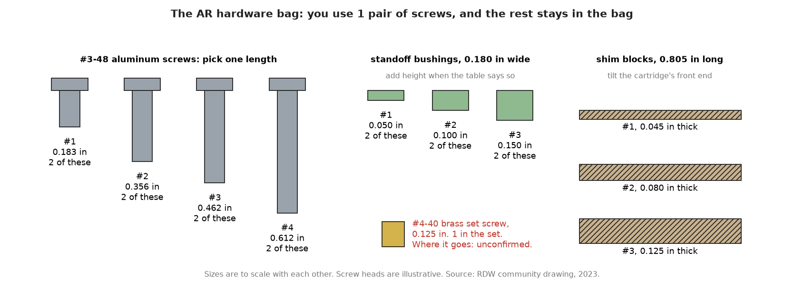
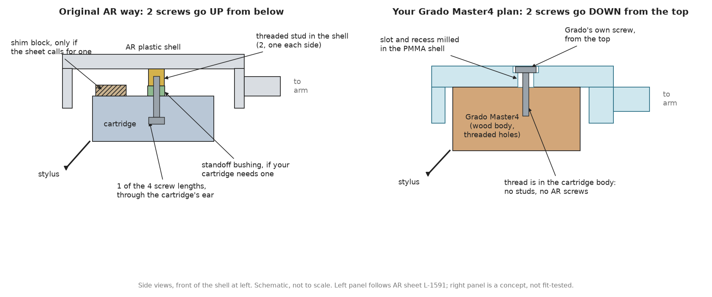
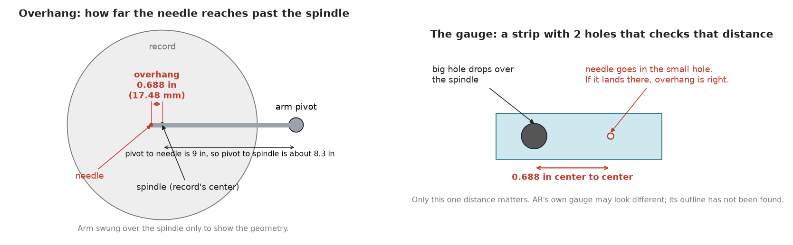

# What it is and where it goes

[Home](../README.md) · [Document index](README.md) · [CAD drawings](../cad/README.md)

## Why are there so many cartridge screws?

**You only fit two.** AR sold the table without a cartridge, so the hardware bag covers cartridges of different heights. [AR sheet L-1591](originals/ar-cartridge-mount.jpg) lists which pieces each cartridge takes.

| In the bag | How many | Dimensions, in | What it does |
| --- | --- | --- | --- |
| #3-48 aluminum screw | 2 of each of 4 lengths | Under head: 0.183, 0.356, 0.462, 0.612 | Holds the cartridge. Use 2 screws of one length |
| Soft plastic standoff bushing | 2 of each of 3 heights | ID 0.100, OD 0.180; heights 0.050, 0.100, 0.150 | Spacer between the shell's stud and the cartridge. Many cartridges use none |
| Cardboard shim block | 1 of each of 3 thicknesses | 0.805 × 0.230; thicknesses 0.045, 0.080, 0.125 | Tilts the front of the cartridge, where the sheet calls for one |
| #4-40 brass set screw | 1 | Length 0.125 | Location Unconfirmed |

Part page: [cartridge screws, bushings and shims](../parts/cartridge-hardware.md). Dimensions and counts for the XA and XB (Owner report, [community drawing](originals/ar-headshell-hardware-rev-1.pdf) signed RDW, December 7, 2023, shared by ronaldw441, who checked the #3-48 thread against 14 original XA/XB shells; posted in a diyAudio thread on AR77XB headshell bolts, posts 2 and 4, whose address is in the [archive index](archive/README.md#not-archived)). Four screw sizes and three bushing sizes (Factory, sheet L-1591).

## Where do they go?

**The original way, on the left.** The shell has two threaded studs inside. Each screw passes through the cartridge's mounting ear, then a bushing if needed, into a stud.

1. Find your cartridge on sheet L-1591. The Shure M91 takes No. 1 standoffs and No. 1 screws. The Shure V15 Type II takes no standoffs and No. 3 screws.
2. Clip the shell's wires onto the cartridge pins: red for right hot, black for right ground, white for left hot, green for left ground.
3. Fit the cartridge, turning any bushings onto the screws to hold them in place.
4. Do not overtighten. The sheet warns that the studs can be stripped or broken off.

For some cartridges the sheet calls for a U.S. penny glued inside the shell, or an extra counterweight section, to reach the right needle force. If your cartridge is not on the sheet, use the shortest screw that fully engages the stud without bottoming out.

**A Grado Master4, on the right, uses none of this.** Its screws enter from the top into the cartridge body: see the [top-mount headshell](../models/xa/mods/headshell-top-mount.md).

## What is an overhang gauge?

A template that checks how far the needle reaches past the record's center. That distance is the overhang.

An arm swings in an arc, so the needle cannot stay in line with the groove. The right overhang keeps that error low. AR arm: **0.688 in (17.48 mm)** (Factory, [Villchur 1962, p. 69](originals/villchur-1962-part-1.pdf)), ± 0.030 in on the XB (Factory, [drawing 119](drawings/xb-drawing-119.png), note 10). Check it after fitting a new cartridge or shell.

1. Drop the big hole over the spindle, with the small hole on the line toward the arm's pivot.
2. Lower the needle gently. It should land in the small hole.
3. If not, adjust and try again. Villchur's paper says "the effective arm length is adjusted". The XA parts list has an overhang set screw, item 21J, on the arm's center block: loosen it, slide the arm tube, and retighten.

AR supplied a gauge: "Overhang Template", part 914, on the XA, and P/N 402001 on the XB. The [overhang template page](../parts/overhang-template.md) lists both and a [new design](../cad/exports/overhang-gauge-new-pmma/PRELIMINARY-overhang-gauge-new-pmma.pdf) for tables that have lost theirs. Only the distance between the two holes matters.

## Every screw, by job

XA column: Factory, [XA service manual](originals/xa-service-manual.pdf). XB column: Factory, [drawing 119](drawings/xb-drawing-119.png), revision T. No AR77XB source exists. "Not stated" means the source names the part without a size; those are logged in [TO-CONFIRM.md](../TO-CONFIRM.md).

| Job | XA | XB, revision T |
| --- | --- | --- |
| Cartridge to shell | #3-48, 2 of 8 in the bag | #3-48, 2 of 8 in the bag |
| Shell to arm | Knurled nut, item 21C. Twisting the shell while tightening can deform the arm's socket | Knurled end on arm assembly 404014 |
| Lock the counterweight | Set screw, item 22A, part 942. Not stated | Set screw, item 6, part 501008. Not stated |
| Arm's up-and-down pivot | 2 pivot screws, item 21H, part 918, with Loc-Tite. Not stated | Pivot screws in the arm assembly, with Loctite. Setting in note 9 |
| Set the overhang | Overhang set screw, item 21J, part 1123. Not stated | Not shown |
| Hold the motor | 2 screws. Not stated | 2 × #4-48 × ⅛ in, item 18, part 501009 |
| Suspension height | 3 nuts, item 17, part 1095. Not stated | 3 × #10-24 nuts, item 32, part 502006, on threaded studs, item 33 |
| Tonearm rest | Rest with its nut, item 10, part 907 | #5-40 nut, item 60, and #5 star washer, item 61 |
| Cueing lever | No cueing lever | 2 × #8-32 nuts, item 28, with lockwashers, item 58. 1 × #4-40 screw, item 62 |
| Top badge | Not stated | 2 push nuts, item 27, part 500015 |
| Audio terminal strip | Not stated | Wood screw, item 24, part 501007 |
| Brackets, clamps, capacitor straps | Not stated | #8 × ⅜ in, item 37, part 501012; 12 in all. Pitch and head not stated |
| Bottom panel | 3 Phillips screws, or a staple | Staples, item 36 |
| Shipping bolt | Not listed | Item 8, part 501011, with nylon washer, item 7. Remove before use |

## Words used in this repository

| Word | Meaning |
| --- | --- |
| Cartridge | The part that holds the needle and makes the signal |
| Stylus, needle | The diamond tip in the groove |
| Shell, headshell | The holder at the end of the arm that the cartridge bolts to |
| Counterweight | The weight at the back of the arm that balances it |
| Tracking force, needle force | How hard the needle presses on the record, in grams |
| Spindle | The pin at the center of the platter |
| Pivot | The point the arm swings on |
| T-bar, tee bar | The sprung metal frame that carries both the platter and the arm |
| Top plate | The metal panel on top of the wooden base |
| Standoff bushing | A small tube used as a spacer |
| Shim block | A thin block used to raise or tilt something |
| Set screw | A small headless screw, tightened into a part to lock it |
| ECO | Engineering change order: a factory record of a design change |
