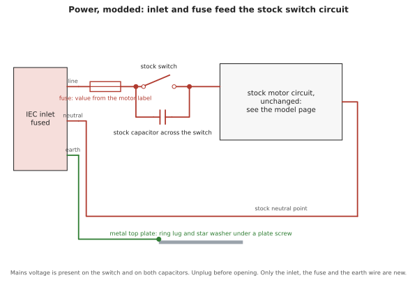
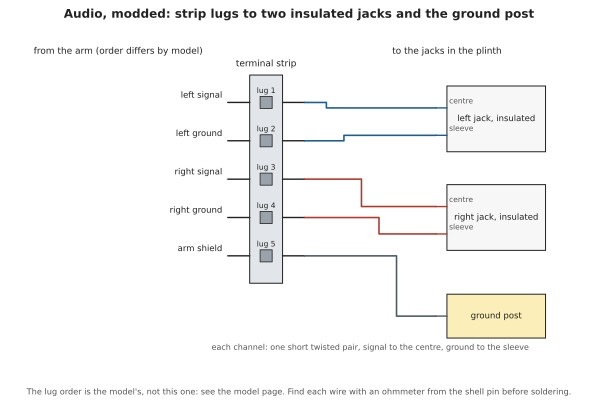
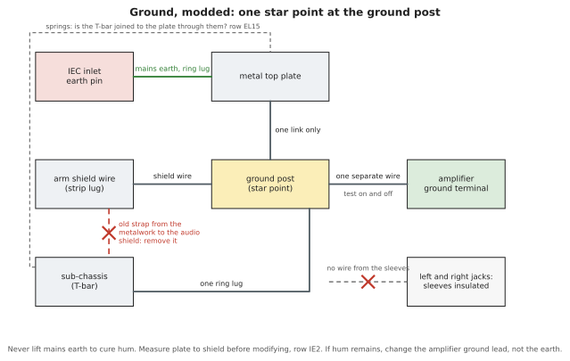

# Wiring

[Home](../../README.md) · [XA wiring](../../models/xa/wiring.md) · [XB wiring](../../models/xb/wiring.md) · [AR77XB wiring](../../models/ar77xb/wiring.md) · [XA mods](../../models/xa/mods/README.md) · [Things to confirm](../../TO-CONFIRM.md)

Three diagrams for the table as people rebuild it: RCA jacks in the plinth instead of the captive audio cable, a fused IEC mains inlet instead of the captive cord, and a separate ground post with the old strap from the metalwork to the audio shield removed. The diagrams here carry no model values. Each model page carries the same three diagrams with that model's colours, parts and values, and shows the stock wiring you will find when you open the table.

| Page | What it gives |
| --- | --- |
| [XA wiring](../../models/xa/wiring.md) | The 120 V circuit, capacitor values and motor lead colours from the service manual; the five strip lugs from its exploded view |
| [XB wiring](../../models/xb/wiring.md) | The parts, part numbers and strip colours from drawing 119; no factory circuit exists |
| [AR77XB wiring](../../models/ar77xb/wiring.md) | The XB pattern, every line dashed, with the list of what to read on the table |

The diagrams are drawn by [diagrams.py](../../cad/tools/diagrams.py) from the facts on the pages. Change the page and the script together.

## Gotchas

- **Mains voltage is present on both capacitors and on the switch under the plate.** Unplug before opening. Have the work checked if you are not experienced with mains wiring.
- **The fuse value is not known.** It comes from the motor label: row [IE1](../../TO-CONFIRM.md#xa-mods).
- **The wire colours inside the arm are not the shell wire colours.** Check every wire with an ohmmeter from the shell pin to the strip lug before soldering.
- **Metal jacks on a metal panel short the two channel grounds together and to the plate.** Use insulated jacks or nylon shoulder washers.
- **When the ground post goes in, the old strap from the metalwork to the audio shield comes out.** Leaving both makes a loop and hum.
- **Never lift mains earth to cure hum.**

## Power

| Wire | From | To |
| --- | --- | --- |
| Line | Inlet line pin | Fuse, then the stock switch. The stock capacitor stays across the switch. After the switch, the stock motor circuit, unchanged |
| Neutral | Inlet neutral pin | The stock neutral point: the cord wire that did not go to the switch |
| Earth | Inlet earth pin | A ring lug with a star washer under a top plate screw |

Nothing after the switch changes. The model page gives the circuit after the switch, its capacitor values and the lead colours.

## Audio

| From the strip | To |
| --- | --- |
| Left signal lug | Left jack centre |
| Left ground lug | Left jack sleeve |
| Right signal lug | Right jack centre |
| Right ground lug | Right jack sleeve |
| Arm shield lug | Ground post |

Each channel's pair is one short twisted pair. Keep the new leads short: AR allowed at most 2.36 in of cable and arm wire inside the XB cabinet (Factory, drawing 119, note 19), and a long loop picks up hum. The jacks are insulated from the panel and from each other. Which lug is which differs by model and is on the model page.

Shell wires on all three models: left is white with green as its ground; right is red with black as its ground (Factory, [XA owner's manual, p. 3](../transcripts/xa-owners-manual.md), [sheet L-1591](../transcripts/ar-cartridge-mount-l-1591.md), [XB1 manual, pp. 4 and 5](../transcripts/xb1-owners-manual.md)). The modern cartridge code uses green for right ground and blue for left ground, so a rewired arm may follow either: row [RW1](../../TO-CONFIRM.md#xa-mods).

## Ground

The star point rule: mains earth goes to the top plate, signal ground goes to the ground post, one link joins the plate to the post, and nothing else is bridged.

| Connection | How |
| --- | --- |
| Arm shield wire to the post | From the shield lug on the strip |
| Sub-chassis (T-bar) to the post | One wire with a ring lug under a T-bar screw |
| Top plate to the post | One link |
| Post to the amplifier ground terminal | One separate wire. Test with it on and off; keep whichever is quieter |
| Inlet earth pin to the top plate | Ring lug and star washer, on the power diagram |
| Jack sleeves | Insulated from the plate and from the post. No wire |
| Old strap from the metalwork to the audio shield | Removed |

Ground post recipe (Galo): a 6-32 × ⅝ in machine screw, #6 ground lug, lock washer, hex nut and knurled thumbnut; the insulated post adds a nylon shoulder washer and a flat washer. From the [RCA jacks page](../../models/xa/mods/rca-jacks.md#parts).

Whether the stock top plate is already tied to the audio shield is open: row [IE2](../../TO-CONFIRM.md#xa-mods). Measure it before modifying. Whether the T-bar is joined to the plate through the springs is open too: row [EL15](../../TO-CONFIRM.md#motor-electrical-and-overall-size).

## Ohmmeter checks

Table unplugged for every check.

Before soldering:

1. Left shell pins to the strip lugs: find the lugs for white and for green.
2. Right shell pins to the strip lugs: find the lugs for red and for black.
3. Arm tube to the shield lug.
4. Top plate to each strip lug: row IE2. Write down what you find before any wire is cut.
5. T-bar to the top plate: row EL15.

After:

1. Each jack centre to its shell pin.
2. Each jack sleeve to its shell pin.
3. No continuity between the two sleeves.
4. No continuity from either sleeve to the plate.
5. Inlet earth pin to the top plate.
6. Arm tube to the ground post.
7. Line and neutral pins not connected to the plate.

## Sources

Each link opens the copy kept in this repository.

- [XA service manual, pp. 2 to 4](../originals/xa-service-manual.pdf). Factory. [The wiring in words](../transcripts/xa-service-manual-wiring.md).
- [XB drawing 119](../drawings/xb-drawing-119.png). Factory.
- [XA owner's manual](../transcripts/xa-owners-manual.md), [sheet L-1591](../transcripts/ar-cartridge-mount-l-1591.md), [XB1 manual](../transcripts/xb1-owners-manual.md). Factory.
- [Gary Galo, "A Belt-Drive Turntable Upgrade", audioXpress](../archive/audioxpress/galo-belt-drive-turntable-upgrade.pdf). Owner report.
- [John's second XA restoration](../archive/johns-weather/xa-restoration-2012.md). Owner report.
