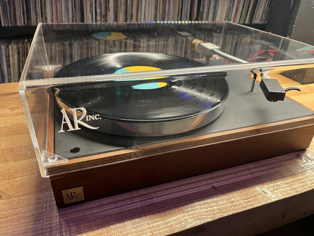
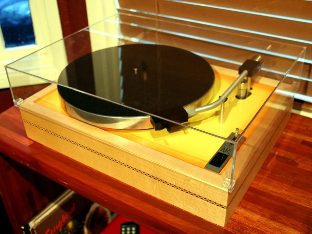
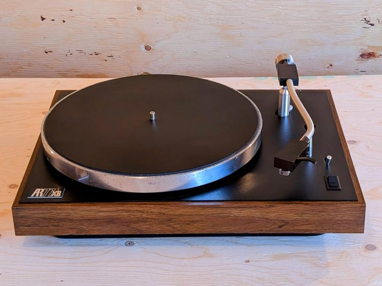
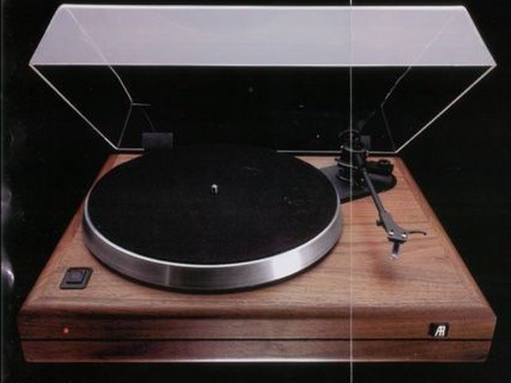
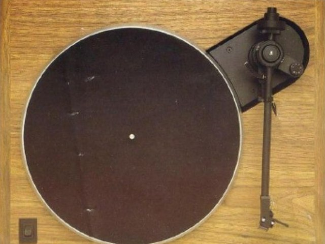
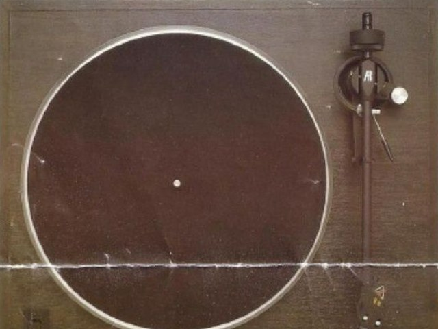
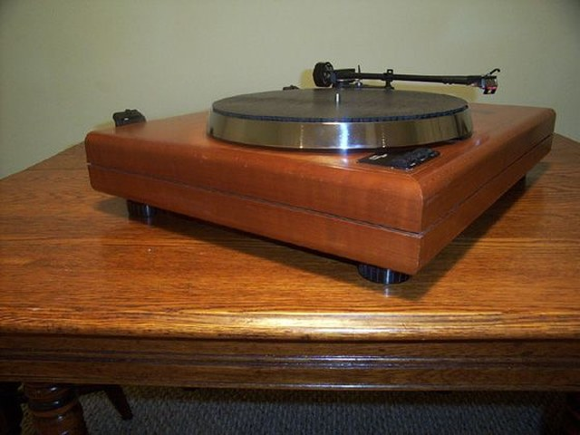

# AR turntable models

[Home](../README.md) · [XA](xa/README.md) · [XB](xb/README.md) · [AR77XB](ar77xb/README.md) · [Documents](../docs/README.md) · [Things to confirm](../TO-CONFIRM.md)

Every AR turntable model and variant: how to recognise it, when it was made, who made it, and its published figures. Workshop detail stays on the three model pages.

Each value carries a label and a short source name in parentheses. The short names are expanded under [Sources](#sources). Two labels are used here beyond the four on the [home page](../README.md#how-to-read-this-reference): **Period** is a listing, advert, or review printed at the time, and **Specialist** is Vinyl Nirvana's own description of a model.

## Two families

AR made two generations of turntable, four years apart. Do not carry a part or a figure from one to the other.

| | First family | Second family |
| --- | --- | --- |
| Made | 1961 to 1979 | 1983 to at least 1988 |
| Models | XA, TA, XB, XB1, AR77XB | The AR Turntable (sold as The Legend in Britain), EB-101, ES-1, ETL-1 |
| At a glance | Painted metal top plate. The arm rises through a hole in it. About 16¾ in wide | No metal top plate: the top is finished like the base. Separate arm, on a black armboard on most. About 17½ to 20½ in wide |
| Maker's name | AR Inc.; Acoustic Research, Inc.; later Teledyne Acoustic Research | Teledyne Acoustic Research |

Dates: first shipped to dealers in 1961 (Owner report, Allison). "Production ceased in 1979" (Factory, 1983 brochure). The relaunch brochure is dated 10/83. The last dated factory paper is a pair of EB101N schematics of 13 September 1988 (Factory, drawings 148 and 149).

## Identify a table from a photo

### First family, 1961 to 1979

| XA | XB | AR77XB |
| --- | --- | --- |
|  |  |  |
| New cover and arm rest | New plinth, cover, and top-plate colour | As found |

| Name on the listing | Look for | Made | More |
| --- | --- | --- | --- |
| **XA** | No cueing lever. Top plate grey, brown, or black. Headshell tan or black plastic. Black plastic arm rest. Base solid oiled walnut, later walnut veneer, last walnut-look vinyl (Specialist, VN XA). Up to serial XA66866, two motors show under the outer platter (Factory, XA service manual p. 1) | 1961 to 1979 | [XA page](xa/README.md) |
| **TA** | "Nearly identical" to the XA (Specialist, VN XA). A forum account, not yet read, calls it a 33⅓ rpm only table: Unconfirmed, [MD3](../TO-CONFIRM.md#models-and-dates) | Unconfirmed | |
| **XA91**, **XB91**, also XB-91 | An XA or XB sold with a Shure M91ED cartridge: "same as XB but with Shure M91ED cartridge mounted and tested" (Period, retail catalogue). $55 more at list (Specialist, VN XB) | Unconfirmed | |
| **XB** | A cueing lever beside a rocker power switch at the front right, both set in a brushed-metal AR panel. Top plate always black. Metal arm rest. Black plastic headshell. Brass or stainless steel counterweight (Specialist, VN XB). The same page gives the base as plywood veneer in its text and walnut-look vinyl in its list | From about 1972 or 1973, [MD1](../TO-CONFIRM.md#models-and-dates). Drawings still revised in March 1977 | [XB page](xb/README.md) |
| **XBU**, factory code TT-XBU | Not a name on the table. It is the second build on the XB assembly drawing, added on 5 June 1974: its own top plate (400039-2) and a P.C. board assembly (800018), with no UL label, no CSA label, and no separate motor and switch capacitors (Factory, drawing 112). Its appearance, its market, and the meaning of U: Unconfirmed, [MD2](../TO-CONFIRM.md#models-and-dates) | From 1974 | [Drawing 112](../docs/drawings/xb-drawing-112.png) |
| **XB1** | The British XB: a 220–240 V table with a blue and brown mains lead, a 3 A fuse notice, and a Houghton Regis address in its manual. Cueing lever and rocker switch as on the XB (Factory, XB1 manual pp. 6–8, 16) | Unconfirmed. Its rework parts were removed from the drawings in 1976–77 (Factory, [ECO 1315 sheet 4](../docs/drawings/xb-drawing-118.png)) | [XB1 manual](../docs/originals/xb1-owners.pdf) |
| **AR77XB**, also AR77-XB, AR77 XB, XB77, XB-77 | An XB with a vinyl-wrapped chipboard base, a lighter aluminium counterweight, and the newer AR logo as a printed metal square (Specialist, VN XB77). One photographed table carries an "AR77XB" badge at the front left of a black top plate, with the cueing lever and rocker switch set straight into the plate at the front right and no panel around them (Owner report, [photo](../docs/images/models/ar77xb.jpg)). Headshell metal or plastic: Conflict, [HS5](../TO-CONFIRM.md#headshell-and-screws) | 1977 to 1979 at the latest; see [MD5](../TO-CONFIRM.md#models-and-dates) | [AR77XB page](ar77xb/README.md) |

To tell an XB from an AR77XB, check the badge, the panel around the lever and switch, the base material, and the counterweight. The mechanism is the same pattern. Factory papers for the AR77XB have not been found.

### Second family, 1983 onward

| The AR Turntable | The Legend | EB-101 | ETL-1 |
| --- | --- | --- | --- |
|  |  |  |  |
| Factory brochure, 1983 | Factory brochure | Factory brochure | The owner's own arm; it was sold without one |

No ES-1 photo with its original arm has been found. Photo credits are on the [home page](../README.md).

| Name on the listing | Look for | Made | Arm |
| --- | --- | --- | --- |
| **The AR Turntable**, also "AR TT" | Walnut veneer all over, rounded edges, and the arm on a black board that is crescent-shaped in front and round behind (Specialist, VN AR the Turntable; Period, Wolf). The brochure photo shows a rocker switch at the front left and an AR badge at the front right | From late 1983 | AR medium-mass arm, Japanese-made, or sold without an arm (Factory, 1983 brochure; Period, Audio 1984) |
| **The Legend** | The British name. "We re-designed and re-launched our turntable as the Legend." Solid MDF plinth with real wood veneer (Factory, GB brochure). Its turntable figures match the 1983 US brochure line for line; its arm does not | Unconfirmed | Integral die-cast aluminium headshell (Factory, GB brochure) |
| **EB-101**, also EB101 | The budget model. Vinyl-covered particle board plinth (Factory, GB brochure). Square edges, and about an inch smaller all round (Period, Wolf). Early units have a solid top with the arm rising through a hole; later ones have the armboard. British-built units include an all-black version (Specialist, VN EB-101) | 1984 to at least 1988 | Fitted AR arm |
| **EB101N** | A name found only on two factory schematics of 13 September 1988. The meaning of N: Unconfirmed | 1988 | |
| **ES-1**, Connoisseur Series | Looks like The AR Turntable, but with solid wood sides in cherry or walnut. Sapphire bearing. Sold with or without an arm (Specialist, VN ES-1; Period, Wolf) | Conflict, [MD6](../TO-CONFIRM.md#models-and-dates) | Japanese-made AR arm, or the buyer's own |
| **ETL-1**, Research Series | The large one: 20.44 in wide and 29 lb. Electronic speed control, an 8.5 lb platter, adjustable feet, cherry or piano black (Specialist, VN ETL-1) | To early 1987 or to 1988: Conflict, [MD7](../TO-CONFIRM.md#models-and-dates) | Sold without an arm |

## Timeline

| Date | Event | Source |
| --- | --- | --- |
| 1954 | Acoustic Research founded by Edgar Villchur and Henry Kloss | Secondary, Wikipedia |
| 1961 | First turntables shipped to dealers at $58 | Owner report, Allison |
| September and October 1962 | Villchur publishes the design in *Audio* | Factory, Villchur 1962 |
| 1962 | "Introduced in 1962 at a list price of $58." Conflict with 1961: [MD4](../TO-CONFIRM.md#models-and-dates) | Period, Audio 1984 |
| Serial XA66866 | Two-motor drive replaced by one Haydon motor | Factory, XA service manual p. 1 |
| 1967 | Teledyne buys AR | Secondary, Wikipedia |
| About 1972 | XB introduced at $130, with the XA at $115 | Specialist, VN XB |
| July 1973 | XB assembly drawing 100012 drawn. First revision 10 September 1973 | Factory, drawing 112 |
| 5 June 1974 | TT-XBU build added to the XB drawing | Factory, drawing 112, revision H |
| 18 September 1974 | XB motor mounting and pulley changed, ECO 0594 | Factory, drawing 112, revision I |
| Serial XA236534 | Arm damping omitted from the XA | Factory, XA service manual p. 1 |
| 14 September 1976 to 28 January 1977 | Hinged cover added to the XB, then deleted | Factory, drawing 119 |
| 1977 | AR77XB arrives | Specialist, VN XB77 |
| 1979 | Production ceases. Over a third of a million sold in 17 years | Factory, 1983 brochure; Period, Audio 1984 |
| October 1983 | Relaunch brochure for The AR Turntable printed | Factory, 1983 brochure |
| 14 December 1983 | Hurst motor schematics drawn for 115 V and 230 V | Factory, drawings 130 and 131 |
| By 1985 | Three models on sale: EB-101, ES-1, ETL-1 | Period, Wolf |
| 13 September 1988 | EB101N schematics drawn | Factory, drawings 148 and 149 |
| 1989 | Teledyne sells AR to Jensen | Secondary, Wikipedia |

## Company and people

### The name on the paperwork

| When | Name and address as printed | Document |
| --- | --- | --- |
| 1962 | Acoustic Research, Inc., 24 Thorndike St., Cambridge 41, Mass. | Factory, Villchur 1962, Part 2, p. 34 |
| 1960s | "AR Inc." on the brochure and spec sheet; Acoustic Research, Inc., 24 Thorndike Street, Cambridge, Mass. 02141 | Factory, AR spec sheet |
| July 1973 | Acoustic Research, Inc. in the title block | Factory, drawing 112 |
| November 1976 | Teledyne Acoustic Research in the title block | Factory, drawing 119 |
| January 1979 | Teledyne Acoustic Research, 10 American Drive, Norwood, Massachusetts 02062 | Factory, 1979 price list |
| 1970s, XB1 | The Norwood address, and High Street, Houghton Regis, Dunstable, Bedfordshire, England | Factory, XB1 manual p. 16 |
| October 1983 | Teledyne Acoustic Research, Norwood and Houghton Regis | Factory, 1983 brochure |
| Later 1980s | Teledyne Acoustic Research, Houghton Regis, and 330 Turnpike Street, Canton, Massachusetts 02021 | Factory, GB brochure |
| September 1988 | Teledyne Acoustic Research in the title block | Factory, drawings 148 and 149 |

Teledyne owned AR from 1967, so the XB drawing of 1973 still used the older title block. Wikipedia places AR in Cambridge for the whole Teledyne period; the documents above show Norwood by 1979.

### People

| Person | Part played | Source |
| --- | --- | --- |
| Edgar Villchur | Founder. Designed the turntable in-house after the AR-3, and wrote the two design papers | Owner report, Allison; Factory, Villchur 1962 |
| An outside engineer, not named | Worked on a turntable for AR for a year and a half before Villchur's design; it "came to nothing" | Owner report, Allison |
| John McConnell, of ESL | Credited by Villchur for the point about horizontal balance of the arm | Factory, Villchur 1962, Part 1, footnote 5 |
| Mitchell Cotter | Re-annealed and re-bored the early Delrin bearings, which seized again; steel-jacketed Babbitt inserts fixed them | Owner report, Allison |
| Roy Allison | Joined in March 1959 as assistant to the president. Vice president of engineering and manufacturing from 1967 to 1972 | Unconfirmed, [SR17](../docs/sources-to-read.md) |
| Abe Hoffman | Financial vice president, then president after Villchur left in 1967 | Unconfirmed, [SR17](../docs/sources-to-read.md) |
| "J.A." | Initials in the Drawn By box of the 1973 XB assembly drawing | Factory, drawing 112 |
| Ron Fone | President of Teledyne Acoustic Research at the 1983 relaunch | Unconfirmed, [SR18](../docs/sources-to-read.md) |
| "P. Pilat", as it reads | Drawn By box of the December 1983 Hurst motor schematics | Factory, drawings 130 and 131 |
| "Rich C.", as it reads | Drawn By box of the 1988 EB101N schematics | Factory, drawings 148 and 149 |

The approval signatures on the drawings are handwritten and not read with confidence. The designer of the 1983 table is not named in any source read so far. Both are [MD8](../TO-CONFIRM.md#models-and-dates).

## Published figures

### First family

| Item | XA | XB | XB1 | AR77XB |
| --- | --- | --- | --- | --- |
| Speeds | 33⅓ and 45 rpm (Factory, AR brochure) | 33⅓ and 45 rpm (Period, retail catalogue) | 33⅓ and 45 rpm ± 0.3% (Factory, XB1 manual p. 2) | Unconfirmed |
| Speed accuracy | ±0.3%, which is 21 lines a minute on a 216-line strobe card, held with 5 g of extra stylus force (Factory, AR spec sheet) | ±21 dots a minute at 1.5 g (Factory, drawing 119) | ±0.3% | Unconfirmed |
| Wow and flutter | Within NAB's 0.1% combined (Factory, AR spec sheet) | Unconfirmed | 0.03% | Unconfirmed |
| Rumble | Within NAB's 35 dB below 1 cm/sec at 100 cps (Factory, AR spec sheet) | Unconfirmed | "Greater than −40 dB", as printed | Unconfirmed |
| Motor | [By serial](xa/README.md#motor-identification). First design: an 18-pole, 400 rpm permanent-magnet synchronous drive motor and a 600 rpm hysteresis starter motor (Factory, Villchur 1962, Part 2, p. 36) | "Hysteresis/synchronous" (Period, retail catalogue). Part 802006, maker not stated (Factory, drawing 119) | Permanent-magnet, synchronous | Unconfirmed |
| Platter | 3.3, 3.5, or 3.9 lb: Conflict, [PL1](../TO-CONFIRM.md#platter-bearings-and-suspension) | Unconfirmed | 11¾ in diameter, 4 lb | Unconfirmed |
| Belt | Ground rubber (Owner report, Allison) | Part 400134 | Ground neoprene | Unconfirmed |
| Suspension | Three springs, designed for 3.5 cps (Factory, Villchur 1962, Part 1) | Three studs and nuts (Factory, drawing 119) | Unconfirmed | Unconfirmed |
| Effective arm length | 9 in (Factory, Villchur 1962, Part 1, p. 69) | Unconfirmed | Unconfirmed | Unconfirmed |
| Overhang | 0.688 in (same) | 0.688 in ± 0.030 (Factory, drawing 119) | Unconfirmed | Unconfirmed |
| Cartridge mounting | Unconfirmed, [GR11](../TO-CONFIRM.md#grado-cartridge-and-top-mounting) | Unconfirmed | ½ in EIA centres | Unconfirmed |
| Cable capacitance | About 135 pF a channel in all (Factory, Villchur 1962, Part 1, p. 69) | Unconfirmed | 100 pF | Unconfirmed |
| Size with cover | 12¾ × 16¾ × 5¼ in (Factory, AR brochure) | 12¾ × 16¾ × 5¾ in (Period, retail catalogue) | 12¾ × 16¾ × 5½ in | Unconfirmed |
| Weight | 13½ lb (Period, Audio 1969 directory) | 19 lb shipping weight (Period, retail catalogue) | 13 lb 9 oz, printed as 6.32 kg | Unconfirmed |
| Guarantee | 1 year (Factory, AR brochure) | Unconfirmed | 5 years | Unconfirmed |

XB1 figures are all from the XB1 manual, p. 2. Web listings give the AR77XB 0.03% wow and flutter and 5.89 kg; no document behind them has been read, see [SR5 to SR7](../docs/sources-to-read.md).

### Second family

| Item | The AR Turntable, 1983 | The Legend | EB-101 | ES-1 | ETL-1 |
| --- | --- | --- | --- | --- | --- |
| Motor | 24-pole synchronous, 300 rpm at 60 Hz or 250 rpm at 50 Hz | Same | 12-pole synchronous, 600 rpm at 60 Hz or 500 rpm at 50 Hz | 24-pole, 3 W Hurst; 1.5 W Philips Airpax on early units | Electronic speed control |
| Speeds | 33⅓ and 45 rpm | Same | Same | Same | Same |
| Platter | 3.9 lb (1.8 kg) | 1.8 kg | 1.8 kg | 3.9 lb | 8.5 lb |
| Subchassis | Die-cast T-bar on three damped springs | Same | Pressed-steel T-bar on three damped springs | Not stated | Three-point dual springs, adjustable weights |
| Wow and flutter, DIN 45507 | 0.04% | 0.04% | 0.05% | 0.04% | 0.03% |
| Rumble, DIN 45539B | −73 dB | −73 dB | −72 dB | −78 dB | −81 dB |
| Power | 9 W | 9 W | 9 W | Not stated | Not stated |
| Width × depth × height, closed | 462 × 387 × 179 mm (18³⁄₁₆ × 15¼ × 7 in) | 462 × 387 × 179 mm | 442 × 365 × 180 mm | 18.19 × 15.25 × 7 in | 20.44 × 17.5 × 7.5 in |
| Weight | 18 lb (8.2 kg) | Not stated | Not stated | Not stated | 29 lb |
| Arm effective length | 9 in (229 mm) | 229 mm | 229 mm | 9 in | No arm |
| Overhang | ¹⁹⁄₃₂ in (15 mm) | 15 mm | 16 mm | ¹⁹⁄₃₂ in | |
| Arm effective mass | 13 g | 14 g | 12 g | 13 g | |
| Cartridge weight | 3 to 9 g | 3 to 11 g | 3 to 9 g | 3 to 9 g | |
| Tracking force | 0 to 3 g | 0 to 3 g | 0.5 to 3 g | 0 to 3 g | |
| Pivot friction | Under 20 mg | Under 20 mg | Under 30 mg | Under 20 mg | |
| Arm and lead capacitance | 85 pF | 85 pF | Not stated | 85 pF | |
| Headshell | Carbon-fibre reinforced, clamping screw on the arm | Integral die-cast aluminium | Not stated | Carbon-fibre reinforced | |
| Warranty | 3 years; arm 1 year | 3 years | 1 year | Not stated | Not stated |
| Label | Factory, 1983 brochure | Factory, GB brochure | Factory, GB brochure | Specialist, VN ES-1 | Specialist, VN ETL-1 |

Spindle to arm pivot is 9.5 in on the ETL-1 and 8.4 in on the others (Period, Wolf). Vinyl Nirvana gives The AR Turntable and the EB-101 the same figures: a 12-pole motor, 0.05%, −72 dB, and 13.5 lb. The motor and performance figures match the brochure's EB-101, not its Legend or the 1983 US table.

## Motors and mains by market

| Table | Supply | Motor capacitor | Switch capacitor | Also | Source |
| --- | --- | --- | --- | --- | --- |
| XA | 120 V | 0.1 µF, 600 VDC | 0.022 µF, 600 VDC | 60-cycle pulley | Factory, XA service manual p. 3 |
| XA | 220 V | 0.39 µF, 600 VDC | 0.01 µF, 600 VDC | 50-cycle pulley, larger in diameter, for 50 Hz | Factory, XA service manual pp. 1, 3 |
| XA, retail in 1964 | 110–120 V, 60 cycle | | | Two motors | Period, 1964 Allied flyer |
| XB, build TT-XB | Not stated | Part 803002, value unconfirmed | Part 803004, value unconfirmed | 60-cycle pulley 400126; UL and CSA labels | Factory, drawing 119 |
| XB, build TT-XBU | Not stated | None listed | None listed | P.C. board assembly 800018; no UL or CSA label | Factory, drawing 112 |
| XB1 | 220–240 V | Unconfirmed | Unconfirmed | 3 A fuse; blue neutral, brown live | Factory, XB1 manual pp. 6, 16 |
| AR77XB | Unconfirmed | Unconfirmed | Unconfirmed | | [EL5](../TO-CONFIRM.md#motor-electrical-and-overall-size) |
| The AR Turntable | 115 V, 60 Hz | 0.25 µF | 0.022 µF | Hurst motor; NE-2 lamp with 30 kΩ, ½ W | Factory, [drawing 131](../docs/drawings/ar-turntable-drawing-131.png), AR drawing 102068 |
| The AR Turntable | 230 V, 50 Hz | 0.82 µF | 0.01 µF | Hurst motor; 3.9 kΩ, 5 W resistor in series with the supply; NE-2 lamp with 47 kΩ, ½ W | Factory, [drawing 130](../docs/drawings/ar-turntable-drawing-130.png), AR drawing 192068 |
| EB101N | 115 V, 60 Hz | 0.25 µF | 0.022 µF | Hurst motor; no lamp | Factory, [drawing 149](../docs/drawings/eb101n-drawing-149.png), AR drawing 102125 |
| EB101N | 230 V, 50 Hz | 0.82 µF | 0.01 µF | Hurst motor; 3.9 kΩ, 5 W series resistor; no lamp | Factory, [drawing 148](../docs/drawings/eb101n-drawing-148.png), AR drawing 192125 |

The brochures state the second family's supply as 110–120 V at 60 Hz or 220–240 V at 50 Hz. A synchronous motor's speed follows the supply frequency, so a 50 Hz table needs its own pulley or motor as well as the right voltage. The schematics give no capacitor voltage ratings.

Vinyl Nirvana says early units of The AR Turntable did not have the Hurst motor; the factory Hurst schematics are dated December 1983, two months after the brochure. See [MD9](../TO-CONFIRM.md#models-and-dates).

## Prices when new

| Year | Table | Price | Source |
| --- | --- | --- | --- |
| 1961 | First AR turntable | $58 | Owner report, Allison |
| 1963 or later | XA | $78 less cartridge, 5% more in the West and Deep South | Factory, AR brochure |
| 1964 | XA | $68.00; $68.01 with an Empire 880P cartridge | Period, 1964 Allied flyer |
| 1972 | XA | "Still only $90" | Owner report, Allison |
| About 1972 | XA; XB | $115; $130 | Specialist, VN XB |
| Undated, 1970s | XB; XB-91 | $99.95; $119.95, a retailer's own prices | Period, retail catalogue |
| 1984 | The AR Turntable | $450 with arm, $325 without | Period, Audio 1984 |
| 1984 | The AR Turntable | $475 with arm, $350 without | Period, Wolf |
| 1985 | EB-101; ES-1; ETL-1 | $399; $475 with arm or $350 without; $700 | Period, Wolf |
| 1988 | EB-101; ES-1; ETL-1 | $425; $500 with arm or $375 without; $700 without arm | Specialist, VN |

The 1972 figures disagree, and so do the 1984 ones. They stay side by side.

## Sources

| Short name | Document |
| --- | --- |
| Allison | Roy Allison, [Acoustic Research Inc., The Golden Years](../docs/archive/vinyl-nirvana/ar-turntable-history/acoustic-research-inc-the-golden-years-by-roy-allison.md), 2004. A first-hand account by an AR executive, written decades later |
| Villchur 1962 | Edgar Villchur, A New Turntable-Arm Design, *Audio*, [Part 1](../docs/originals/villchur-1962-part-1.pdf) and [Part 2](../docs/originals/villchur-1962-part-2.pdf) |
| AR brochure | [AR Inc. turntable brochure](../docs/archive/vinyl-nirvana/ar-turntable-history/ar-brochure.md), which quotes 1963 magazines |
| AR spec sheet | [Technical Specifications of the AR Turntable](../docs/archive/vinyl-nirvana/ar-turntable-history/1969-ar-xa-technical-specifications.md), AR Inc., Cambridge |
| 1964 Allied flyer | [Allied sales flyer advert](../docs/archive/vinyl-nirvana/ar-turntable-history/1964-ar-xa-ad.md) |
| Audio 1969 directory | [*Audio*, September 1969](../docs/originals/audio-1969-09-directory-p50.pdf), PDF p. 50 |
| XA service manual | [AR XA Turntable Service Manual](../docs/originals/xa-service-manual.pdf) |
| 1979 price list | [XA turntable parts price list](../docs/archive/vinyl-nirvana/ar-turntable-history/1979-xa-price-list.md), January 1979 |
| XB1 manual | [Installation and Operating Instructions, Model XB1](../docs/originals/xb1-owners.pdf) |
| Drawing 112 | [XB Turntable Assy](../docs/drawings/xb-drawing-112.png), AR drawing 100012 through revision L, with its revision list and two-column parts list |
| Drawing 119 | [XB Final Assembly](../docs/drawings/xb-drawing-119.png), AR drawing 100012 revision T |
| Drawings 130 and 131 | Schematic, Hurst Motor, used on "AR TT": [230 V, 50 Hz](../docs/drawings/ar-turntable-drawing-130.png) and [115 V, 60 Hz](../docs/drawings/ar-turntable-drawing-131.png) |
| Drawings 148 and 149 | Schematic, EB101N: [230 V, 50 Hz](../docs/drawings/eb101n-drawing-148.png) and [115 V, 60 Hz](../docs/drawings/eb101n-drawing-149.png) |
| 1983 brochure | ["The legendary AR Turntable has returned"](../docs/archive/vinyl-nirvana/ar-turntable-history/ar-the-turntable-brochure.md), Teledyne Acoustic Research, 701049-0, 10/83 |
| GB brochure | [AR Legend and EB101 brochure](../docs/archive/vinyl-nirvana/ar-turntable-history/ar-legend-and-eb-101-brochure-from-great-britain.md), Teledyne Acoustic Research, printed in England, undated |
| Retail catalogue | Undated 1970s catalogue panel for the AR Model XB and XB-91, kept on the [hifi-wiki XB entry](../docs/archive/hifi-wiki/acoustic-research-model-xb.md). The entry dates the XB to 1972 |
| Audio 1984 | Peter W. Mitchell, [review of the AR turntable](../docs/archive/gamma-electronics/audio-1984-07-ar-turntable.md), *Audio*, July 1984 |
| Wolf | Kurt Wolf, [notes distinguishing the mid-eighties AR turntables](../docs/archive/vinyl-nirvana/ar-models/mid-80s-ar-distinguishing-notes.md) |
| VN | Vinyl Nirvana model pages: [XA](../docs/archive/vinyl-nirvana/ar-models/ar-xa.md), [XB](../docs/archive/vinyl-nirvana/ar-models/ar-xb.md), [XB77](../docs/archive/vinyl-nirvana/ar-models/ar-xb77.md), [AR the Turntable](../docs/archive/vinyl-nirvana/ar-models/ar-the-turntable.md), [EB-101](../docs/archive/vinyl-nirvana/ar-models/ar-eb-101.md), [ES-1](../docs/archive/vinyl-nirvana/ar-models/ar-es-1.md), [ETL-1](../docs/archive/vinyl-nirvana/ar-models/ar-etl-1.md) |
| Wikipedia | [Acoustic Research](../docs/archive/wikipedia/acoustic-research.md). Used for company dates only. Its XA motor description, a 24-pole Hurst, does not match the XA service manual |
