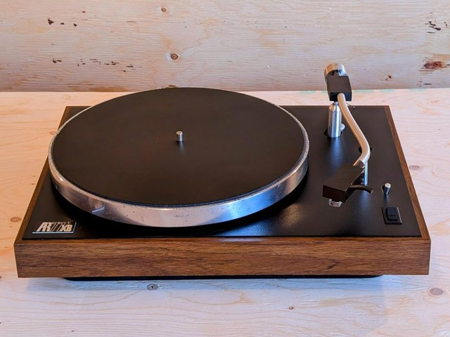

# AR77XB

[Home](../../README.md) · [All models](../README.md) · [XB](../xb/README.md) · [Parts and makers](../../parts/README.md) · [Documents](../../docs/README.md)

The last version of AR's first turntable: an XB with a new badge, a cheaper base, and a lighter counterweight. Also written AR77-XB, AR77 XB, XB77, and XB-77.

No factory document for this model has been found. Everything below comes from a specialist's description, one photographed table, and makers' parts listings. Nothing here is a factory figure.

## At a glance

| Item | Value |
| --- | --- |
| Made | From 1977 (Specialist). AR says production of its turntable ceased in 1979 (Factory, 1983 brochure); the last AR77XB year itself is open, [MD5](../../TO-CONFIRM.md#models-and-dates) |
| Maker's name in those years | Teledyne Acoustic Research, Norwood, Massachusetts (Factory, [1979 price list](../../docs/archive/vinyl-nirvana/ar-turntable-history/1979-xa-price-list.md)) |
| Family | First family, 1961 to 1979: XA, then XB, then AR77XB. See the [model guide](../README.md) |
| Layout | Belt drive. Two-part aluminium platter on an oil bearing. Platter and arm on a subchassis hung on three springs. 12 in S-shaped arm with a cueing lift (Specialist) |
| Speeds | 33⅓ and 45 rpm, by moving the belt on the pulley, as on the XB. Not stated for the AR77XB itself |

## How to recognise one

| Look at | AR77XB | XB, for comparison |
| --- | --- | --- |
| Badge | "AR77XB" on a small plate at the front left of the top plate (Owner report, photo above) | AR logo on a brushed-metal panel at the front right |
| Cueing lever and power switch | Set straight into the black top plate at the front right, with no panel (Owner report, photo above) | Inside the brushed-metal AR panel (Specialist) |
| Cover logo | The newer AR lettering, on a printed metal square (Specialist) | Not recorded |
| Base | Chipboard wrapped in walnut-look vinyl (Specialist) | Plywood veneer, or walnut-look vinyl: the description gives both |
| Counterweight | Aluminium, lighter (Specialist) | Brass or stainless steel (Specialist) |
| Headshell | Black. Metal in one line of the description and plastic in another: Conflict, [HS5](../../TO-CONFIRM.md#headshell-and-screws) | Black plastic with brass thread inserts (Specialist) |
| Top plate | Textured black (Specialist) | Always black (Specialist) |

Not the same table: the **XB1** is the British 220–240 V XB, and **The AR Turntable** of 1983 is a different design with the arm on a separate board.

## Published figures

All from the specialist's description. It leaves overall size and weight blank.

| Item | Value |
| --- | --- |
| Platter | Two-part aluminium, 3.9 lb (1.8 kg). Other sources give 3.3 to 4 lb for this platter: Conflict, [PL1](../../TO-CONFIRM.md#platter-bearings-and-suspension) |
| Arm | 12 in overall, S-shaped, on an oil bearing, with cueing |
| Motor | AC synchronous, 110–120 V, 60 cycle |
| Wow, flutter, rumble, speed accuracy | Given as "see the XA technical specifications": the NAB broadcast limits AR guaranteed, listed in the [model guide](../README.md#first-family) |
| Finish | Walnut-look vinyl base, textured black top plate |
| Overall size and weight | Unconfirmed, [DM3](../../TO-CONFIRM.md#motor-electrical-and-overall-size). Unchecked web listings give about 16.4 × 15.6 × 5.5 in and 5.89 kg |
| Wow and flutter figure | Unconfirmed. An unchecked web listing gives 0.03% |

## Parts sold for it

| Part | What the maker says | Label |
| --- | --- | --- |
| Drive belt | Vinyl Nirvana's replacement belt names the AR XB77. Not for 50 Hz | Maker claim, [belt listing](../../docs/archive/vinyl-nirvana/products/replacement-ar-turntable-belt.md) |
| Suspension kit | Vinyl Nirvana's upgrade kit is titled for the "XA XB XB-77": 3 springs, 3 grommets, 3 washers, 3 studs of 2 in, 3 wing nuts | Maker claim, [kit listing](../../docs/archive/vinyl-nirvana/products/upgrade-spring-kit-xa-xb-xb-77.md) |
| Headshell | The reproduction shell is listed for the XA and XB only. Fit on an AR77XB is unconfirmed | Maker claim, [Pat's Audio](../../docs/archive/pats-audio/ar-xa-xb-headshell.md) |

More on each: [parts and makers](../../parts/README.md), [suspension kit](../xa/mods/suspension-kit.md), [belt and pulley](../xa/mods/belt-and-pulley.md).

## What to use until AR77XB figures exist

The XB is the nearest documented table. Its factory values are a starting point to check on your table, not AR77XB figures.

| Need | Nearest factory value | Where |
| --- | --- | --- |
| Stylus overhang | 0.688 in ± 0.030 past the spindle | [XB setup values](../xb/README.md#factory-setup-values) |
| Platter height | Outer platter ⅜ in ± ¹⁄₃₂ above the top plate | Same |
| Vertical pivots | Tighten until friction is barely perceptible, then back one screw out ⅛ to ¼ turn | Same |
| Bearing oil | 3 drops of 10W oil on the arm and platter spindles | [XB bearings](../xb/README.md#bearings-and-suspension) |
| Screws and small parts | XB bill of materials | [What it is and where it goes](../../docs/what-goes-where.md) |

## Electrical

Motor maker, capacitor values, and mains wiring: Unconfirmed, [EL5](../../TO-CONFIRM.md#motor-electrical-and-overall-size). Before changing anything, write down the motor label and the markings on both capacitors, and add them here.

For reference only: the XA used 0.1 µF on the motor and 0.022 µF across the switch at 120 V ([XA electrical](../xa/README.md#electrical)). The XB drawings give part numbers without values ([XB electrical](../xb/README.md#electrical)).

## A modified example

Gig Harbor Audio sold a custom "AR77 XB" with a Rega 202 arm, an Ortofon OM10 cartridge, and a custom cover, keeping the original AR motor, power cable, and audio cables (Maker claim, [Gig Harbor Audio](../../docs/archive/gig-harbor-audio/custom-units.md)). A table like that no longer matches the recognition table above.

## Still missing

- An operating manual, brochure, or factory drawing that names the AR77XB: [MD10](../../TO-CONFIRM.md#models-and-dates).
- Overall size and weight, measured.
- Motor label and capacitor markings from an unmodified table.
- Headshell material, and whether XB shells and cartridge screws fit.

## Sources

Each link opens the copy kept in this repository.

- [Vinyl Nirvana, AR XB77](../../docs/archive/vinyl-nirvana/ar-models/ar-xb77.md). Specialist description.
- [Vinyl Nirvana, AR XB](../../docs/archive/vinyl-nirvana/ar-models/ar-xb.md). Specialist description.
- [The 1983 AR Turntable brochure](../../docs/archive/vinyl-nirvana/ar-turntable-history/ar-the-turntable-brochure.md). Factory.
- Photo of a badged AR77XB, supplied by the repository owner. Owner report.
- Unchecked listings: SR5 to SR7 in [sources to read](../../docs/sources-to-read.md).
