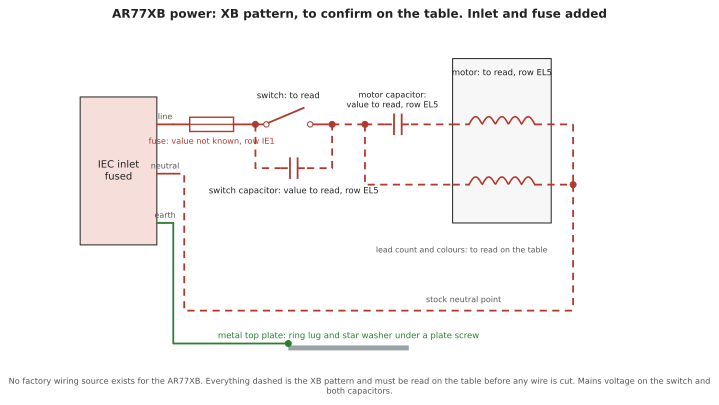
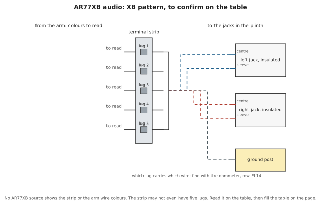
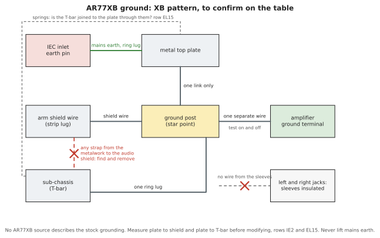

# AR77XB wiring

[AR77XB](README.md) · [XB wiring](../xb/wiring.md) · [Wiring overview](../../docs/wiring/README.md) · [Things to confirm](../../TO-CONFIRM.md#motor-electrical-and-overall-size) · [Home](../../README.md)

No factory wiring source exists for the AR77XB: row [EL5](../../TO-CONFIRM.md#motor-electrical-and-overall-size). The three diagrams below show the XB pattern, every connection dashed, so that the mod can be planned. Nothing on this page is a fact about the AR77XB unless its row says it was read on an AR77XB. The first job is the list under [What to read on the table](#what-to-read-on-the-table).

## Gotchas

- **Mains voltage is present on both capacitors and on the switch under the plate.** Unplug before opening. Have the work checked if you are not experienced with mains wiring.
- **The fuse value is not known.** It comes from the motor label: rows [IE1](../../TO-CONFIRM.md#xa-mods) and [EL5](../../TO-CONFIRM.md#motor-electrical-and-overall-size).
- **The wire colours inside the arm are not the shell wire colours, and the AR77XB's arm colours are not recorded.** Check every wire with an ohmmeter from the shell pin to the strip lug before soldering.
- **Metal jacks on a metal panel short the two channel grounds together and to the plate.** Use insulated jacks or nylon shoulder washers.
- **When the ground post goes in, the old strap from the metalwork to the audio shield comes out.** Leaving both makes a loop and hum.
- **Never lift mains earth to cure hum.**
- **Do not carry an XB value to this table.** The XB rows below are the pattern to check against, not AR77XB values.

## Power

| Part | Value | Label | Source |
| --- | --- | --- | --- |
| IEC inlet, fused | Schurter KD series or equivalent; see the [IEC inlet page](../xa/mods/iec-inlet.md#parts) | Mod | [IEC inlet](../xa/mods/iec-inlet.md) |
| Fuse | Not known. From the motor's rated current | Unconfirmed | Rows IE1 and EL5 |
| Switch | Not recorded. Set straight into the top plate at the front right, with no panel, on the photographed table | Owner report, for the position | [AR77XB page](README.md#how-to-recognise-one) |
| Switch capacitor | Not recorded | Unconfirmed | Row EL5 |
| Motor capacitor | Not recorded | Unconfirmed | Row EL5 |
| Motor | AC synchronous, 110 to 120 V, 60 cycle; maker and label not recorded | Specialist | [AR77XB page](README.md#published-figures) |
| The circuit | Not recorded. XB pattern on the diagram | Unconfirmed | Row [EL14](../../TO-CONFIRM.md#motor-electrical-and-overall-size) |
| Neutral and earth | As on the [wiring overview](../../docs/wiring/README.md#power) | Mod | Same |

For comparison only: the XB has switch 802004, switch capacitor 803004, motor capacitor 803002 and motor 802006, part numbers without values ([XB wiring](../xb/wiring.md#power)).

## Audio

| Strip lug | Arm wire colour | Goes to | Label | Source |
| --- | --- | --- | --- | --- |
| 1 to 5 | To read on the table | Found with the ohmmeter: left signal to the left jack centre, left ground to its sleeve, right signal to the right jack centre, right ground to its sleeve, the arm shield to the ground post | Unconfirmed | Row EL14 |

The strip may not have five lugs; the count is also to read. For comparison only, the XB strip reads silver, copper, red, blue, green from the arm ([XB wiring](../xb/wiring.md#audio)).

Shell wires: left is white with green as its ground; right is red with black as its ground, on AR's sheet for the shell (Factory, [sheet L-1591](../../docs/transcripts/ar-cartridge-mount-l-1591.md)). Whether the AR77XB shell follows the sheet is open with the shell itself: row [HS5](../../TO-CONFIRM.md#headshell-and-screws). An arm rewired to the modern code has green as right ground and blue as left ground: row [RW1](../../TO-CONFIRM.md#xa-mods).

## Ground

| Connection | How | Label | Source |
| --- | --- | --- | --- |
| Arm shield wire to the post | From whichever lug the ohmmeter shows as the shield | Mod | This page |
| Sub-chassis to the post | One wire with a ring lug under a sub-chassis screw | Mod | [Wiring overview](../../docs/wiring/README.md#ground) |
| Top plate to the post | One link | Mod | [IEC inlet](../xa/mods/iec-inlet.md#gotchas) |
| Post to the amplifier ground terminal | One separate wire; test on and off | Mod | [IEC inlet](../xa/mods/iec-inlet.md#verification) |
| Inlet earth pin to the top plate | Ring lug and star washer | Mod | [Plinth rebuild](../xa/mods/plinth-rebuild.md#wiring-plan) |
| Jack sleeves | Insulated from the plate and from the post. No wire | Mod | [RCA jacks](../xa/mods/rca-jacks.md#gotchas) |
| Any stock strap from the metalwork to the audio shield | Not recorded. Find it and remove it when the post goes in | Unconfirmed | Rows IE2 and EL14 |

Whether the stock top plate is tied to the audio shield, and whether the sub-chassis is joined to the plate through the springs, are open: rows [IE2](../../TO-CONFIRM.md#xa-mods) and [EL15](../../TO-CONFIRM.md#motor-electrical-and-overall-size). Measure both before modifying.

## Ohmmeter checks

Table unplugged for every check.

Before soldering:

1. Left shell pins to the strip lugs: find white and green. Write the lug numbers and the arm wire colours into the audio table above.
2. Right shell pins to the strip lugs: find red and black.
3. Arm tube to the shield lug.
4. Top plate to each strip lug: row IE2. Write down what you find.
5. Sub-chassis to the top plate: row EL15.

After:

1. Each jack centre to its shell pin.
2. Each jack sleeve to its shell pin.
3. No continuity between the two sleeves.
4. No continuity from either sleeve to the plate.
5. Inlet earth pin to the top plate.
6. Arm tube to the ground post.
7. Line and neutral pins not connected to the plate.

## What you will find when you open it

Not recorded. No factory picture exists for this model, and no owner has described its underside. Photos wanted: `ar77xb-terminal-strip.jpg` and `ar77xb-underside-wiring.jpg`, see [photo requests](../../docs/photo-requests.md). For what an XB looks like inside, see the [XB page](../xb/wiring.md#what-you-will-find-when-you-open-it).

## What to read on the table

Before any wire is cut, with the table unplugged and on its side:

1. The motor label: maker, part number, voltage, current. Rows EL5 and IE1.
2. The markings on both capacitors, and where each is wired. Row EL5.
3. The switch: its terminals, and which cord wire reaches it. Row EL14.
4. The terminal strip: the lug count, the arm wire colour on each lug, and what the cable side carries. Row EL14.
5. The ground strap, if any: from where to where. Rows IE2 and EL14.
6. The ohmmeter checks above, before soldering. Rows IE2 and EL15.
7. Photographs of the strip and the underside.

Then fill the tables on this page, change each label from Unconfirmed, and change the dashed lines in [diagrams.py](../../cad/tools/diagrams.py) to solid.

## Still to confirm

| Row | What |
| --- | --- |
| [IE1](../../TO-CONFIRM.md#xa-mods) | Motor rated current and fuse value |
| [IE2](../../TO-CONFIRM.md#xa-mods) | Whether the stock top plate is tied to signal ground |
| [RW1](../../TO-CONFIRM.md#xa-mods) | Your arm's colour-to-pin map |
| [EL5](../../TO-CONFIRM.md#motor-electrical-and-overall-size) | Capacitors and motor |
| [EL14](../../TO-CONFIRM.md#motor-electrical-and-overall-size) | Strip layout, arm wire colours, switch and capacitor arrangement |
| [EL15](../../TO-CONFIRM.md#motor-electrical-and-overall-size) | Sub-chassis to top plate through the springs |
| [HS5](../../TO-CONFIRM.md#headshell-and-screws) | The shell, and with it the shell wires |

## Sources

Each link opens the copy kept in this repository.

- [AR77XB page](README.md): the specialist description and the photographed table. No factory document.
- [AR sheet L-1591](../../docs/transcripts/ar-cartridge-mount-l-1591.md). Factory, for the shell.
- [XB wiring](../xb/wiring.md) and [XB drawing 119](../../docs/drawings/xb-drawing-119.png). Factory, for the XB only.
- [RCA jacks](../xa/mods/rca-jacks.md), [IEC inlet](../xa/mods/iec-inlet.md), [plinth rebuild](../xa/mods/plinth-rebuild.md). Mod pages, written for the XA.
