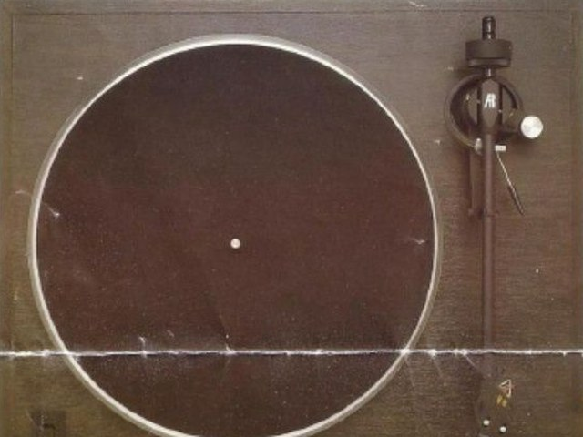

# EB-101

[Home](../../README.md) · [All models](../README.md) · [The AR Turntable](../the-ar-turntable/README.md) · [ES-1](../es-1/README.md) · [ETL-1](../etl-1/README.md) · [Parts and makers](../../parts/README.md) · [Documents](../../docs/README.md)

The budget model of AR's second family: a 12-pole motor, a pressed-steel T-bar and a vinyl-covered particle board base, with a fitted AR arm. Also written EB101 and AR-EB101. The 1988 factory schematics call it EB101N.

**Not bench-verified. No table on hand.** Everything below is from the GB factory brochure, two factory schematics, and specialist accounts.

## At a glance

| Item | Value |
| --- | --- |
| Made | 1984 to an unknown year (Specialist, VN EB-101). On sale by 1985 (Period, Wolf). Factory schematics drawn 13 September 1988 (Factory, drawings 148 and 149) |
| Maker's name | Teledyne Acoustic Research, High Street, Houghton Regis, Dunstable, Bedfordshire, England, and 330 Turnpike Street, Canton, Massachusetts 02021 (Factory, GB brochure) |
| Family | Second family. Do not carry first-family parts or figures across. See the [model guide](../README.md#two-families) |
| Layout | Belt drive. Two-piece cast platter. Arm and platter on a pressed-steel T-bar, sprung and damped at three points (Factory, GB brochure) |
| Speeds | 33⅓ and 45 rpm, by moving the belt by hand (Factory, GB brochure) |
| Price when new | $399 in 1985 (Period, Wolf); $425 in 1988 (Specialist, VN EB-101) |

## How to recognise one

| Look at | EB-101 | The AR Turntable, for comparison |
| --- | --- | --- |
| Base | Vinyl-covered particle board (Factory, GB brochure). Square edges, boxier, about an inch (25 mm) smaller all round (Period, Wolf; Specialist, VN EB-101) | Walnut veneer, rounded edges |
| Arm mounting | Early units: a solid top with the arm rising through a hole in it. Later units: a black armboard, crescent-shaped in front and round behind (Specialist, VN EB-101). The GB brochure photo shows the solid top | Black armboard |
| Controls | Rocker switch at the front left (Factory, GB brochure photo) | Rocker switch at the front left |
| Finish | Walnut (Specialist, VN EB-101). British-built units include an all-black painted version (Specialist, same page) | Walnut veneer |

Vinyl Nirvana warns that the early solid-top style is hard to fit with another arm, and that the British-sourced EB-101 has some cheaper parts; it calls the black painted version the low point of the mid-1980s AR tables (Specialist, VN EB-101). When the solid top gave way to the armboard: Unconfirmed, [MD15](../../TO-CONFIRM.md#models-and-dates).

## Variants

- **Early style**, solid top, arm through a hole (Specialist, VN EB-101).
- **Later style**, crescent armboard (Specialist, VN EB-101).
- **British-built**, including an all-black version (Specialist, VN EB-101).
- **EB101N**: the name on two factory schematics of 13 September 1988, for 115 V and 230 V. The meaning of N: Unconfirmed ([model guide](../README.md#second-family-1983-onward)).

## Published figures

| Item | GB brochure (Factory) | Vinyl Nirvana, "later unit" (Specialist) |
| --- | --- | --- |
| Motor | 12-pole synchronous, 500 rpm at 50 Hz, 600 rpm at 60 Hz | 12-pole synchronous |
| Platter | 1.8 kg (3.9 lb) | 3.9 lb (1.8 kg) |
| Suspension | Pressed-steel T-bar, spring-suspended and damped at three points | 3 point dual spring suspension, "same subchassis as the ES-1" |
| Wow and flutter | 0.05%, DIN 45507 | 0.05% |
| Rumble | −72 dB, DIN 45539B | −72 dB |
| Mains, power | 110–120 V or 220–240 V, 50 or 60 Hz; 9 W | Not stated |
| Size | 442 × 365 × 180 mm (17.4 × 14.4 × 7.1 in), width × depth × height | 18.19 × 15.25 × 7 in (462 × 387 × 178 mm), cover down. Conflict, [DM6](../../TO-CONFIRM.md#motor-electrical-and-overall-size) |
| Weight | Not stated | 13.5 lb (6.1 kg) |
| Warranty | 1 year, table and arm | Not stated |
| Dust cover | Acrylic | Not stated |

Vinyl Nirvana's size is the same as the one it and the 1983 brochure give The AR Turntable, and Wolf says the EB-101 is about an inch smaller all round. The brochure's 442 × 365 mm agrees with Wolf.

### Arm

| Item | Value (Factory, GB brochure) |
| --- | --- |
| Effective length | 229 mm (9.0 in) |
| Overhang | 16 mm (0.63 in) |
| Pivot friction | Under 30 mg horizontal or vertical |
| Effective mass | 12 g |
| Cartridge weight | 3 to 9 g |
| Stylus force range | 0.5 to 3 g |
| Headshell | Detachable (Specialist, VN EB-101; Period, Wolf). Material not stated |
| Capacitance | Not stated |

Spindle to arm pivot: 8.4 in (213 mm) (Period, Wolf). Other arms can be fitted with optional AR adaptors (Factory, GB brochure).

No magazine measurements of the EB-101 are held. Mitchell's July 1984 measurements are of The AR Turntable, a different table: see that [page](../the-ar-turntable/README.md#measured-one-table) for comparison only.

## Mechanical

- **Platter and bearing:** heavy, cast, two-piece platter and a close-tolerance main bearing (Factory, GB brochure). Bearing type and ball size: Unconfirmed. Wolf says the ES-1 improved on the EB-101 with a sapphire bearing (Period, Wolf).
- **Belt:** Vinyl Nirvana sells a replacement belt listed for the EB-101, not for 50 Hz tables (Maker claim, [belt listing](../../docs/archive/vinyl-nirvana/products/replacement-ar-turntable-belt.md)).
- **Restoration:** Vinyl Nirvana offers restoration of the EB-101 (Maker claim, [restoration services](../../docs/archive/vinyl-nirvana/restoration-services.md)).

## Electrical

Factory, [drawing 149](../../docs/drawings/eb101n-drawing-149.png) (115 V, 60 Hz, AR drawing 102125) and [drawing 148](../../docs/drawings/eb101n-drawing-148.png) (230 V, 50 Hz, AR drawing 192125), "Schematic, EB101N", initial release 13 September 1988:

| Supply | Motor capacitor | Switch capacitor | Also |
| --- | --- | --- | --- |
| 115 V, 60 Hz | 0.25 µF | 0.022 µF across the single-pole switch | Hurst motor; no lamp |
| 230 V, 50 Hz | 0.82 µF | 0.01 µF | Hurst motor; 3.9 kΩ, 5 W resistor in series with the supply; no lamp |

Motor lead colours on the 115 V drawing: two blue to the supply, black to the capacitor, red to the other side. No capacitor voltage ratings are given. The drawings name a Hurst motor; the brochure gives 12 poles. Whether earlier EB-101s had the same motor: Unconfirmed. Before changing anything, write down the motor label and both capacitor markings.

## Still missing

- Owner's manual and any service paper: [MD14](../../TO-CONFIRM.md#models-and-dates).
- When the armboard replaced the solid top: [MD15](../../TO-CONFIRM.md#models-and-dates).
- Overall size: Conflict, [DM6](../../TO-CONFIRM.md#motor-electrical-and-overall-size).
- Motor on tables before 1988, and the meaning of N in EB101N.
- Headshell material and arm cable capacitance.

## Wanted from owners

- Serial number, label text, and whether the top is solid or has an armboard.
- Motor label and both capacitor markings, with the serial.
- Width, depth and height with the cover closed, and the weight.
- Photos of the top, the armboard or arm hole, the T-bar with the platter off, and the label underneath.
- For a British-built or black unit: what differs from a US unit.

## Sources

Each link opens the copy kept in this repository.

- [AR Legend and EB-101 brochure from Great Britain](../../docs/archive/vinyl-nirvana/ar-turntable-history/ar-legend-and-eb-101-brochure-from-great-britain.md), undated. Factory ("GB brochure").
- Drawings [148](../../docs/drawings/eb101n-drawing-148.png) and [149](../../docs/drawings/eb101n-drawing-149.png), EB101N schematics, 13 September 1988. Factory.
- Kurt Wolf, [notes distinguishing the mid-eighties AR turntables](../../docs/archive/vinyl-nirvana/ar-models/mid-80s-ar-distinguishing-notes.md). Period ("Wolf").
- [Vinyl Nirvana, AR EB-101](../../docs/archive/vinyl-nirvana/ar-models/ar-eb-101.md). Specialist ("VN").
- [Vinyl Nirvana restoration services](../../docs/archive/vinyl-nirvana/restoration-services.md) and [replacement belt listing](../../docs/archive/vinyl-nirvana/products/replacement-ar-turntable-belt.md). Maker claim.
