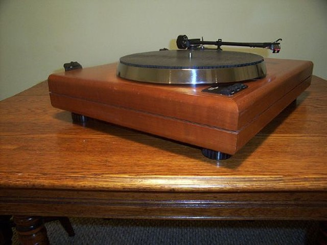

# ETL-1

[Home](../../README.md) · [All models](../README.md) · [The AR Turntable](../the-ar-turntable/README.md) · [EB-101](../eb-101/README.md) · [ES-1](../es-1/README.md) · [Parts and makers](../../parts/README.md) · [Documents](../../docs/README.md)

The largest AR turntable: electronic speed control, an 8.5 lb platter, a sapphire bearing and adjustable feet, sold without an arm. The arm in the photo is not from AR.

**Not bench-verified. No table on hand.** No factory document for the ETL-1 is held. Everything below is from specialist accounts.

## At a glance

| Item | Value |
| --- | --- |
| Made | On sale by 1985 (Period, Wolf). Phased out in early 1987 (Period, Wolf); priced for 1988 (Specialist, VN ETL-1). Conflict, [MD7](../../TO-CONFIRM.md#models-and-dates). First year: Unconfirmed, TCNEW-M3 |
| Series name | "Research Series" (Period, Wolf; Specialist, VN gallery). "Connoisseur Series" on the Vinyl Nirvana model page (Specialist, VN ETL-1). Conflict, TCNEW-M3 |
| Maker's name | Teledyne Acoustic Research. No ETL-1 paper with an address is held |
| Family | Second family. Do not carry first-family parts or figures across. See the [model guide](../README.md#two-families) |
| Layout | Belt drive with electronic speed control. Sapphire bearing. Three-point dual-spring suspension with adjustable weights. Adjustable feet (Specialist, VN ETL-1) |
| Speeds | 33⅓ and 45 rpm (Specialist, VN ETL-1) |
| Price when new | $700 (Period, Wolf, 1985); $700 without arm (Specialist, VN ETL-1, 1988) |

## How to recognise one

| Look at | ETL-1 | ES-1, for comparison |
| --- | --- | --- |
| Size | 20.44 in (519 mm) wide, 17.5 in (445 mm) deep, 7.5 in (191 mm) high with the cover down (Specialist, VN ETL-1) | 18.19 × 15.25 × 7 in |
| Weight | 29 lb (13.2 kg) (Specialist, VN ETL-1) | Not stated |
| Spindle to arm pivot | 9.5 in (241 mm) (Period, Wolf) | 8.4 in (213 mm) |
| Finish | Cherry or piano black (Specialist, VN ETL-1) | Cherry or walnut solid wood sides |
| Feet | Adjustable (Specialist, VN ETL-1) | Not stated |
| Arm | None from the factory | AR arm, or none |

The 9.5 in spindle-to-pivot distance means an arm board made for The AR Turntable, EB-101 or ES-1 will not place an arm correctly on an ETL-1 (our assessment, from Wolf's two figures).

## Variants

- **Cherry**, the usual finish (Specialist, VN ETL-1).
- **Piano black**, rare. Vinyl Nirvana doubted it existed until one appeared; its underside is also gloss black. That one came with a Sumiko FT-3 arm (Specialist, [VN gallery, piano black ETL-1](../../docs/archive/vinyl-nirvana/ar-gallery/piano-black-ar-etl-1-the-research-series.md)).

## Published figures

All Specialist, VN ETL-1.

| Item | Value |
| --- | --- |
| Drive | Belt, electronic speed control |
| Platter | 8.5 lb (3.9 kg) |
| Bearing | Sapphire |
| Suspension | Three-point dual springs, adjustable weights |
| Wow and flutter | 0.03% |
| Rumble | −81 dB |
| Width × height × depth, cover down | 20.44 × 7.5 × 17.5 in (519 × 191 × 445 mm) |
| Weight | 29 lb (13.2 kg) |
| Arm | None |

The measurement standard behind the 0.03% and −81 dB is not stated.

## Mechanical

- **Arm mounting:** the buyer's own arm. Arm board material, cut-out and fixing: Unconfirmed.
- **Suspension weights:** "adjustable weights" is all the source says. How they are adjusted: Unconfirmed.
- **Belt:** the Vinyl Nirvana replacement belt listing names other AR models but not the ETL-1 (Maker claim, [belt listing](../../docs/archive/vinyl-nirvana/products/replacement-ar-turntable-belt.md)). Belt size for the ETL-1: Unconfirmed.

## Electrical

Motor type, speed control circuit, power supply and mains wiring: Unconfirmed, TCNEW-M9. No ETL-1 schematic is held. The Hurst schematics for The AR Turntable and the EB101N do not name the ETL-1 and are not ETL-1 figures. Before changing anything, write down the motor label, the control board markings and the mains rating label.

## Still missing

- Any factory paper naming the ETL-1: TCNEW-M10.
- Motor and speed control: TCNEW-M9.
- First year on sale, and the series name: TCNEW-M3. Last year: [MD7](../../TO-CONFIRM.md#models-and-dates).
- Belt size, bearing parts, suspension weight adjustment.

## Wanted from owners

- Serial number and label text.
- Photos of the motor and its label, the speed control board, and the underside.
- How the suspension weights and feet adjust, with photos.
- Arm board dimensions and the spindle-to-pivot distance measured on the table.
- Belt length, width and thickness.
- Weight, and the size with the cover closed.

## Sources

Each link opens the copy kept in this repository.

- [Vinyl Nirvana, AR ETL-1](../../docs/archive/vinyl-nirvana/ar-models/ar-etl-1.md), with [more photos](../../docs/archive/vinyl-nirvana/ar-models/ar-etl-1/more-details-and-photos-of-etl-1.md). Specialist ("VN").
- Vinyl Nirvana gallery: [AR ETL-1 The Research Series](../../docs/archive/vinyl-nirvana/ar-gallery/ar-etl-1-the-research-series.md), [piano black ETL-1](../../docs/archive/vinyl-nirvana/ar-gallery/piano-black-ar-etl-1-the-research-series.md). Specialist.
- Kurt Wolf, [notes distinguishing the mid-eighties AR turntables](../../docs/archive/vinyl-nirvana/ar-models/mid-80s-ar-distinguishing-notes.md). Period ("Wolf").
- [Vinyl Nirvana replacement belt listing](../../docs/archive/vinyl-nirvana/products/replacement-ar-turntable-belt.md). Maker claim.
