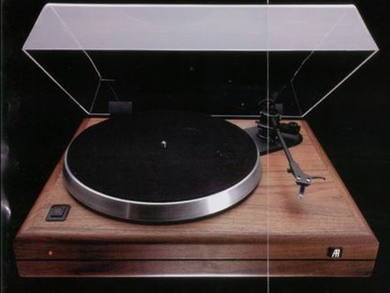
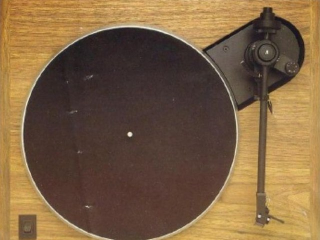

# The AR Turntable

[Home](../../README.md) · [All models](../README.md) · [EB-101](../eb-101/README.md) · [ES-1](../es-1/README.md) · [ETL-1](../etl-1/README.md) · [Parts and makers](../../parts/README.md) · [Documents](../../docs/README.md)

AR's 1983 relaunch: the original sprung T-bar mechanism in a new walnut base, with a straight Japanese-made arm on a separate black armboard, or sold without an arm. Sold in Britain as The Legend, covered [below](#the-legend). Also written "AR the Turntable" and "AR TT".

**Not bench-verified. No table on hand.** Everything below is from the 1983 factory brochure, two factory schematics, one magazine review with measurements, and specialist and owner accounts.

## At a glance

| Item | Value |
| --- | --- |
| Made | Brochure printed October 1983, form 701049-0 (Factory, 1983 brochure). One owner bought his new in November 1983 (Owner report, Dagogo). Introduced in 1984 (Period, Wolf; Specialist, VN AR the Turntable). Conflict, TCNEW-M1 |
| Maker's name | Teledyne Acoustic Research, 10 American Drive, Norwood, Massachusetts 02062, and High Street, Houghton Regis, Dunstable, Bedfordshire, England (Factory, 1983 brochure) |
| Family | Second family, 1983 onward: The AR Turntable, The Legend, EB-101, ES-1, ETL-1. Do not carry first-family parts or figures across. See the [model guide](../README.md#two-families) |
| Layout | Belt drive. Two-part cast aluminium platter. Platter and arm on a die-cast T-bar hung on three damped springs (Factory, 1983 brochure). The arm sits on a separate wood-composite board bolted to an open frame on the T-bar, so the board can be swapped for another arm (Period, Audio 1984) |
| Speeds | 33⅓ and 45 rpm, changed by lifting off the outer platter and moving the belt to the other pulley step. Speed is not adjustable (Period, Audio 1984) |
| Price when new | $450 with arm, $325 without (Period, Audio 1984). $475 with arm, $350 without (Period, Wolf). Both stay side by side |

## How to recognise one

| Look at | The AR Turntable | EB-101, for comparison |
| --- | --- | --- |
| Base | Walnut veneer all over, rounded edges (Specialist, VN AR the Turntable; Period, Wolf) | Square edges, about an inch (25 mm) smaller all round (Period, Wolf) |
| Arm mounting | Black armboard, crescent-shaped in front and round behind (Specialist, VN AR the Turntable) | Solid top with the arm through a hole on early units, armboard on later ones (Specialist, VN EB-101) |
| Top | No metal top plate; the top is finished like the base (Factory, 1983 brochure photo) | Same |
| Controls | Rocker switch at the front left, AR badge at the front right (Factory, 1983 brochure photo) | Rocker switch at the front left (Factory, GB brochure photo) |
| Model name | On the back of the table (Owner report, Dagogo comments) | Not recorded |
| Arm | Straight, black anodised aluminium, with a damped cueing lift and an anti-skating control (Period, Audio 1984) | Fitted AR arm (Factory, GB brochure) |

Not the same table: the **ES-1** looks almost the same but has solid wood sides, a sapphire bearing, and was more often sold without an arm (Specialist, VN ES-1). Vinyl Nirvana says many owners assume the ES-1 name came later for an upgraded version of this table (Specialist, VN AR the Turntable).

## Variants

- **The Legend**: the British name. See [The Legend](#the-legend) below.
- **Without arm**: sold with no arm, for the buyer's own (Factory, 1983 brochure; Period, Audio 1984). Many surviving tables carry another arm, such as a Sumiko Premier MMT fitted by the dealer in 1983 (Owner report, Dagogo).
- **Rosewood prototype**: one table in rosewood veneer, said by a former AR marketing employee to be one of six made in different veneers before launch. The rosewood was not chosen (Owner report, [Vinyl Nirvana gallery](../../docs/archive/vinyl-nirvana/ar-gallery/prototype-ar-turntable-in-rosewood.md)). The same page says the production table came only in walnut veneer. Kurt Wolf says the finishes were mostly oiled walnut in the US and a deeper cherry in the UK (Period, Wolf). Both stay side by side.

## Published figures

Maker's figures are limits and claims. Measured figures are from one table on one bench. Keep them apart.

### Maker's figures

| Item | Value (Factory, 1983 brochure) | Other source |
| --- | --- | --- |
| Motor | 24-pole synchronous, 300 rpm at 60 Hz or 250 rpm at 50 Hz | "Later unit": 12-pole synchronous (Specialist, VN AR the Turntable). Conflict, TCNEW-M8. Motor in the first units: [MD9](../../TO-CONFIRM.md#models-and-dates) |
| Platter | 3.9 lb (1.8 kg) | Same on Vinyl Nirvana |
| Suspension | Damped three-point sprung suspension of a die-cast T-bar | 3 point dual spring suspension, "same subchassis as the ES-1" (Specialist, VN AR the Turntable) |
| Wow and flutter | 0.04%, DIN 45507 | 0.05% for the later unit (Specialist, VN AR the Turntable) |
| Rumble | −73 dB, DIN 45539B weighting | −72 dB for the later unit (Specialist, same page) |
| Mains | 110–120 V 60 Hz or 220–240 V 50 Hz | |
| Power | 9 W | |
| Width × depth | 18³⁄₁₆ × 15¼ in (462 × 387 mm) | 18.19 × 15.25 in (Specialist, VN AR the Turntable) |
| Height | 7 in (179 mm) cover closed, 17 in (432 mm) cover open | 7 in (Specialist, same page) |
| Weight | 18 lb (8.2 kg) | 13.5 lb (6.1 kg) (Specialist, same page). Conflict, TCNEW-M2 |
| Warranty | 3 years on the table; 1 year on the arm | |

The 12-pole motor, 0.05%, −72 dB and 13.5 lb that Vinyl Nirvana gives this table are the same figures it and the GB brochure give the EB-101.

### Arm, maker's figures

| Item | Value (Factory, 1983 brochure) | Same item in the Audio 1984 specification box |
| --- | --- | --- |
| Effective length | 9 in (229 mm) | 9 in (229 mm) |
| Overhang | ¹⁹⁄₃₂ in (15 mm) | 0.6 in (15 mm) |
| Pivot friction | Under 20 mg horizontal, under 20 mg vertical | Under 20 mg |
| Effective mass | 13 g | 13 g, without cartridge |
| Cartridge weight | 3 to 9 g, cartridge not supplied | 3 to 9 g |
| Stylus force range | 0 to 3 g | 0 to 3 g |
| Arm and lead capacitance | 85 pF | 85 pF |
| Headshell | Carbon-fibre reinforced, with a clamping screw on the arm | Carbon fibre |

Spindle to arm pivot: 8.4 in (213 mm) (Period, Wolf).

### Measured, one table

Peter Mitchell's review; the measurements were made by Alvin Foster and J. K. Pollard of the Boston Audio Society (Period, Audio 1984).

| Item | Result |
| --- | --- |
| Speed | Exactly correct at 33⅓ and 45 rpm, and unchanged with mains from 75 to 130 V |
| Wow and flutter | 0.05%, DIN weighted |
| Drive torque | Low: a 10 g drag slowed the platter by 0.27%. A Discwasher brush stopped it |
| Rumble | Measured with a Thorens Rumpelmesskoppler on the spindle: a narrow peak of −40 dB unweighted at 6 Hz, −60 dB at 12 Hz, −70 dB at 20 Hz, −80 dB at 30 Hz, about −90 dB at audible frequencies. The lowest rumble the testers had measured |
| Stylus force dial | Accurate within 0.1 g at all settings |
| Anti-skating | At 1 g stylus force, the dial had to read 1.5 g to track heavily modulated grooves best |
| Arm and cartridge resonance | With a Shure V15 Type IV, brush up: 7.5 Hz, peak 8 dB. Brush down: a 2 dB rise from 11 to 16 Hz, falling fast below 9 Hz |
| Stylus force variation | 0.2 g peak to peak on a flat record, 0.5 g on a record with a 4 mm warp |
| Cable | 32 in (813 mm) after the loop, gold-plated plugs, 82 pF a channel measured |
| Suspension | Resonance about 3 Hz |
| Acoustic feedback | 19 dB more gain before feedback than a Kenwood KD-500 with an SME Series III arm in the same place, 1 m from a full-range speaker |
| Platter | Inner and outer platters ring when tapped alone; together they are dead. Felt mat supplied |
| Disc microphony | About average. A Platter Matter mat improved it about 6 dB but its 1 lb (0.45 kg) nearly bottomed the suspension |

Weaknesses Mitchell found on the same table: the vertical pivots sit nearly ½ in (12.7 mm) above the record surface, so warped records may cause some wow; the cueing lever is on the sprung subchassis, so touching it rocks the platter and arm; the arm moves slightly outward when lifted, from the anti-skating force; and the headshell is not plug-compatible with ADC-type shells (Period, Audio 1984).

## Mechanical

- **Subchassis:** the original AR T-bar, modified: the I-beam is shorter, and an open frame carries the bolted-on armboard (Period, Audio 1984).
- **Fitting another arm:** replace the armboard. The bilingual English and French owner's manual explains how to trim the spring tension for a different arm weight and how to check whether the motor needs a shim to centre the belt on the pulley (Period, Audio 1984). The manual itself is not held: TCNEW-M10.
- **Arm cable:** loops in a half circle after leaving the arm pillar before it is fixed to the base, so it does not stiffen the suspension (Period, Audio 1984).
- **Placement:** with a suspension near 3 Hz, the table needs a stable shelf. Heavy footfalls on a weak wooden floor can cause flutter or skipping (Period, Audio 1984).
- **Belt:** the manual recommended dusting the belt with talcum powder once a year (Period, Audio 1984). Vinyl Nirvana sells a replacement belt listed for this table, not for 50 Hz tables (Maker claim, [belt listing](../../docs/archive/vinyl-nirvana/products/replacement-ar-turntable-belt.md)).
- **Known faults:** early tables could develop motor bearing noise; a new motor with better bearing materials and finish came in 1985. Most arms developed severe sticking, and the cueing device was redesigned and replaced under warranty (Period, Wolf). One owner's motor began to grind after about 20 years; oiling the motor bearing well stopped it, and he now oils the motor and platter bearings once a year and changes the belt about every 5 years (Owner report, Dagogo). The oil grade AR specified for this table: Unconfirmed, TCNEW-M10.
- **Restoration:** Vinyl Nirvana offers restoration of The AR Turntable, EB-101 and ES-1, typically 8 to 10 weeks, and rents original packing for $20 plus shipping (Maker claim, [restoration services](../../docs/archive/vinyl-nirvana/restoration-services.md)).

## Electrical

Factory, [drawing 131](../../docs/drawings/ar-turntable-drawing-131.png) (115 V, 60 Hz, AR drawing 102068) and [drawing 130](../../docs/drawings/ar-turntable-drawing-130.png) (230 V, 50 Hz, AR drawing 192068), both titled for a Hurst motor, used on "AR TT", drawn December 1983:

| Supply | Motor capacitor | Switch capacitor | Also |
| --- | --- | --- | --- |
| 115 V, 60 Hz | 0.25 µF | 0.022 µF across the single-pole switch | NE-2 lamp with 30 kΩ, ½ W |
| 230 V, 50 Hz | 0.82 µF | 0.01 µF | 3.9 kΩ, 5 W resistor in series with the supply; NE-2 lamp with 47 kΩ, ½ W |

Motor lead colours on the 115 V drawing: two blue to the supply, black to the capacitor, red to the other side of the capacitor. The drawings give no capacitor voltage ratings. A 50 Hz table needs its own pulley or motor as well as the right voltage ([model guide](../README.md#motors-and-mains-by-market)).

Which motor the first units had: Conflict, [MD9](../../TO-CONFIRM.md#models-and-dates). Before changing anything, write down the motor label and the markings on both capacitors.

## The Legend

The British name. The GB brochure says AR redesigned and relaunched its turntable as the Legend (Factory, GB brochure). Years made: Unconfirmed, TCNEW-M4. The brochure is undated and gives the Houghton Regis address and 330 Turnpike Street, Canton, Massachusetts.

| Item | The Legend (Factory, GB brochure) | The AR Turntable, for comparison (Factory, 1983 brochure) |
| --- | --- | --- |
| Base | Solid MDF ("Synergite") plinth with real wood veneer | Walnut veneer |
| Motor | 24-pole synchronous, 250 rpm at 50 Hz, 300 rpm at 60 Hz | Same |
| Platter | 1.8 kg (3.9 lb), heavy, cast, two-piece | 3.9 lb (1.8 kg) |
| Suspension | Arm and platter on a die-cast T-bar, three-point spring-suspended and damped | Same wording in substance |
| Wow and flutter, DIN 45507 | 0.04% | 0.04% |
| Rumble, DIN 45539B | −73 dB | −73 dB |
| Mains, power | 110–120 V or 220–240 V, 50 or 60 Hz; 9 W | Same |
| Size | 462 × 387 × 179 mm (18.2 × 15.2 × 7.0 in) | 462 × 387 × 179 mm |
| Arm effective length, overhang | 229 mm, 15 mm | 229 mm, 15 mm |
| Arm friction | Under 20 mg horizontal or vertical | Same |
| Arm effective mass | 14 g | 13 g |
| Cartridge weight | 3 to 11 g | 3 to 9 g |
| Stylus force range | 0 to 3 g | 0 to 3 g |
| Arm and lead capacitance | 85 pF | 85 pF |
| Headshell | Integral die-cast aluminium | Carbon-fibre reinforced, clamping screw on the arm |
| Warranty | 3 years; AR arms 1 year | 3 years; arm 1 year |
| Dust cover | Acrylic | Not stated |

The turntable figures match line for line; the arm does not. Other arms can be fitted with optional AR adaptors (Factory, GB brochure). The brochure photo shows the arm on a black crescent armboard, a rocker switch at the front left and an AR badge on the front of the base.

## Still missing

- The owner's manual (English and French), and any service manual.
- First year on sale: TCNEW-M1. Weight: TCNEW-M2. Motor pole count by date: TCNEW-M8. First motor: MD9.
- A parts list or exploded drawing of the T-bar, armboard frame, bearing and arm.
- Oil grade and service intervals from AR: TCNEW-M10.
- The Legend's years: TCNEW-M4.

## Wanted from owners

- Serial number and the label on the back, with the year bought if known.
- Motor label (maker, pole count, voltage) and both capacitor markings, with the serial.
- Weight of the table without cover, and of the cover alone.
- Photos of the armboard from above and below, the T-bar with the platter off, and the arm cueing mechanism.
- Belt length, width and thickness; pulley diameters for both speeds.
- A scan of the owner's manual.
- For The Legend: a dated receipt or review, and the label underneath.

## Sources

Each link opens the copy kept in this repository.

- [The 1983 AR Turntable brochure](../../docs/archive/vinyl-nirvana/ar-turntable-history/ar-the-turntable-brochure.md), Teledyne Acoustic Research, 701049-0, 10/83. Factory.
- [AR Legend and EB-101 brochure from Great Britain](../../docs/archive/vinyl-nirvana/ar-turntable-history/ar-legend-and-eb-101-brochure-from-great-britain.md), undated. Factory.
- Drawings [130](../../docs/drawings/ar-turntable-drawing-130.png) and [131](../../docs/drawings/ar-turntable-drawing-131.png), Hurst motor schematics, December 1983. Factory.
- Peter W. Mitchell, [review of the AR turntable](../../docs/archive/gamma-electronics/audio-1984-07-ar-turntable.md), *Audio*, July 1984. Period ("Audio 1984").
- Kurt Wolf, [notes distinguishing the mid-eighties AR turntables](../../docs/archive/vinyl-nirvana/ar-models/mid-80s-ar-distinguishing-notes.md). Period ("Wolf").
- [Vinyl Nirvana, AR the Turntable](../../docs/archive/vinyl-nirvana/ar-models/ar-the-turntable.md) and [AR ES-1](../../docs/archive/vinyl-nirvana/ar-models/ar-es-1.md). Specialist ("VN").
- [Dagogo, The AR Turntable commentary](../../docs/archive/dagogo/the-ar-turntable-commentary.md), 2020, with readers' comments. Owner report.
- [Vinyl Nirvana, rosewood prototype](../../docs/archive/vinyl-nirvana/ar-gallery/prototype-ar-turntable-in-rosewood.md). Owner report.
- [Vinyl Nirvana restoration services](../../docs/archive/vinyl-nirvana/restoration-services.md) and [replacement belt listing](../../docs/archive/vinyl-nirvana/products/replacement-ar-turntable-belt.md). Maker claim.
