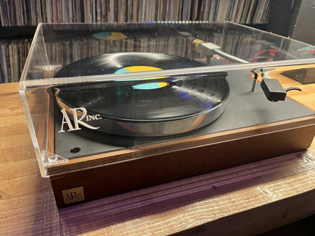

# AR XA

[Home](../../README.md) · [All models](../README.md) · [Mods](mods/README.md) · [Parts and makers](../../parts/README.md) · [Documents](../../docs/README.md)

AR's first turntable, and the pattern for every later one. This one is all stock except for a new cover and arm rest (photo: Gig Harbor Audio).

## At a glance

| Item | Value |
| --- | --- |
| Made | 1961 to 1979. First shipped to dealers in 1961 (Owner report, [Allison](../../docs/archive/vinyl-nirvana/ar-turntable-history/acoustic-research-inc-the-golden-years-by-roy-allison.md)); production ceased in 1979 (Factory, [1983 brochure](../../docs/archive/vinyl-nirvana/ar-turntable-history/ar-the-turntable-brochure.md)) |
| Maker's name | AR Inc. and Acoustic Research, Inc., Cambridge, Massachusetts; by 1979 Teledyne Acoustic Research, Norwood, Massachusetts. See [company and people](../README.md#company-and-people) |
| Designer | Edgar Villchur, who published the design in *Audio* in 1962. See the [design-paper notes](../../docs/design-notes.md) |
| Layout | Belt drive. Two-part aluminium platter. Platter and arm on a T-bar subchassis hung on three springs. S-shaped arm, no cueing lever |
| Speeds | 33⅓ and 45 rpm, by moving the belt on the pulley (Factory, [AR brochure](../../docs/archive/vinyl-nirvana/ar-turntable-history/ar-brochure.md)) |
| Performance | Guaranteed to NAB broadcast limits: speed within ±0.3%, wow and flutter within 0.1% combined, rumble at least 35 dB below 1 cm/sec at 100 cps (Factory, [AR spec sheet](../../docs/archive/vinyl-nirvana/ar-turntable-history/1969-ar-xa-technical-specifications.md)) |
| Price when new | $58 in 1961, $78 by about 1963, $90 to $115 by 1972. See [prices](../README.md#prices-when-new) |

## How to recognise one

Specialist description, [Vinyl Nirvana](../../docs/archive/vinyl-nirvana/ar-models/ar-xa.md), unless noted.

| Look at | XA |
| --- | --- |
| Controls | No cueing lever. That is the quickest difference from an XB or AR77XB |
| Top plate | Painted metal: smooth grey, textured brown, smooth brown, or textured black |
| Headshell | Plastic with brass thread inserts, tan or black |
| Arm rest | Black plastic |
| Base | Solid oiled walnut on early tables, then walnut veneer, last walnut-look vinyl |
| Badge | "AR Inc." plate on the front of the base (Owner report, photo above) |
| Under the outer platter | Two motors up to serial XA66866, one after (Factory, [XA service manual, p. 1](../../docs/originals/xa-service-manual.pdf)) |
| Arm damping | The arm floats down when dropped, up to serial XA236534; omitted after (Factory, same page) |

Variants: the **TA** is described as nearly identical, and the **XA91** is an XA sold with a Shure M91ED cartridge. Both are covered in the [model guide](../README.md#first-family-1961-to-1979).

## Mechanical

### Dimensions and arm geometry

| Item | Value |
| --- | --- |
| Overall size with cover, W × D × H | 16¾ × 12¾ × 5¼ in, about 425.5 × 323.9 × 133.4 mm (Period listing, [*Audio*, September 1969 directory](../../docs/originals/audio-1969-09-directory-p50.pdf); the same size is in the [AR brochure](../../docs/archive/vinyl-nirvana/ar-turntable-history/ar-brochure.md)) |
| Complete weight | 13½ lb, about 6.12 kg (same two sources) |
| Arm overall length | 12 in (Period listing, same directory) |
| Effective arm length, pivot to stylus | 9 in / 228.6 mm (Factory, [Villchur 1962, p. 69](../../docs/originals/villchur-1962-part-1.pdf); same in the directory) |
| Overhang | 0.688 in / about 17.48 mm (Factory, Villchur 1962, p. 69) |
| Counterweight and tonearm rest | [Measurement record](../../parts/xa-counterweight.md) |

### Motor identification

Factory, [XA service manual, p. 1](../../docs/originals/xa-service-manual.pdf):

| Serial range as printed | Drive | Shaft |
| --- | --- | --- |
| Up to XA66866 | Two motors | Not specified |
| XA66866–XA175235 | Haydon | ⅛ in |
| XA176235–XA204462 | Philips | ¹⁄₁₆ in |
| Above XA204462 | Haydon | ⅛ in |

The printed ranges overlap at XA66866 and leave a gap before XA176235. Pulley fit depends on the motor type and on 50 or 60 Hz supply.

### Service details

Factory, [XA service manual, pp. 1–2](../../docs/originals/xa-service-manual.pdf):

- **Platter clearance:** with a heavy record in place, the outer platter rides ⅛ in above the top plate. The XB figure is [⅜ in](../xb/README.md#factory-setup-values).
- **Arm spindle:** it needs its small ball bearing and the disc beneath it. Page 1 calls the disc Teflon; the p. 4 parts list has a "Nylon Disc Bearing", part 1092.
- **Arm damping:** omitted from XA236534.
- **Handling:** unplug before opening. Support the table on its side; do not invert it.

### Screws and replacements

Cartridge hardware and every other screw: [What it is and where it goes](../../docs/what-goes-where.md). Replacement shells: [parts](../../parts/README.md) and the [top-mount headshell](mods/headshell-top-mount.md).

## Electrical

### Historical capacitor values

Factory, [XA service manual, p. 3](../../docs/originals/xa-service-manual.pdf):

| Circuit | Motor capacitor C1 | Switch capacitor C2 |
| --- | --- | --- |
| 120 V | 0.1 µF, 600 VDC | 0.022 µF, 600 VDC |
| 220 V | 0.39 µF, 600 VDC | 0.01 µF, 600 VDC |

600 VDC is a DC rating, not a 600 VAC rating. See [Motor phase capacitor](mods/motor-capacitor.md).

### Wire and audio cable

| Item | Value |
| --- | --- |
| Internal signal wire | Cardas 33 AWG, nothing thicker; already slightly thicker than the original (Owner report, [Scott Hamrick's rewiring account](../../docs/archive/vinyl-nirvana/ar-diy-do-it-yourself/rewiring-an-ar-xa-tonearm.md)) |
| Original output cable | 21 pF/ft, 4.5 ft; roughly 135 pF total per channel including arm wiring (Factory, [Villchur 1962, p. 69](../../docs/originals/villchur-1962-part-1.pdf)) |
| Mains lead | Unconfirmed |

## Still to establish

- Fastener sizes, belt dimensions, bearing-ball diameter, and thrust-disc dimensions, by revision.
- A dimensioned drawing of the plinth and original dust cover.
- Current motor substitutes with their shaft, mounting, pulley, and capacitor.
