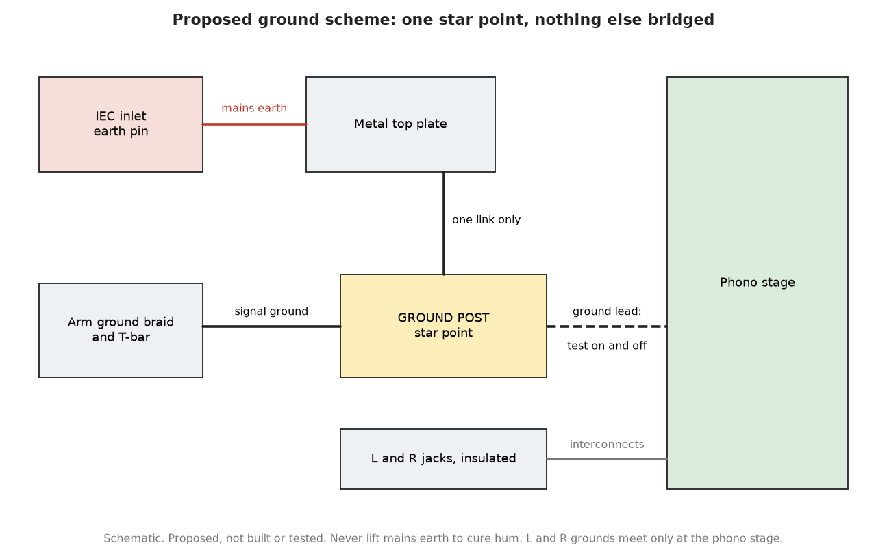

# IEC mains inlet in the plinth

[XA](../README.md) · [Mods](README.md) · [Home](../../../README.md)

## Purpose

Fit a detachable mains cord. This mod works on mains voltage, and the grounding scheme below is a proposal that has not been built or tested.

The idea applies to the XB and AR77XB, but their wiring has not been checked for this mod.

## Stock situation

See [Historical capacitor values](../README.md#historical-capacitor-values) and the [XA service manual, p. 3](../../../docs/originals/xa-service-manual.pdf). The manual's diagrams show a two-pin plug and no fuse. The [XB parts list](../../xb/README.md#factory-component-identifiers) also has no fuse item.

## Parts

| Part | What is established |
| --- | --- |
| Fused IEC C14 inlet: Schurter KD series or equivalent | Maker data: fuse-links of 5 × 20 mm or 6.3 × 32 mm, 10 A, protection class I. Panel thickness depends on the exact part number, and some versions include a switch |
| Fuse | Value to confirm on the part, from the motor's rated current |
| Mains cord with earth | To suit the inlet and your country |
| Earth wire, ring lug, and fixing to the top plate | Size to confirm on the part |

## Procedure

Unplug the table before starting. Have someone qualified check the work if you are not experienced with mains wiring.

1. Read the motor's rated current from its label. Choose the fuse from that.
2. Cut the window for the inlet. John's XA build used a template, a coping saw, and a file, working up to a snug fit because his socket had little lip.
3. Wire the line through the fuse to the stock switch circuit, keeping the capacitors as they were. Wire neutral to its stock point.
4. Bond the inlet's earth pin to the metal top plate.
5. Build the ground scheme below.
6. Cover every exposed mains terminal.

## Gotchas

- **The stock XA has no fuse and a two-wire cord.** A three-pin inlet means mains earth must be bonded to the metal top plate.
- **It can add hum.** Your phono stage may have its own earth, which gives a second earth path through the signal ground and can hum. **Our reading:** check on your table whether the top plate is tied to signal ground, because no source here states it.
- **Keep one star point.** Mains earth goes to the top plate, signal ground goes to the ground post, and one link joins the plate to the post. Nothing else is bridged.
- **Never lift mains earth to cure hum.** If hum remains, change the phono ground lead, not the mains earth.
- **The capacitor across the switch sits on the mains.** See [Motor phase capacitor](motor-capacitor.md).

## Verification

1. With the table unplugged, check continuity from the inlet's earth pin to the top plate.
2. Check that line and neutral are not connected to the top plate.
3. Plug in, then run a hum check with the phono stage connected, with the ground lead on and then off. Keep whichever is quieter.

## Sources

- [XA service manual, p. 3](../../../docs/originals/xa-service-manual.pdf). Factory.
- [Schurter KD series datasheet](https://datasheets.globalspec.com/ds/Schurter/kd/f2b002c3-9424-4f27-9f5d-cd0383e9044e). Seen in a search excerpt; check the exact part's datasheet.
- [John's second XA restoration](https://www.johnsweather.com/Turntable.html). Owner report of a socketed power cord in the base.
- [Gary Galo, "A Belt-Drive Turntable Upgrade", audioXpress](https://audioXpress.com/assets/upload/files/galo2931.pdf). Separate chassis and signal ground posts, on a table with no earth inlet.
- [AudioKarma: AR XA grounding problem](https://audiokarma.org/forums/threads/ar-xa-grounding-problem.787681/). Located; direct access returned 403, so its contents are not relied on here.
