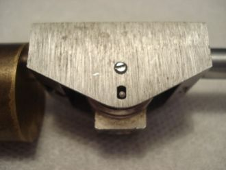
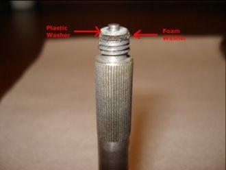
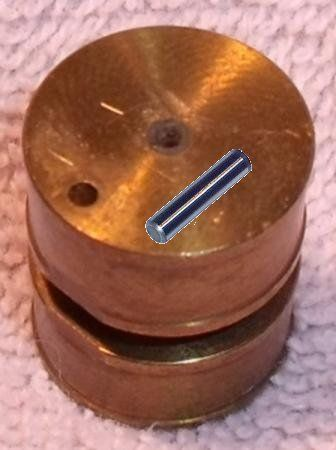

# XA service

[Home](../../README.md) · [XA](README.md) · [Mods](mods/README.md) · [Things to confirm](../../TO-CONFIRM.md) · [Documents](../../docs/README.md)

Routine service for the XA: oiling the two bearings, the motor, the arm damping, the belt and pulley, and cleaning the top plate, the cover and the platter. Each value names its source. The factory papers are the [owner's manual](../../docs/transcripts/xa-owners-manual.md) (form L-1588) and the [XA service manual](../../docs/originals/xa-service-manual.pdf).

## Before you start

- **Do not turn the table upside down.** Brace it on its side to work underneath (Factory, service manual p. 2). Oil can also run out of the spindle wells (Owner report, Galo).
- **Do not lose the small steel ball in the arm spindle well.** It is an important part and sits loose under the spindle (Factory, owner's manual p. 2). Without it, sideways pivot friction rises and the stylus skips or sticks in one groove (Factory, service manual p. 1). One owner measured it at 0.219 in (5.56 mm) (Owner report, [John's Weather 2012](../../docs/archive/johns-weather/xa-restoration-2012.md)); ball size is open, [PL5](../../TO-CONFIRM.md#platter-bearings-and-suspension).
- **A small disc sits in the arm spindle well under the ball.** It must be in place before the spindle goes back in (Factory, service manual p. 1). Teflon on p. 1, nylon on p. 4: Conflict, [PL4](../../TO-CONFIRM.md#platter-bearings-and-suspension).
- **Do not pull the arm wire.** It runs out of the back of the arm and breaks easily (Factory, owner's manual pp. 2 and 4).
- **Do not lose the two pivot set screws.** One owner judged them a #2 cone point and doubted a standard part would fit (Owner report, John's Weather 2012). Thread and length are not recorded.
- **Too much oil does not help.** The gap between spindle and bearing wall is very small; there is no room for more than a very small amount (Factory, owner's manual p. 11).
- **Oil on the belt stops clean starts.** Keep oil off the belt, pulley and inner platter rim. If it gets there, clean it as in [Belt and pulley](#belt-and-pulley).
- **Check the serial before working on the damping.** The arm damping was omitted from serial XA236534 on (Factory, service manual p. 1). A later table has nothing to adjust or disable.

Before any internal repair: unplug the mains cord, then remove the record mat, the outer platter, the cartridge shell and the counterweight. Brace the table on its side and tie the arm to its rest (Factory, service manual p. 2).

## Yearly oiling

Factory, owner's manual p. 11. Oil: the bottle packed with the table, or any #10 machine oil without additives, such as Golden Shell 10W.

1. Lift off the mat and the outer platter. The inner platter, the belt and the motor pulley are now in view.
2. Arm spindle: hold the arm pivot assembly with your fingers and lift it straight up about ½ in (13 mm) on its spindle. The spindle shows where it enters its well.
3. Put a few drops of oil on the spindle, near the well. Right: the oil runs down into the well. Wrong: oil on the top plate means too much; wipe it off.
4. Lower the arm assembly back onto its well.
5. Platter spindle: lift the inner platter straight up about 2 in (51 mm). Do not take it out of the bearing, and keep the belt on the pulley.
6. Put a few drops of oil on the platter spindle.
7. Lower the inner platter straight down. Right: it turns freely by hand with the belt still on the upper pulley step.
8. Check the belt and the inner platter rim for oil. Any shine or wet spot means it must be cleaned (see [Belt and pulley](#belt-and-pulley)).
9. Refit the outer platter and the mat.

## Deep clean of the bearings

For a table that has not been serviced in years, or runs slow or noisy after oiling. The step-by-step bearing clean is on the [platter bearing page](mods/platter-bearing.md); it is not repeated here. What the held sources add:

| Point | Value | Source |
| --- | --- | --- |
| Cleaning both wells | Isopropyl alcohol on cotton swabs, about twenty swabs; painter's tape over the wells to keep debris out while the T-bar was cleaned | Owner report, [John's Weather 2009](../../docs/archive/johns-weather/xa-restoration-2009.md) |
| Platter spindle | Wipe old oil off with a soft, lint-free cloth. Keep the subchassis upright and cover the spindle hole | Owner report, Galo |
| Felt washer on top of the platter spindle well | The original foam washer had disintegrated; replaced with green felt cut to fit | Owner report, John's Weather 2012 |
| Oil quantity after a rebuild | "A few drops" | Factory, owner's manual p. 11 |
| | About 10 drops of sewing machine oil on the platter spindle | Owner report, John's Weather 2012 |
| Oil type | #10 machine oil without additives, such as Golden Shell 10W | Factory, owner's manual p. 11 |
| | Merrill Ultra High-Film Strength Turntable Oil, on a modified table | Owner report, Galo |

The factory and owner quantities and oils differ. They stay side by side.

### Arm spindle

The top of the arm spindle carries a foam rubber spring and a plastic washer, coated with oil. On a table with working damping, do not wipe that oil off; only pick off bits of packing (Factory, owner's manual p. 2). The service manual says to clean and oil the spindle when the pivot assembly is off (Factory, service manual p. 2). One owner cleaned the knurled part of the spindle with a small wire wheel and buffed the bearing surfaces; he measured the brass pivot bearing at 0.618 in (15.70 mm) before and after buffing and found no change (Owner report, John's Weather 2012). Buffing removes metal: measure before and after as he did.

A small grey plastic piece in the spindle thread works as a thread lock, so the spindle holds the position set for the damping (Owner report, John's Weather 2012).

## Motor

No held source says to oil the XA motor, or where. Motor lubrication: Unconfirmed, [EL9](../../TO-CONFIRM.md#motor-electrical-and-overall-size).

What the sources do give:

- A slight vibration felt in the motor pulley with the switch off is normal and harmless (Factory, owner's manual pp. 9 and 11).
- Slow start or chattering at start-up: replace the belt and clean the pulley first. If it persists, the motor may be defective (Factory, service manual p. 2).
- Motor by serial number, and which pulley fits it: [Motor identification](README.md#motor-identification).
- Shaft wobble check: one owner stood a machinist's square against the motor shaft and moved the shaft away from it by hand. A visible gap at the bottom of the shaft showed play in the motor bearing, and he replaced the motor with a Hurst 3001-001 on an adapter plate (Owner report, John's Weather 2009). The flange is larger and the shaft about 0.250 in (6.4 mm) longer than the original, so the original mounting holes do not fit directly.

Motor replacement, factory steps (service manual p. 2), in short: pull the pulley straight up off the shaft, or pry it gently with two large spoons; remove the wire crimp holders and disconnect the motor wires; remove the two mounting screws and lift the motor out; fit the new motor; reconnect as the wiring diagram on p. 3 shows; press the pulley straight back on. If the pulley is loose on the shaft, crimp the bottom of its mounting bracket gently. Then test speed and running noise.

## Arm damping

Up to serial XA236534 the arm falls slowly when dropped. The damping lets go about 1 in (25 mm) above the record, so it does not act during play (Factory, owner's manual p. 7). AR later recommended disabling it on every XA, because many newer cartridges track below the force the damping was made for, and a defective damping mechanism was the most common cause of skating complaints (Factory, service manual p. 1).

How it works is described two ways:

| Description | Source |
| --- | --- |
| A stopper pin on a porous bronze shaft soaked in silicone fluid turns in a Delrin sleeve; the silicone gives the drag. Drag is set by turning the arm spindle | Factory, [Villchur 1962, p. 23](../../docs/design-notes.md#setup-facts-from-part-1), the 1962 design |
| A foam washer and a plastic washer on top of the arm spindle rub against the brass pivot bearing as the arm falls. A flat spot on the bearing lines up with the washers during play, so they no longer touch. A pin pressed into the bearing pokes through a slot in the arm housing and keeps the bearing aligned | Owner report, John's Weather 2009 and 2012, on production tables |

Whether production tables used the 1962 mechanism: Unconfirmed, [CU4](../../TO-CONFIRM.md#cueing-lift-and-arm-damping).

*The pin in its slot, below the pivot set screw. Photo: John's Weather, [XA restoration 2012](../../docs/archive/johns-weather/xa-restoration-2012.md).*

### Adjust the damping

Factory, owner's manual pp. 5 and 7. Do this after the stylus force is set.

1. Lift the arm off its rest and let go of it about 3 in (76 mm) above the record. Right: the arm stays up, or sinks only slowly. Wrong: it falls straight down; the spindle is already too loose.
2. Unscrew the arm spindle a small amount, by hand, holding its knurled part.
3. Lift the arm to about 3 in (76 mm) and let go again. Time the fall.
4. Repeat steps 2 and 3 until the arm takes two or three seconds to come down.
5. Stop there. Unscrewing further spoils the damping release.
6. Before playing, lower the shell just below the level of the mat, then set it on the record. This makes sure the damping has let go.
7. Check the stylus force again with the arm forced down to about parallel with the record, so the damping cannot affect the reading (p. 5).

Wrong signs: the force gauge sticks at both ends of its travel (the pivot screws are too tight, not the damping; see [Pivot set screws](#pivot-set-screws)); or the arm drifts up or down during play (the damping is not releasing).

### Disable the damping

**Gotcha: the pin you remove is the one the owner's manual uses to judge the pivot set screws.** Its movement in the slot is the check on p. 12. After it is out, set the screws by feel, as in step 10 below (our assessment, from owner's manual p. 12 and service manual p. 2).

**Gotcha: the pivot set screws may be sealed with Loc-Tite.** AR says MEK (methyl ethyl ketone) may be needed to break them loose (Factory, service manual p. 1).

Factory steps from the service manual p. 2, "Vertical Pivot Assembly", with detail from John's Weather 2012 (Owner report). Tools: a small flat screwdriver, small pliers, the oil.

1. Unplug the table. Remove the mat, the outer platter, the shell and the counterweight.
2. Lift the arm off its rest and hold it.
3. Back out the two vertical pivot screws from the coupling block, one on each side of the pivot housing. Put them in a dish. If they will not turn, see the Loc-Tite gotcha above.
4. Lift the arm assembly off the pivot assembly. The steel pin may catch slightly but does not stop it coming off (service manual p. 2). John's Weather describes the collar holding the brass pivot bearing sliding out of the housing.
5. Do not touch the pointed bearing faces on each side of the brass bearing. Right: smooth cone seats with no grooves. Wrong: a groove or a flattened point; record it before going on.
6. Screw the arm spindle fully into the pivot, tight (service manual p. 2). With the damping gone it can be snug (John's Weather 2012).
7. Grip the small steel pin in the side of the brass bearing with the pliers and pull it straight out (service manual p. 2; John's Weather used pliers).
8. Optional, Owner report only: remove the foam washer and the plastic washer from the top of the spindle. They may already have crumbled.
9. Clean the spindle, then put a drop of oil on it (service manual p. 2). John's Weather also oiled the brass bearing with a cotton swab.
10. Refit the arm. Seat each pivot screw point in its plastic bearing insert before tightening either one. Tighten just enough to leave a small amount of play in the pivot (service manual p. 2). Right: no visible wobble when you twist the curved arm section slightly, and the arm moves up and down freely. Wrong: the arm is sluggish or the force gauge sticks (too tight), or the arm assembly wobbles (too loose) (owner's manual p. 12).
11. Centre the pivot assembly in the housing by adjusting the two screws (John's Weather 2009). Right: the brass part shows evenly on both sides, as in Figure 3 of the owner's manual p. 2. Wrong: more brass shows on one side, as in its Figure 3a.
12. Refit the counterweight and shell, balance the arm and reset the stylus force.

Right result: the arm falls at once when let go, with no delay. That is expected now; lower it by hand.

*The plastic washer and the foam washer on top of the arm spindle. Photo: John's Weather, [XA restoration 2012](../../docs/archive/johns-weather/xa-restoration-2012.md).*

*The brass pivot bearing, its pin pulled out and laid on top. Photo by "MuZak" of Vinyl Engine, shown on John's Weather, [XA restoration 2009](../../docs/archive/johns-weather/xa-restoration-2009.md).*

## Pivot set screws

Factory, owner's manual p. 12. Do not touch them unless there are symptoms:

- Too tight: the arm is a little sluggish over its small range of vertical free play, and the force gauge acts as though it is sticking. The size of that free play is illegible on the scan.
- Too loose: a slight twist of the curved arm section makes the aluminium arm assembly wobble.
- On a table with the damping pin in place, loosen only until the pin visibly moves up and down in its slot. Adjust only the outside screw; it is easier to watch.

A deformed screw tip, or a screw tightened too far, makes the arm stick as if the damping were binding; loosen or replace the screws (Factory, service manual p. 1). A large difference between how far each screw is driven in can push the arm sideways by several tenths of a gram (same page).

## Belt and pulley

The cleaning steps are on the [belt and pulley page](mods/belt-and-pulley.md). The sources differ on the solvent and on the talc:

| Point | Factory, owner's manual p. 10 | Other sources |
| --- | --- | --- |
| Belt solvent | Tissue soaked in methyl alcohol (wood alcohol). Not rubbing alcohol | 99.5% isopropyl alcohol on the pulley and inner platter rim (Owner report, Vinyl Nirvana, on the belt page) |
| Pulley and inner platter rim | Wipe clean with the same alcohol | Scrub with a green pad and alcohol (same) |
| Powder | Ordinary talcum powder. Without it the table will not start properly | Pure talc, not talcum powder (Owner report, Galo) |
| How often | Clean and powder once a year | |

## Cleaning without damage

### Dust cover

Clean it with a wax such as Johnson's Pledge (Factory, owner's manual p. 12). The XB1 manual gives a fuller method for its own cover: see the [XB service page](../xb/service.md#dust-cover), for comparison. Abrasive pads and solvents on the cover: Unconfirmed.

### Top plate paint

No held source gives a safe cleaner for the painted top plate. Unconfirmed, [CL1](../../TO-CONFIRM.md#other-parts).

**Gotcha: the top plate finish comes off fast under paint stripper.** One owner found it lifted within ten minutes; he then sanded, cleaned with acetone and repainted the plate with Rust-Oleum paint and primer in one (Owner report, John's Weather 2012). That is a refinish, not a clean. Try any cleaner on a hidden spot first (our assessment).

### Platter and mat

- The original foam mat absorbs dirt from the air when the cover is off, and can break down and soil the records. Wash it in a dilute solution of mild soap and water, or replace it (Factory, service manual p. 2).
- An old mat stored in a damp place turns into a sticky residue on the platter. One owner scraped it off, then used 240 grit sandpaper, and finished both platters with a Scotch-Brite pad on a lathe (Owner report, John's Weather 2012). **This removes metal and changes the finish.** A cleaner that removes the residue without abrasion: Unconfirmed, [CL1](../../TO-CONFIRM.md#other-parts).
- The T-bar: small Scotch-Brite green pads and a wire brush in the corners removed dirt and light oxidation; the brass counterweight was cleaned the same way (Owner report, John's Weather 2009).

## Sources

Each link opens the copy kept in this repository.

- [XA owner's manual, transcript](../../docs/transcripts/xa-owners-manual.md), pp. 2, 5, 7, 9 to 12. Factory.
- [XA service manual](../../docs/originals/xa-service-manual.pdf), pp. 1 to 3. Factory.
- [Design notes on Villchur 1962, Part 1](../../docs/design-notes.md#setup-facts-from-part-1), p. 23. Factory.
- [John's Weather, XA restoration 2009](../../docs/archive/johns-weather/xa-restoration-2009.md). Owner report, with photographs.
- [John's Weather, XA restoration 2012](../../docs/archive/johns-weather/xa-restoration-2012.md). Owner report, with photographs.
- [Gary Galo, "A Belt-Drive Turntable Upgrade", audioXpress](../../docs/archive/audioxpress/galo-belt-drive-turntable-upgrade.pdf). Owner report.
- [Belt and pulley](mods/belt-and-pulley.md) and [platter bearing](mods/platter-bearing.md) pages, with their own sources.
