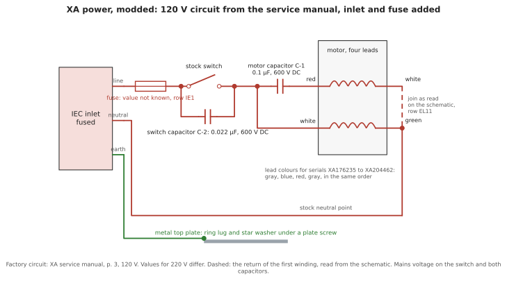
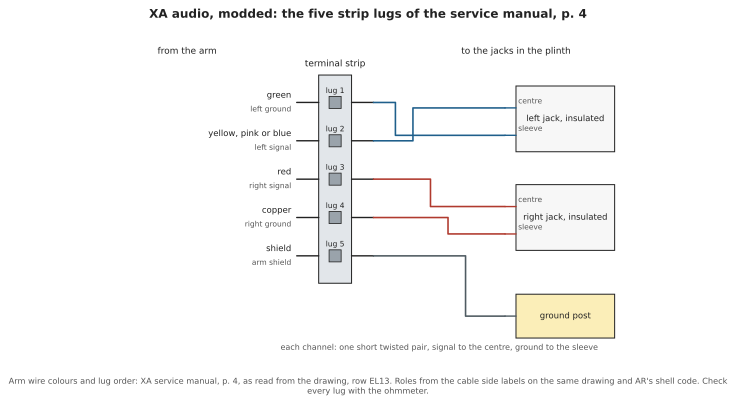
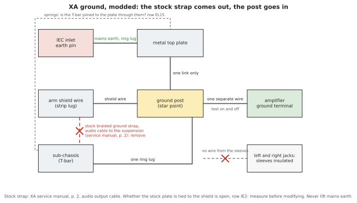
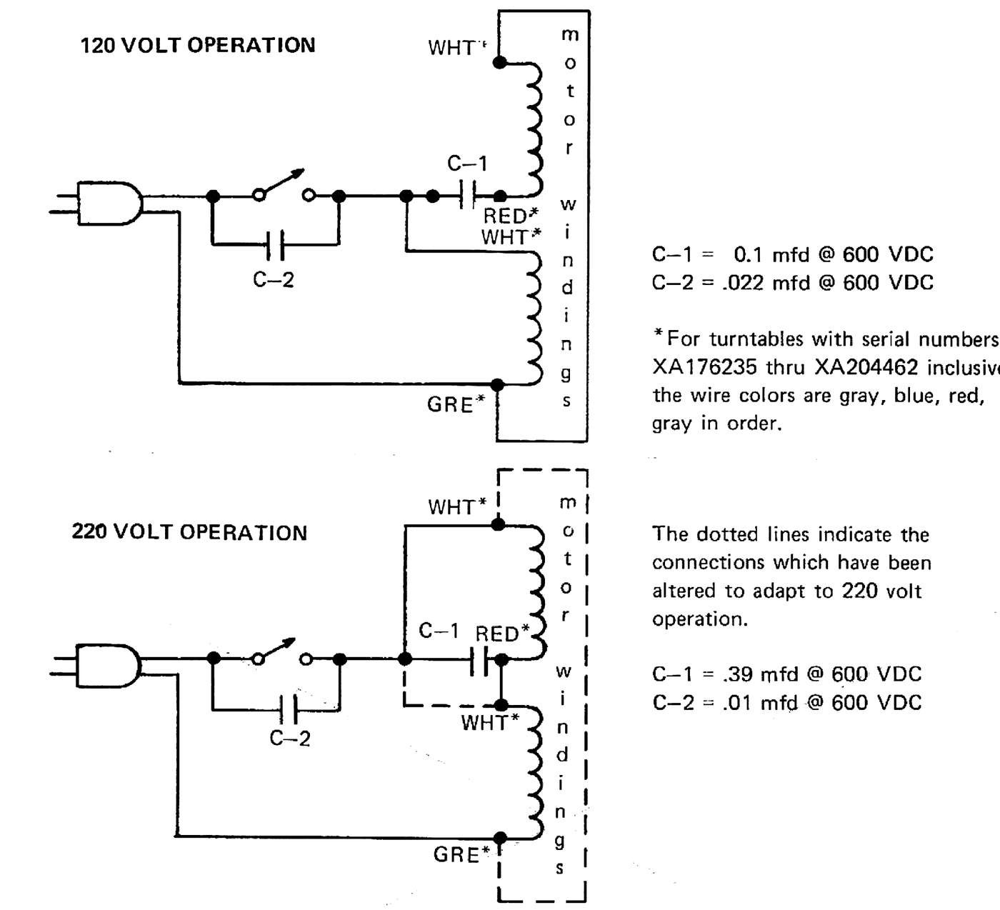
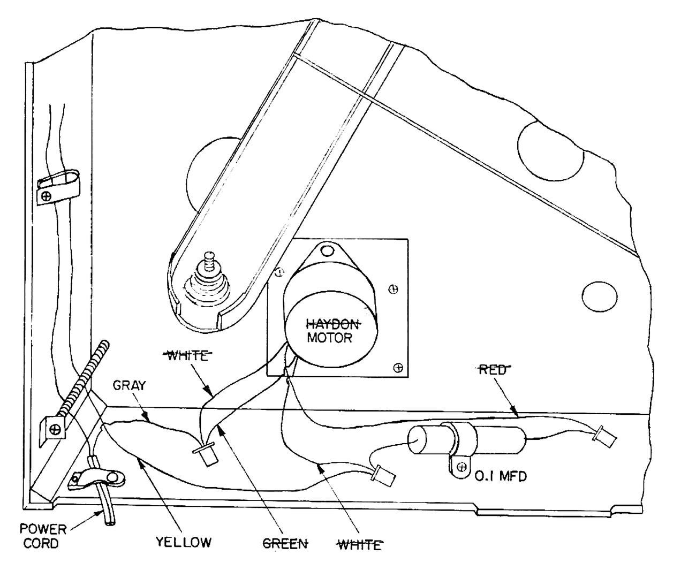
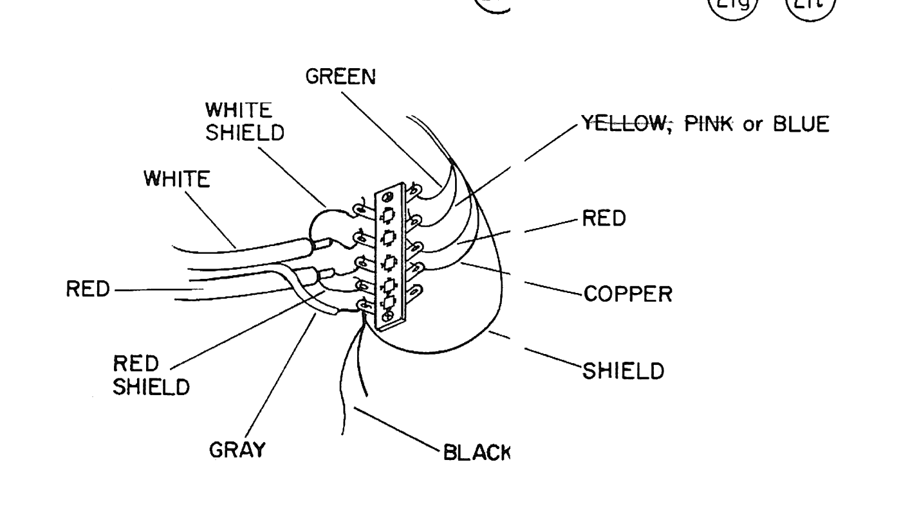

# XA wiring

[XA](README.md) · [Mods](mods/README.md) · [Wiring overview](../../docs/wiring/README.md) · [Things to confirm](../../TO-CONFIRM.md#motor-electrical-and-overall-size) · [Home](../../README.md)

The XA wired as people rebuild it: RCA jacks in the plinth, a fused IEC inlet, and a separate ground post. Every colour and value on a diagram has a row in the table under it. The stock wiring is at the end, under [What you will find when you open it](#what-you-will-find-when-you-open-it).

## Gotchas

- **Mains voltage is present on both capacitors and on the switch under the plate.** Unplug before opening. Have the work checked if you are not experienced with mains wiring.
- **The fuse value is not known.** It comes from the motor label: row [IE1](../../TO-CONFIRM.md#xa-mods).
- **The wire colours inside the arm are not the shell wire colours.** Green, yellow or pink or blue, red and copper inside; white, green, red and black at the shell. Check every wire with an ohmmeter from the shell pin to the strip lug before soldering.
- **Metal jacks on a metal panel short the two channel grounds together and to the plate.** Use insulated jacks or nylon shoulder washers.
- **When the ground post goes in, the old strap from the metalwork to the audio shield comes out.** On the XA that is the braided ground strap of the audio cable, which AR tied to the suspension. Leaving both makes a loop and hum.
- **Never lift mains earth to cure hum.**
- **The motor lead colours differ by serial.** XA176235 to XA204462 have gray, blue, red, gray in place of white, red, white, green.

## Power

| Part | Value | Label | Source |
| --- | --- | --- | --- |
| IEC inlet, fused | Schurter KD series or equivalent; see the [IEC inlet page](mods/iec-inlet.md#parts) | Mod | [IEC inlet](mods/iec-inlet.md) |
| Fuse | Not known. From the motor's rated current | Unconfirmed | Row [IE1](../../TO-CONFIRM.md#xa-mods) |
| Switch | The stock switch, part 923, in the line wire | Factory | [Service manual, p. 3 and p. 4 parts list](../../docs/originals/xa-service-manual.pdf) |
| Switch capacitor C-2 | 0.022 µF, 600 V DC at 120 V. 0.01 µF at 220 V. Across the switch | Factory | Service manual, p. 3; row [EL3](../../TO-CONFIRM.md#motor-electrical-and-overall-size) |
| Motor capacitor C-1 | 0.1 µF, 600 V DC at 120 V. 0.39 µF at 220 V. From the junction after the switch to the red lead | Factory | Service manual, p. 3; row EL3 |
| Capacitor part | Part 1130 on the parts list, one entry for both | Factory | Service manual, p. 4 |
| Motor leads, in the order drawn | White (top of the first winding), red (bottom of it, to C-1), white (top of the second winding, to the switched line), green (bottom of it, to neutral) | Factory | Service manual, p. 3 |
| Motor leads, XA176235 to XA204462 | Gray, blue, red, gray in the same order | Factory | Service manual, p. 3, footnote |
| Return of the first winding | Its top white lead joins the neutral node, as read from the schematic's frame | Unconfirmed | Row [EL11](../../TO-CONFIRM.md#motor-electrical-and-overall-size); [the schematic in words](../../docs/transcripts/xa-service-manual-wiring.md) |
| Motor | Haydon with a ⅛ in shaft, or Philips with a ¹⁄₁₆ in shaft, by serial | Factory | [Motor identification](README.md#motor-identification) |
| Neutral | Inlet neutral pin to the stock neutral point: the cord wire that went to the green lead | Factory, for the stock point | Service manual, p. 3 |
| Earth | Inlet earth pin to a ring lug with a star washer under a top plate screw | Mod | [IEC inlet](mods/iec-inlet.md), [plinth rebuild](mods/plinth-rebuild.md#wiring-plan) |

The 220 V circuit moves the top white lead to the junction after the switch and the lower white lead to the red lead's node, so the windings run in series with C-1 across the first: service manual, p. 3, and [the schematic in words](../../docs/transcripts/xa-service-manual-wiring.md). Replacing a capacitor: [motor phase capacitor](mods/motor-capacitor.md).

## Audio

| Strip lug, top to bottom | Arm wire colour | Goes to | Stock cable side on the same lug | Label | Source |
| --- | --- | --- | --- | --- | --- |
| 1 | Green | Left jack sleeve (left ground) | White shield | Factory, as read | Service manual, p. 4; row [EL13](../../TO-CONFIRM.md#motor-electrical-and-overall-size) |
| 2 | Yellow, pink or blue | Left jack centre (left signal) | White | Factory, as read | Same |
| 3 | Red | Right jack centre (right signal) | Red | Factory, as read | Same |
| 4 | Copper | Right jack sleeve (right ground) | Red shield | Factory, as read | Same |
| 5 | Shield, the braid round the arm wires | Ground post | Gray, and black | Factory, as read | Same |

The drawing is an isometric sketch with crowded leaders, so the pairing is a reading: [the strip in words](../../docs/transcripts/xa-service-manual-wiring.md#the-terminal-strip-page-4). The roles follow from the cable side: the white lead is the left channel, whose plug is the gray one (Factory, XB1 manual, p. 7, for the same two-plug cable), and the red lead is the right channel. The ohmmeter check below settles every lug. Note the strip has five lugs, not six; the two round-head screws at the ends hold the strip.

Each channel's pair is one short twisted pair, signal to the centre and ground to the sleeve. Keep the leads short. The jacks are insulated from the panel and from each other: [RCA jacks](mods/rca-jacks.md).

Shell wires: left is white with green as its ground; right is red with black as its ground (Factory, [owner's manual, p. 3](../../docs/transcripts/xa-owners-manual.md), [sheet L-1591](../../docs/transcripts/ar-cartridge-mount-l-1591.md)). An arm rewired to the modern code has green as right ground and blue as left ground: row [RW1](../../TO-CONFIRM.md#xa-mods). Rewiring: [tonearm rewire](mods/tonearm-rewire.md).

## Ground

| Connection | How | Label | Source |
| --- | --- | --- | --- |
| Arm shield wire to the post | From lug 5 | Mod | This page |
| Sub-chassis (T-bar) to the post | One wire with a ring lug under a T-bar screw | Owner report | [John's 2012 restoration](../../docs/archive/johns-weather/xa-restoration-2012.md), "added the ground from the T bar" |
| Top plate to the post | One link | Mod | [IEC inlet](mods/iec-inlet.md#gotchas) |
| Post to the amplifier ground terminal | One separate wire; test on and off | Mod | [IEC inlet](mods/iec-inlet.md#verification) |
| Inlet earth pin to the top plate | Ring lug and star washer | Mod | [Plinth rebuild](mods/plinth-rebuild.md#wiring-plan) |
| Jack sleeves | Insulated from the plate and from the post. No wire | Mod | [RCA jacks](mods/rca-jacks.md#gotchas) |
| Stock braided ground strap, audio cable to the turntable suspension | Removed when the post goes in | Factory, for the stock strap | Service manual, p. 2, "Audio Output Cable" |
| Ground post | 6-32 × ⅝ in machine screw, #6 lug, lock washer, hex nut, knurled thumbnut, nylon shoulder washer | Owner report | [RCA jacks](mods/rca-jacks.md#parts), Galo |

Whether the stock top plate is tied to the audio shield is open: row [IE2](../../TO-CONFIRM.md#xa-mods). Whether the T-bar is joined to the plate through the springs is open: row [EL15](../../TO-CONFIRM.md#motor-electrical-and-overall-size). Measure both before modifying.

## Ohmmeter checks

Table unplugged for every check.

Before soldering:

1. Left shell pins to the strip lugs: find white and green. Expected from the drawing: green on lug 1, white on lug 2.
2. Right shell pins to the strip lugs: find red and black. Expected: red on lug 3, black on lug 4.
3. Arm tube to the shield lug. Expected: lug 5.
4. Top plate to each strip lug: row IE2. Write down what you find.
5. T-bar to the top plate: row EL15.

After:

1. Each jack centre to its shell pin.
2. Each jack sleeve to its shell pin.
3. No continuity between the two sleeves.
4. No continuity from either sleeve to the plate.
5. Inlet earth pin to the top plate.
6. Arm tube to the ground post.
7. Line and neutral pins not connected to the plate.

## What you will find when you open it

Factory, [service manual, pp. 2 to 4](../../docs/originals/xa-service-manual.pdf). Open the table as the manual says: unplug, take off the mat, outer platter, shell and counterweight, brace the unit on its side, and slide off the bottom cover. Do not turn it upside down.

- A two-pin cord and no fuse. The cord enters at the rear through a clamp.
- A yellow wire from the cord to the switch and a gray wire from the switch onward, on the underside drawing.
- C-2 across the switch, C-1 in the lead to the motor's red wire, held by a strap on the rear wall.
- The motor with four leads in two pairs, joined to the table wiring with crimp holders.
- The audio cable with two shielded leads, white and red, each with a shield pigtail, plus gray and black wires, soldered to a five-lug terminal strip on the base.
- A braided ground strap from the audio cable to the suspension.

The three pictures are crops of the manual's pages; [the wiring in words](../../docs/transcripts/xa-service-manual-wiring.md) spells them out.

## Still to confirm

| Row | What |
| --- | --- |
| [IE1](../../TO-CONFIRM.md#xa-mods) | Motor rated current and fuse value |
| [IE2](../../TO-CONFIRM.md#xa-mods) | Whether the stock top plate is tied to signal ground |
| [RW1](../../TO-CONFIRM.md#xa-mods) | Your arm's colour-to-pin map |
| [RJ2](../../TO-CONFIRM.md#xa-mods) | Chosen jack and its insulation |
| [EL3](../../TO-CONFIRM.md#motor-electrical-and-overall-size) | The 120 V capacitor markings on an unmodified table |
| [EL11](../../TO-CONFIRM.md#motor-electrical-and-overall-size) | Return of the first winding |
| [EL13](../../TO-CONFIRM.md#motor-electrical-and-overall-size) | The strip pairing and lug count |
| [EL15](../../TO-CONFIRM.md#motor-electrical-and-overall-size) | T-bar to top plate through the springs |

Photo wanted: `xa-terminal-strip.jpg`, see [photo requests](../../docs/photo-requests.md).

## Sources

Each link opens the copy kept in this repository.

- [XA service manual, pp. 2 to 4](../../docs/originals/xa-service-manual.pdf). Factory. [The wiring in words](../../docs/transcripts/xa-service-manual-wiring.md).
- [XA owner's manual, p. 3](../../docs/transcripts/xa-owners-manual.md) and [sheet L-1591](../../docs/transcripts/ar-cartridge-mount-l-1591.md). Factory.
- [XB1 manual, p. 7](../../docs/transcripts/xb1-owners-manual.md), for the gray and red plugs. Factory.
- [Gary Galo, "A Belt-Drive Turntable Upgrade", audioXpress](../../docs/archive/audioxpress/galo-belt-drive-turntable-upgrade.pdf). Owner report.
- [John's second XA restoration](../../docs/archive/johns-weather/xa-restoration-2012.md). Owner report.
- [RCA jacks](mods/rca-jacks.md), [IEC inlet](mods/iec-inlet.md), [plinth rebuild](mods/plinth-rebuild.md), [tonearm rewire](mods/tonearm-rewire.md), [motor phase capacitor](mods/motor-capacitor.md). Mod pages.
