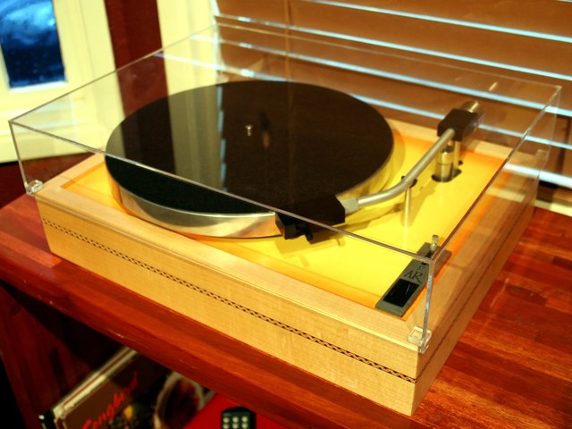

# AR XB

[Home](../../README.md) · [All models](../README.md) · [Parts and makers](../../parts/README.md) · [Factory drawing index](../../docs/README.md#xb-factory-drawings)

The XA with a cueing lever added. This table has a new plinth, cover, and top-plate colour; the arm is original (photo supplied by the repository owner).

## At a glance

| Item | Value |
| --- | --- |
| Made | From about 1972 (Specialist, [Vinyl Nirvana](../../docs/archive/vinyl-nirvana/ar-models/ar-xb.md)). The factory assembly drawing was drawn in July 1973 and still revised in March 1977 (Factory, [drawing 112](../../docs/drawings/xb-drawing-112.png), [drawing 119](../../docs/drawings/xb-drawing-119.png)). Start year open: [MD1](../../TO-CONFIRM.md#models-and-dates) |
| Maker's name | Acoustic Research, Inc. on the 1973 drawing; Teledyne Acoustic Research by November 1976 (Factory, same drawings) |
| Layout | Belt drive. Two-part aluminium platter. Platter and arm on a T-bar subchassis hung on three springs. S-shaped arm with a viscous-damped cueing lift |
| Speeds | 33⅓ and 45 rpm (Period listing, [retail catalogue](../../docs/archive/hifi-wiki/acoustic-research-model-xb.md)) |
| Motor | "Hysteresis/synchronous" (Period listing, same catalogue). AR part 802006; maker not stated (Factory, drawing 119) |
| Size with cover | 12¾ × 16¾ × 5¾ in (Period listing, same catalogue) |
| Shipping weight | 19 lb (Period listing, same catalogue) |
| Price when new | $99.95 in the catalogue; $130 list about 1972 (Specialist, Vinyl Nirvana) |

## How to recognise one

Specialist description, [Vinyl Nirvana](../../docs/archive/vinyl-nirvana/ar-models/ar-xb.md), unless noted.

| Look at | XB |
| --- | --- |
| Controls | A cueing lever and a rocker power switch at the front right, both set in a brushed-metal AR panel. An XA has no lever; an AR77XB has the lever and switch with no panel |
| Top plate | Always black |
| Headshell | Black plastic with brass thread inserts |
| Arm rest | Metal |
| Counterweight | Brass or stainless steel |
| Base | Plywood veneer in the description's text, walnut-look vinyl in its list. "Walnut grained" in the catalogue |
| Arm damping | None. The cueing lift replaces the XA's damped arm |

## Variants

| Name | What it is | Source |
| --- | --- | --- |
| **XB-91** | "Same as XB but with Shure M91ED cartridge mounted and tested", $119.95 against $99.95 | Period listing, [retail catalogue](../../docs/archive/hifi-wiki/acoustic-research-model-xb.md) |
| **TT-XB** and **TT-XBU** | The two builds on the factory assembly drawing. TT-XBU, added on 5 June 1974, has its own top plate (400039-2) and a P.C. board assembly (800018) in place of the two capacitors, and no UL or CSA label. Its market is open: [MD2](../../TO-CONFIRM.md#models-and-dates) | Factory, [drawing 112](../../docs/drawings/xb-drawing-112.png) |
| **XB1** | The British table: 220–240 V, blue and brown mains lead, 3 A fuse. 12¾ × 16¾ × 5½ in, 13 lb 9 oz, wow and flutter 0.03%, platter 11¾ in and 4 lb, cable capacitance 100 pF | Factory, [XB1 manual, pp. 2, 6, 16](../../docs/originals/xb1-owners.pdf) |
| **AR77XB** | The 1977 version | [AR77XB page](../ar77xb/README.md) |

The factory drawings below cover several XB configurations, so check the revision against your table. Some [XA mods](../xa/mods/README.md) also apply to the XB.

## Mechanical

### Factory hardware

Factory, [drawing 119](../../docs/drawings/xb-drawing-119.png), AR drawing 100012, revision T, bill of materials and callouts. For each screw's job, see [What it is and where it goes](../../docs/what-goes-where.md).

| Item | AR part number | Description | Quantity | Where it goes |
| --- | --- | --- | --- | --- |
| 18 | 501009 | #4-48 × ⅛ in screw | 2 | Motor mounting ears |
| 28 | 502001 | #8-32 hex nut | 2 | Cueing lever assembly, under the top plate, with lockwashers, item 58 |
| 32 | 502006 | #10-24 nut | 3 | Suspension stud adjustment |
| 37 | 501012 | #8 × ⅜ in screws | 12 | Brackets, cable clamps, capacitor straps. Pitch and head not stated |
| 60 | 502007 | #5-40 hex nut | 1 | Tonearm rest, item 22 |
| 61 | 504014 | #5 star lockwasher | 1 | Tonearm rest, item 22 |
| 62 | 501014 | #4-40 screw | 1 | Cueing lever assembly. Length not stated |

Revision S ([drawing 113](../../docs/drawings/xb-drawing-113.png)) lists four #6 × 0.375 in wood screws, four #4-40 × 0.375 in screws, and four #4-40 dome nuts for the hinged cover. ECO 1315 ([sheet 1](../../docs/drawings/xb-drawing-115.png)) removes the hinges and that hardware.

### Cover dimensions and clearance

Factory, [drawing 114](../../docs/drawings/xb-drawing-114.png), revision S, sheet 2, lower-left detail of the older hinge arrangement. Both units are as printed.

| Detail | Drawing value |
| --- | --- |
| Horizontal spacing between paired holes | 0.98 in; 25 mm |
| Spacing between cover and base hole rows | 1.26 in; 32 mm |
| Base hole row to top edge of base | 1.00 in; 25.5 mm |
| Cover hole row to lower edge of cover | 0.57 in; 14.5 mm |
| End of cover to first cover hole | 2.20 in; 60.6 mm, which does not match (2.20 in is about 55.9 mm) |
| End of base to first base hole | 2.28 in; 58 mm |
| Four holes in dust cover | 0.15 in diameter; 4 mm |
| Four holes in base | 0.11 in diameter × 0.37 in deep; 2.8 × 9.5 mm |
| Clearance shown on assembled hinge | 0.05 in; 1.5 mm |

Overall base and cover size: Unconfirmed.

The hinge was added by ECO 1135 on September 14, 1976, and deleted by ECO 1315 on January 28, 1977 (Factory, drawing 119 revision block). These are paperwork dates, not production cutoffs.

### Bearings and suspension

Factory, drawing 119 BOM: bearing ball 500013; bearing spacer 400061; T-bar assembly 404007; drive belt 400134; 60 Hz pulley 400126; Shell oil 10W, part 600013, item 35. Assembly note 11 cites the oil as item 36. Ball diameter and a current oil equivalent: Unconfirmed.

Replacement springs: see the [suspension kit](../xa/mods/suspension-kit.md).

### Factory setup values

Factory, drawing 119, revision T, assembly notes and performance test requirements.

| Setting | Value | Note |
| --- | --- | --- |
| Stylus overhang past the spindle | 0.688 in ± 0.030; gauge P/N 402001 | 10 |
| Cartridge-shell mounting bosses | Parallel to the turntable surface within ±1° | 10 |
| Outer platter above top plate | ⅜ in ± ¹⁄₃₂ | 13 |
| Arm spindle and cueing cylinder to top-plate hole | 0.050 in minimum clearance | 13 |
| Cueing lift, with mat and one record | Raises the stylus ¼ to ⁷⁄₁₆ in above the record; lowered, allows at least ¼ in of drop below the record surface | 7 |
| Cueing descent | 1 to 3 seconds from maximum height to the record | 8 |
| Vertical pivots | Tighten until friction is barely perceptible, then back one screw out ⅛ to ¼ turn | 9 |
| Bearing oil | 3 drops on the arm and platter spindle bearings at final assembly, after cleaning | 11 |
| Speed | ±7 dots in 20 seconds, or ±21 dots per minute, at 1.5 g stylus force | Performance test A |

## Electrical

### Factory component identifiers

Factory, [drawing 119](../../docs/drawings/xb-drawing-119.png). The BOM gives part numbers only. Capacitance, voltage, and suppression class: Unconfirmed.

| Component | AR part number | Item |
| --- | --- | --- |
| Motor | 802006 | 40 |
| Motor capacitor | 803002 | 44 |
| Switch capacitor | 803004 | 46 |
| Power cord | 802001 | 43 |
| Audio output cable assembly | 404012-2 | 30 |
| Internal cable assembly | 404017 | 64 |

### Wiring and mounting changes

Factory, ECO 1315. Sheets 2–4 are dated October 21, 1976, and sheet 1 January 28, 1977. All four carry a March 30, 1977 stamp.

- Cable assembly 404017 moves to the inside rear of the base, with a **2.36 in maximum allowable length** for amplifier cable and arm wires inside the cabinet. The motor capacitor stays at least **⅛ in** from the top plate. [Sheet 2](../../docs/drawings/xb-drawing-116.png)
- Straps and insulating tubing replace the tape and staples on the capacitors: a **⅝ in strap for the switch capacitor** and a **⁷⁄₁₆ in strap for the motor capacitor**, adding two #8 × ⅜ in screws. [Sheet 3](../../docs/drawings/xb-drawing-117.png)
- The XB1 bezel, top-plate, and switch rework parts are removed, as no longer required for the cited British standard. [Sheet 4](../../docs/drawings/xb-drawing-118.png)

For the audio terminal layout, use the wiring detail on drawing 119 and match the arm-side and cable-side labels, not only the wire colors.

## Still to establish

Capacitor ratings; tonearm and mains-wire specifications; overall dimensions; spring rate; bearing dimensions; the serial ranges affected by each change.
