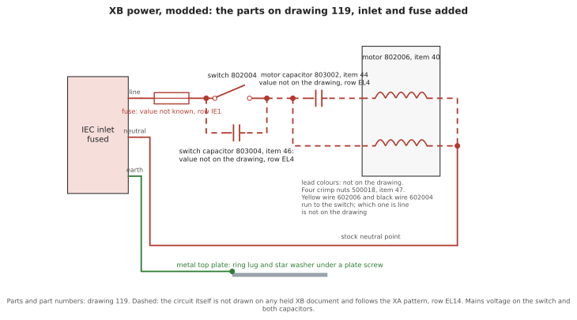
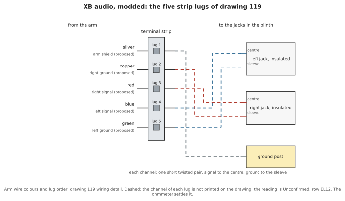
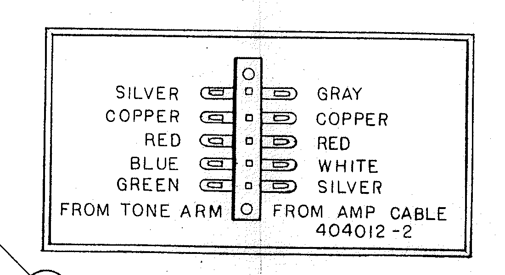
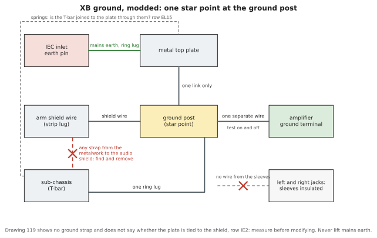
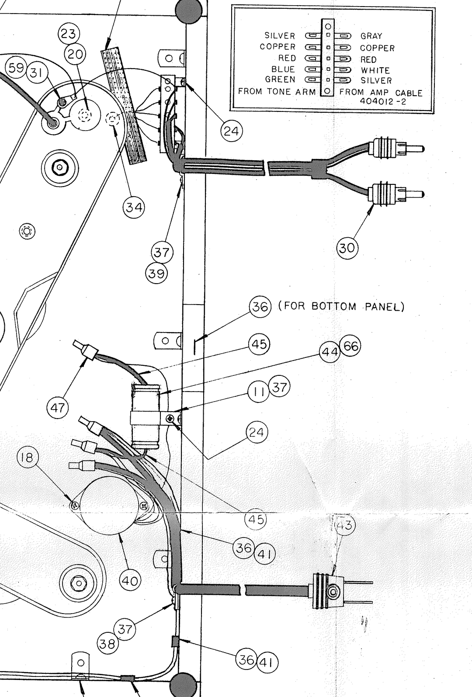

# XB wiring

[XB](README.md) · [Wiring overview](../../docs/wiring/README.md) · [XA mods](../xa/mods/README.md) · [Things to confirm](../../TO-CONFIRM.md#motor-electrical-and-overall-size) · [Home](../../README.md)

The XB wired as people rebuild it: RCA jacks in the plinth, a fused IEC inlet, and a separate ground post. Every colour and value on a diagram has a row in the table under it. The only factory source is [drawing 119](../../docs/drawings/xb-drawing-119.png), which names the parts and shows where they sit but has no circuit. Dashed lines on the diagrams are connections the drawing does not show. The stock wiring is at the end, under [What you will find when you open it](#what-you-will-find-when-you-open-it).

## Gotchas

- **Mains voltage is present on both capacitors and on the switch under the plate.** Unplug before opening. Have the work checked if you are not experienced with mains wiring.
- **The fuse value is not known.** It comes from the motor label: row [IE1](../../TO-CONFIRM.md#xa-mods).
- **The wire colours inside the arm are not the shell wire colours.** Silver, copper, red, blue and green inside; white, green, red and black at the shell. Check every wire with an ohmmeter from the shell pin to the strip lug before soldering.
- **Which lug is which channel is not printed on the drawing.** The assignment below is a proposal: row [EL12](../../TO-CONFIRM.md#motor-electrical-and-overall-size).
- **Metal jacks on a metal panel short the two channel grounds together and to the plate.** Use insulated jacks or nylon shoulder washers.
- **When the ground post goes in, the old strap from the metalwork to the audio shield comes out.** Leaving both makes a loop and hum.
- **Never lift mains earth to cure hum.**
- **Keep the leads inside the cabinet short.** AR allowed at most 2.36 in of amplifier cable and arm wire inside the cabinet.

## Power

| Part | Value | Label | Source |
| --- | --- | --- | --- |
| IEC inlet, fused | Schurter KD series or equivalent; see the [IEC inlet page](../xa/mods/iec-inlet.md#parts) | Mod | [IEC inlet](../xa/mods/iec-inlet.md) |
| Fuse | Not known. From the motor's rated current | Unconfirmed | Row [IE1](../../TO-CONFIRM.md#xa-mods) |
| Switch | 802004, item 1, in the AR panel at the front right, with two quick-connect terminals 503016, item 63 | Factory | [Drawing 119](../../docs/drawings/xb-drawing-119.png), bill of materials and callouts |
| Wires to the switch | Yellow wire 602006, item 49, and black wire 602004, item 48, 33½ in each on the bill of materials. Which one is line is not on the drawing | Factory | Drawing 119 |
| Switch capacitor | 803004, item 46, in tubing 600012, item 45. Capacitance and voltage not on the drawing | Factory, part number only | Drawing 119; row [EL4](../../TO-CONFIRM.md#motor-electrical-and-overall-size) |
| Motor capacitor | 803002, item 44, in insulating tubing 600066-2, item 66, on a mounting bracket, item 11, at least ⅛ in from the top plate. Capacitance and voltage not on the drawing | Factory, part number only | Drawing 119, note 20; row EL4 |
| Motor | 802006, item 40, leads joined with four wire crimp nuts 500018, item 47. Lead colours not on the drawing | Factory | Drawing 119 |
| The circuit after the switch | Capacitor across the switch, motor capacitor in one motor lead, both windings to neutral: the XA pattern, dashed | Unconfirmed | Row [EL14](../../TO-CONFIRM.md#motor-electrical-and-overall-size) |
| Neutral | Inlet neutral pin to the stock neutral point: the cord wire that did not go to the switch | Mod | This page |
| Earth | Inlet earth pin to a ring lug with a star washer under a top plate screw | Mod | [IEC inlet](../xa/mods/iec-inlet.md), [plinth rebuild](../xa/mods/plinth-rebuild.md#wiring-plan) |
| Stock cord | Power cord 802001, item 43, which the inlet replaces | Factory | Drawing 119 |

The TT-XBU build has printed circuit board 800018 in place of the two capacitors (Factory, [drawing 112](../../docs/drawings/xb-drawing-112.png); [XB variants](README.md#variants)). Its wiring is not drawn: row [MD2](../../TO-CONFIRM.md#models-and-dates). The British XB1 is a 220 to 240 V table with a blue and brown mains lead and a 3 A fuse (Factory, [XB1 manual](../../docs/transcripts/xb1-owners-manual.md)).

## Audio

From the wiring detail on drawing 119, five lugs, top to bottom:

| Strip lug | Arm wire colour | Stock cable 404012-2 on the same lug | Goes to, proposed | Label | Source |
| --- | --- | --- | --- | --- | --- |
| 1 | Silver | Gray | Ground post (arm shield) | Colours Factory; channel Unconfirmed | Drawing 119; row [EL12](../../TO-CONFIRM.md#motor-electrical-and-overall-size) |
| 2 | Copper | Copper | Right jack sleeve (right ground) | Same | Same |
| 3 | Red | Red | Right jack centre (right signal) | Same | Same |
| 4 | Blue | White | Left jack centre (left signal) | Same | Same |
| 5 | Green | Silver | Left jack sleeve (left ground) | Same | Same |

The proposed reading: the arm's red is right signal and its blue is left signal, as in the modern cartridge code; copper, beside red, is right ground; green, beside blue, is left ground; silver, the bare braid, is the arm shield. The ohmmeter check below settles it, and the result goes in row EL12.

Each channel's pair is one short twisted pair, signal to the centre and ground to the sleeve. AR allowed at most 2.36 in of amplifier cable and arm wire inside the cabinet, and had the arm wires taped to the top plate after soldering (Factory, drawing 119, notes 17 and 19; [ECO 1315, sheet 2](../../docs/drawings/xb-drawing-116.png)). The jacks are insulated from the panel and from each other: [RCA jacks](../xa/mods/rca-jacks.md).

Shell wires: left is white with green as its ground; right is red with black as its ground (Factory, [XB1 manual, pp. 4 and 5](../../docs/transcripts/xb1-owners-manual.md), [sheet L-1591](../../docs/transcripts/ar-cartridge-mount-l-1591.md)). An arm rewired to the modern code has green as right ground and blue as left ground: row [RW1](../../TO-CONFIRM.md#xa-mods).

## Ground

| Connection | How | Label | Source |
| --- | --- | --- | --- |
| Arm shield wire to the post | From lug 1, if the proposed reading holds | Mod | This page |
| Sub-chassis (T-bar, item 26) to the post | One wire with a ring lug under a T-bar screw | Mod | [Wiring overview](../../docs/wiring/README.md#ground) |
| Top plate to the post | One link | Mod | [IEC inlet](../xa/mods/iec-inlet.md#gotchas) |
| Post to the amplifier ground terminal | One separate wire; test on and off | Mod | [IEC inlet](../xa/mods/iec-inlet.md#verification) |
| Inlet earth pin to the top plate | Ring lug and star washer | Mod | [Plinth rebuild](../xa/mods/plinth-rebuild.md#wiring-plan) |
| Jack sleeves | Insulated from the plate and from the post. No wire | Mod | [RCA jacks](../xa/mods/rca-jacks.md#gotchas) |
| Any stock strap from the metalwork to the audio shield | Find it and remove it when the post goes in. Drawing 119 shows no ground strap | Unconfirmed | Row [IE2](../../TO-CONFIRM.md#xa-mods) |
| Ground post | 6-32 × ⅝ in machine screw, #6 lug, lock washer, hex nut, knurled thumbnut, nylon shoulder washer | Owner report | [RCA jacks](../xa/mods/rca-jacks.md#parts), Galo |

Whether the stock top plate is tied to the audio shield is open: row IE2. Whether the T-bar is joined to the plate through the springs is open: row [EL15](../../TO-CONFIRM.md#motor-electrical-and-overall-size). Measure both before modifying.

## Ohmmeter checks

Table unplugged for every check.

Before soldering:

1. Left shell pins to the strip lugs: find white and green. Proposed: white on lug 4 (blue), green on lug 5 (green).
2. Right shell pins to the strip lugs: find red and black. Proposed: red on lug 3 (red), black on lug 2 (copper).
3. Arm tube to the shield lug. Proposed: lug 1 (silver).
4. Top plate to each strip lug: row IE2. Write down what you find.
5. T-bar to the top plate: row EL15.

After:

1. Each jack centre to its shell pin.
2. Each jack sleeve to its shell pin.
3. No continuity between the two sleeves.
4. No continuity from either sleeve to the plate.
5. Inlet earth pin to the top plate.
6. Arm tube to the ground post.
7. Line and neutral pins not connected to the plate.

## What you will find when you open it

Factory, [drawing 119](../../docs/drawings/xb-drawing-119.png), revision T, and [ECO 1315](../../docs/drawings/xb-drawing-116.png). The drawing is a view from below.

- The power cord 802001 enters at the rear through a clamp and runs along the rear wall to the switch.
- The switch 802004 sits under the AR panel at the front right, with two quick-connect terminals and hot melt glue 601010, item 50. The yellow and black wires run from it.
- The switch capacitor 803004 in tubing, and the motor capacitor 803002 in insulating tubing on its bracket on the rear wall, held by a strap and a #8 × ⅜ in screw after ECO 1315; the motor capacitor at least ⅛ in from the top plate.
- The motor 802006 on the top plate, its leads joined with four wire crimp nuts.
- The five-lug terminal strip on the rear wall, with the arm wires on one side and the amplifier cable 404012-2 on the other; the cable leaves the rear and ends in two phono plugs. ECO 1315 moved the internal cable assembly 404017 to the inside rear of the base.
- No fuse, and no ground strap drawn.

The crop is from the drawing; capacitor values, lead colours and the circuit are not on it.

## Still to confirm

| Row | What |
| --- | --- |
| [IE1](../../TO-CONFIRM.md#xa-mods) | Motor rated current and fuse value |
| [IE2](../../TO-CONFIRM.md#xa-mods) | Whether the stock top plate is tied to signal ground |
| [RW1](../../TO-CONFIRM.md#xa-mods) | Your arm's colour-to-pin map |
| [EL4](../../TO-CONFIRM.md#motor-electrical-and-overall-size) | The markings on capacitors 803002 and 803004 |
| [EL12](../../TO-CONFIRM.md#motor-electrical-and-overall-size) | Which lug is which channel |
| [EL14](../../TO-CONFIRM.md#motor-electrical-and-overall-size) | The switch and capacitor circuit, read on the table |
| [EL15](../../TO-CONFIRM.md#motor-electrical-and-overall-size) | T-bar to top plate through the springs |
| [MD2](../../TO-CONFIRM.md#models-and-dates) | The TT-XBU circuit board |

Photo wanted: `xb-terminal-strip.jpg`, see [photo requests](../../docs/photo-requests.md).

## Sources

Each link opens the copy kept in this repository.

- [XB drawing 119](../../docs/drawings/xb-drawing-119.png), bill of materials, callouts, wiring detail, notes 17, 19 and 20. Factory.
- [ECO 1315, sheet 2](../../docs/drawings/xb-drawing-116.png) and [sheet 3](../../docs/drawings/xb-drawing-117.png). Factory.
- [XB drawing 112](../../docs/drawings/xb-drawing-112.png), for the TT-XBU circuit board. Factory.
- [XB1 manual](../../docs/transcripts/xb1-owners-manual.md) and [sheet L-1591](../../docs/transcripts/ar-cartridge-mount-l-1591.md). Factory.
- [Gary Galo, "A Belt-Drive Turntable Upgrade", audioXpress](../../docs/archive/audioxpress/galo-belt-drive-turntable-upgrade.pdf). Owner report.
- [RCA jacks](../xa/mods/rca-jacks.md), [IEC inlet](../xa/mods/iec-inlet.md), [plinth rebuild](../xa/mods/plinth-rebuild.md), [tonearm rewire](../xa/mods/tonearm-rewire.md). Mod pages, written for the XA.
