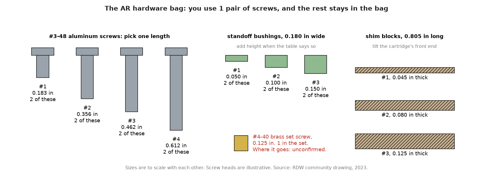

# Cartridge screws, bushings and shims

[Find your part](README.md) · [Part index](reproduction.md) · [What goes where](../docs/what-goes-where.md) · [CAD drawings](../cad/README.md) · [Things to confirm](../TO-CONFIRM.md#headshell-and-screws)

## What it is

The bag of small parts that bolts a cartridge into the AR shell: four lengths of #3-48 screw, three heights of standoff bushing, three thicknesses of shim block, and one set screw. You fit two screws, and bushings and a shim only if the cartridge table on sheet L-1591 calls for them.

## Versions

Dimensions are from the community drawing by RDW, December 7, 2023, who checked the #3-48 thread against 14 original XA and XB shells (Owner report, [community drawing](../docs/originals/ar-headshell-hardware-rev-1.pdf)). Counts and uses are from AR (Factory, [sheet L-1591](../docs/originals/ar-cartridge-mount.jpg)).

| Version | Fitted by AR to | Material | How to recognise it | Dimensions | Mass | Label and source |
| --- | --- | --- | --- | --- | --- | --- |
| Screws No. 1 to No. 4 | XA and XB shells. "Screws in four sizes" (Factory, L-1591). Sold as 1401012-0 "Cartridge Mtg. Hardware" in 1979 (Factory, [price list](../docs/archive/vinyl-nirvana/ar-turntable-history/1979-xa-price-list.md)) | Aluminium | 2 of each length | #3-48 thread; 0.183, 0.356, 0.462, 0.612 in (4.65, 9.04, 11.73, 15.54 mm) under the head | Unconfirmed | Owner report for the sizes |
| Bushings No. 1 to No. 3 | Same | Soft plastic | 2 of each height | ID 0.100 in, OD 0.180 in; heights 0.050, 0.100, 0.150 in (1.27, 2.54, 3.81 mm) | Unconfirmed | Owner report |
| Shim blocks No. 1 to No. 3 | Same | Cardboard | 1 of each thickness | 0.805 × 0.230 in (20.45 × 5.84 mm); 0.045, 0.080, 0.125 in (1.14, 2.03, 3.18 mm) thick | Unconfirmed | Owner report |
| Set screw | In the bag. Where it goes is not stated: HS3 | Brass | 1 | #4-40 × 0.125 in (3.18 mm) | Unconfirmed | Owner report |
| Counterweight set screw, for comparison | XA item 22A, part 942; 1979 part 1501008-0; XB item 6, part 501008. Thread not stated: CW8 | Unconfirmed | Not the #4-40 above unless CW8 says so | Unconfirmed | Unconfirmed | Factory, [XA service manual](../docs/originals/xa-service-manual.pdf), [drawing 119](../docs/drawings/xb-drawing-119.png) |
| Pat's Audio M2.5 screws | Supplied with the reproduction shell | Unconfirmed | "Multiple pairs of progressive length M2.5 screws" | M2.5 | Unconfirmed | Maker claim, [Pat's Audio](../docs/archive/pats-audio/ar-xa-xb-headshell.md) |
| Best Audio M2.5 screws | Sent on request with the Best Audio shell, which takes M2.5 | Unconfirmed | Screws and washers | M2.5 | Unconfirmed | Maker claim, [Best Audio](../docs/archive/ebay/best-audio-xa-headshell.md) |

The thread, from the thread table: #3-48 has a major diameter of 0.0990 in (2.51 mm) and a pitch of 0.5292 mm; #4-40 has a major diameter of 0.1120 in (2.84 mm) and a pitch of 0.635 mm (Standard, [Wikipedia, Unified Thread Standard](../docs/archive/wikipedia/unified-thread-standard.md)). A 4-40 and then an M2.5 thread were also reported in the same forum thread: Conflict, HS1, SR3.

## What fits what

| Version | XA | XB | XB1 | AR77XB | The AR Turntable and Legend | EB-101 | ES-1 | ETL-1 |
| --- | --- | --- | --- | --- | --- | --- | --- | --- |
| #3-48 screws, bushings, shims | Fitted by AR (Factory, L-1591; thread checked on 14 XA and XB shells, community drawing) | Fitted by AR (same) | Unconfirmed | Unconfirmed, HS1 | Unconfirmed | Unconfirmed | Unconfirmed | Unconfirmed |
| Pat's Audio and Best Audio M2.5 screws | Fits with a change: only in those makers' shells, whose inserts are M2.5 (Maker claims) | Fits with a change (same) | Unconfirmed | Unconfirmed | Unconfirmed | Unconfirmed | Unconfirmed | Unconfirmed |

## Drawings

| Version and material | Status | PDF | STEP | Source |
| --- | --- | --- | --- | --- |
| Screws No. 1 to 4, aluminium | Reference; buy it. The head is a placeholder | [Folder](../cad/exports/cartridge-screw-xa-xb-aluminium/) | in the folder | [scad](../cad/parts/cartridge-screw-3-48.scad) |
| Bushings No. 1 to 3, soft plastic | Complete | [Folder](../cad/exports/standoff-bushing-xa-xb-plastic/) | in the folder | [scad](../cad/parts/headshell-standoff-bushing.scad) |
| Shim blocks No. 1 to 3, cardboard | Complete, with a 1:1 cutting DXF | [Folder](../cad/exports/shim-block-xa-xb-cardboard/) | in the folder | [scad](../cad/parts/headshell-shim-block.scad) |
| Set screw, brass | Reference; buy it. The tip is a placeholder | [PDF](../cad/exports/set-screw-xa-xb-brass/set-screw-xa-xb-brass.pdf) | [STEP](../cad/exports/set-screw-xa-xb-brass/set-screw-xa-xb-brass.step) | [scad](../cad/parts/set-screw-4-40.scad) |

## If you make or change it

**Keep:**

- **The thread, #3-48,** for an original shell. A wrong thread strips the stud, and the sheet warns that the studs can be stripped or broken off (Factory, L-1591).
- **The lengths,** so the screw engages the stud fully without bottoming. Which cartridge takes which screw, bushing and shim is the table on sheet L-1591; for a cartridge not on it, use the shortest screw that fully engages.
- **The bushing bore,** 0.100 in on a 0.099 in screw: the bushings turn onto the screws and hold themselves (Factory, L-1591).

**Free:** the screw head style and drive; the bushing and shim materials, as long as they do not crush.

**What else is affected:**

- **The [headshell](headshell.md) studs:** overtightening breaks them.
- **The cartridge's angle:** a shim under the front tilts it (Factory, L-1591). Check the mounting plane after fitting.
- **The [overhang](overhang-template.md):** recheck it after any change of screws, bushings or shim.
- **The stylus force:** for some cartridges the sheet adds a U.S. penny glued inside the shell, or an extra [counterweight](counterweight.md) section.

## Check after fitting

1. Both screws turn in by hand for most of their length. If one stops early, it is too long or the thread is wrong: stop.
2. The cartridge sits flat against the shell or its shim with no rocking.
3. The clips are on the right pins: red right hot, black right ground, white left hot, green left ground (Factory, L-1591).
4. Overhang checked with the template.
5. Stylus force set and checked with a gauge.

## Still to measure

HS1, HS2, HS3, SC3, SC4, SS3, SS4 in [TO-CONFIRM.md](../TO-CONFIRM.md).

## Sources

Each link opens the copy kept in this repository.

- [AR sheet L-1591](../docs/originals/ar-cartridge-mount.jpg). Factory.
- [XA service manual, p. 4](../docs/originals/xa-service-manual.pdf) and [1979 price list](../docs/archive/vinyl-nirvana/ar-turntable-history/1979-xa-price-list.md). Factory.
- [XB drawing 119](../docs/drawings/xb-drawing-119.png). Factory.
- [Community hardware drawing, RDW, December 7, 2023](../docs/originals/ar-headshell-hardware-rev-1.pdf), shared by ronaldw441 on diyAudio. Owner report. The thread itself is not held: SR2, SR3.
- [Wikipedia, Unified Thread Standard](../docs/archive/wikipedia/unified-thread-standard.md). Standard.
- [Pat's Audio](../docs/archive/pats-audio/ar-xa-xb-headshell.md). Maker claim.
