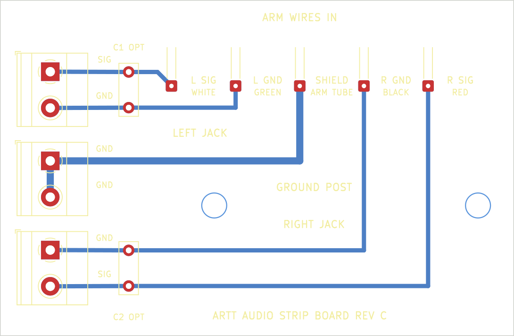

# Audio strip board

[Wiring boards](../README.md) · [Home](../../README.md)

Status: **PRELIMINARY**, revision C. Not yet built.

Schematic: [PDF](docs/artt-audio-strip-board-schematic.pdf).

## Gotchas

- **The wire colours inside the arm are not the headshell colours.** Find each arm wire with an ohmmeter from the headshell pins before soldering.
- **Solder the arm wires. Do not clamp them.** Thread each wire through the larger hole beside its pad first: that hole is the strain relief.
- **Leave the arm wires slack.** They hang from the sprung sub-chassis. A tight wire pulls on the suspension.
- **The arm shield is not joined to either channel ground on this board.** It goes to the ground post only.
- **C1 and C2 stay empty** unless your cartridge needs more load capacitance.

## Mounting

72 x 47 mm. It screws flat to the inside of the rear wall, at the right-hand end, next to the arm pivot stud (Owner report). The edge marked ARM WIRES IN points up, to the top plate.

The three screw terminals are stacked on the left end. Seen from inside the plinth with the table the right way up, left is toward the middle of the rear wall, where the jacks are, so the three outputs leave together and run along the wall.

Two 3.5 mm holes, 37 mm apart, take number 6 wood screws through nylon spacers 6 mm or longer. From the left edge: 30 mm and 67 mm. From the top edge: 28.75 mm for both.

## What the board does

It replaces the factory audio terminal strip.

| Pad or terminal | Board label | Second label row | Goes to |
|---|---|---|---|
| J1 | L SIG | WHITE | Arm wire that rings to the white headshell wire |
| J2 | L GND | GREEN | Arm wire that rings to the green headshell wire |
| J3 | SHIELD | ARM TUBE | The arm's shield wire. It rings to the arm tube |
| J4 | R GND | BLACK | Arm wire that rings to the black headshell wire |
| J5 | R SIG | RED | Arm wire that rings to the red headshell wire |
| J6 LEFT JACK, top | SIG, GND | | Left RCA jack: SIG to the centre, GND to the sleeve |
| J7 GROUND POST, middle | GND, GND | | The ground post. The second pin is spare, for the sub-chassis wire |
| J8 RIGHT JACK, bottom | GND, SIG | | Right RCA jack: SIG to the centre, GND to the sleeve |

The second label row is the headshell wire colour, from the AR owner's manual and sheet L-1591: left is white (signal) and green (ground), right is red (signal) and black (ground). Row RW1 records that the modern colour code differs.

## Arm wire colours at the factory strip

| Model | Arm side of the strip | Label | Source |
|---|---|---|---|
| XA | green, yellow or pink or blue, red, copper, shield | Factory | [XA service manual, p. 4](../../docs/originals/xa-service-manual.pdf) |
| XB | silver, copper, red, blue, green | Factory | [Drawing 119](../../docs/drawings/xb-drawing-119.png) |
| AR77XB | Not recorded | Unconfirmed | |

Neither source prints which colour is which channel. That is why the board is labelled by function and by headshell colour, and why the ohmmeter check comes first.

## To confirm

- Free wall space next to the arm pivot stud, on each model, and that the arm wires reach the pads with slack.
- Which arm wire colour is which channel, XA and XB.
- Arm wire colours on the AR77XB.

## Order and build

1. Zip the `fab/` folder and send it to a board house: two layers, 1.6 mm.
2. Buy the parts in [bom.csv](bom.csv).
3. Solder the three screw terminals.
4. Ohmmeter from each headshell pin to find each arm wire. Solder each to its pad.
5. Screw the board to the wall on spacers. Short twisted pairs from J6 and J8 to the jacks. One wire from J7 to the ground post.
6. Check: each jack centre to its headshell pin, each jack sleeve to its headshell pin, no continuity between the two sleeves, arm tube to the ground post.
