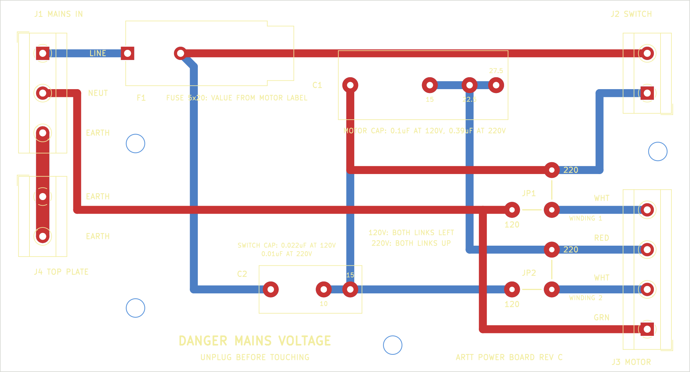

# Power board

[Wiring boards](../README.md) · [Home](../../README.md)

Status: **PRELIMINARY**, revision C. Mains voltage. Not safety certified. Not yet built.

Red tracks are on the parts side, blue tracks on the solder side. Schematic: [PDF](docs/artt-power-board-schematic.pdf).

## Gotchas

- **Unplug the table before touching the board.** Every net except earth is at mains voltage.
- **Spacers and an insulating sheet behind the board.** The solder joints at the back are at mains voltage and must not touch the wood.
- **Fuse value: from the motor label** (TO-CONFIRM row IE1).
- **One wire link per jumper.** Left for 120 V, up for 220 V. A link in both positions of the same jumper is a short circuit across the mains. The fuse is there for that mistake, but do not make it.
- **The motor has two white leads.** They are not interchangeable. Find the pairs with an ohmmeter before connecting: the white lead that shows continuity with red is winding 1, the white lead that shows continuity with green is winding 2.
- **XB and AR77XB: read the motor leads and both capacitors on the table first.** No factory document gives them.
- **The parts stick out from the wall.** Check the motor capacitor's height against the free depth before ordering.

## Mounting

A strip of 130 x 70 mm that screws flat to the inside of a plinth wall, long edge horizontal. Wires run along the wall, so the terminals are on the two ends: mains in and top plate earth on the left end, switch and motor on the right end.

Four 3.5 mm holes take number 6 wood screws through nylon spacers 6 mm or longer. The holes are placed where no mains copper is near, so they are not on a rectangle:

| Hole | From the left edge | From the top edge |
|---|---|---|
| H1 | 25.5 mm | 27 mm |
| H2 | 25.5 mm | 58 mm |
| H3 | 124 mm | 28.5 mm |
| H4 | 74 mm | 65 mm |

Mark the wall through the bare board before soldering anything to it.

The 70 mm height assumes 80 mm of free wall. That is an assumption, not a measurement (TO-CONFIRM row PL12).

## What the board does

It is the XA motor circuit from the [service manual, page 3](../../docs/originals/xa-service-manual.pdf), with a fuse added and with the wire nuts and loose capacitors replaced by labelled terminals.

| Terminal | End of the board | Pins, top to bottom as printed on the board | Goes to |
|---|---|---|---|
| J1 MAINS IN | Left | LINE, NEUT, EARTH | The power inlet in the plinth |
| J4 TOP PLATE | Left | EARTH, EARTH | A ring lug with star washer on the metal top plate. The second pin is spare |
| J2 SWITCH | Right | two pins, either way round | The turntable's own on/off switch |
| J3 MOTOR | Right | WHT, RED (winding 1), WHT, GRN (winding 2) | The four motor leads |

| Part | Label | XA value | Source |
|---|---|---|---|
| F1 | Unconfirmed | 5 x 20 mm fuse, value from the motor label | Row IE1 |
| C1, motor capacitor | Factory | 0.1 µF at 120 V. 0.39 µF at 220 V | XA service manual, p. 3 |
| C2, switch capacitor | Factory | 0.022 µF at 120 V. 0.01 µF at 220 V | XA service manual, p. 3 |

The manual gives both capacitors a 600 V DC rating. A DC rating is not an AC rating: buy film capacitors rated for continuous use on your mains voltage. See [Motor phase capacitor](../../models/xa/mods/motor-capacitor.md).

## Why the capacitors have extra holes

A capacitor has two legs. Each capacitor place has one fixed hole for the first leg and several choices for the second leg, because capacitors of different values and makes have different leg spacing. The number printed beside each hole is the spacing in millimetres.

| Place | Holes | Second leg at |
|---|---|---|
| C1, motor capacitor | 4 | 15, 22.5 or 27.5 mm |
| C2, switch capacitor | 3 | 10 or 15 mm |

The choices for one capacitor are joined by copper, so they are electrically the same. The unused holes stay empty.

## The two voltage settings

Line goes through the fuse to the switch. C2 is across the switch. After the switch, C1 feeds the red lead. Green always goes to neutral.

| Setting | JP1 and JP2 | Winding 1 white goes to | Winding 2 white goes to | Result |
|---|---|---|---|---|
| 120 V | Link left (marked 120) | Neutral | The switched line | The two windings are in parallel. C1 is in series with winding 1 |
| 220 V | Link up (marked 220) | The switched line | Red | The two windings are in series. C1 is across winding 1 |

## To confirm before power

- **Where the winding 1 white lead returns at 120 V.** The manual's 120 V drawing shows that lead with no connection. Neutral is the reading used on this board, from circuit logic (winding 1 and C1 must close the circuit) and from the under-plate picture on the same page, which shows a white lead joined with green and the power cord. On an unmodified 120 V table, check which wire nut holds each white lead. Add a TO-CONFIRM row for it.
- **The 220 V connections.** They follow the manual's 220 V drawing as read here: the dotted lines are taken as the two changed connections. Not checked on a 220 V table.
- **Serials XA176235 to XA204462.** The manual says the lead colours on these are gray, blue, red, gray in order. Which lead is which winding is not stated. Use the ohmmeter.
- **XB.** [Drawing 119](../../docs/drawings/xb-drawing-119.png) gives part numbers only: motor 802006, motor capacitor 803002, switch capacitor 803004. The TT-XBU build has a printed circuit board 800018 in place of the two capacitors.
- **AR77XB.** No factory wiring source.
- **Free wall height and free depth** on each model.

## Layout facts

| Item | Value |
|---|---|
| Mains tracks | 1.5 mm wide |
| Earth track | 2.5 mm wide, on both sides of the board |
| Copper ring around each capacitor and link hole | 0.9 mm per side, so 1.8 mm of copper passes around an empty hole |
| Smallest gap between two different mains nets | 3.25 mm |
| Smallest gap between earth and any other net | 4.5 mm |
| Mains copper to board edge | 6 mm or more |
| Mains copper to a screw head | 6 mm or more |

A track that seems cut by a hole in the picture is not cut: every hole sits in a copper ring that the track joins, and the hole itself is copper plated.

## Order and build

1. Zip the `fab/` folder and send it to a board house: two layers, 1.6 mm, any colour.
2. Buy the parts in [bom.csv](bom.csv). All are through-hole.
3. Solder the terminals, the fuse holder, the two capacitors and the two wire links.
4. With the board on the bench and nothing plugged in, check with an ohmmeter: J1 EARTH to both J4 pins, J1 LINE to the upper J2 pin through the fuse, no continuity from J1 LINE to J1 NEUT with the switch terminals open.
5. Screw it to the wall on spacers with the insulating sheet behind, then wire it.
