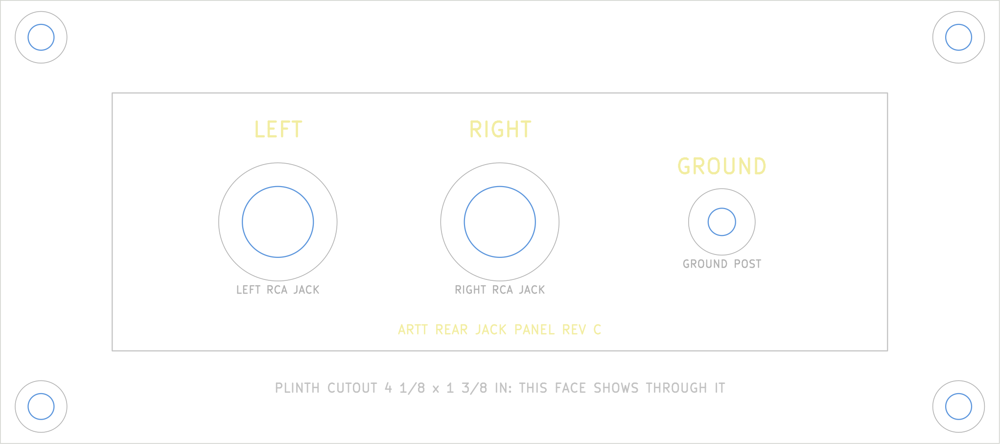

# Rear jack panel

[Wiring boards](../README.md) · [Home](../../README.md)

Status: **PRELIMINARY**, revision C. Unchanged from revision B except the printed revision letter. Not yet built. Hole sizes not checked against a jack.

The large circles are the nut and washer areas. The rectangle is the plinth cutout.

## Gotchas

- **Set the jack hole size from your jacks before ordering.** The holes are 9.6 mm, for a 3/8 in bush. An M10 jack needs 10 mm: ream the hole, or change it in KiCad.
- **A hole can be made larger, not smaller.**
- **The jacks end up recessed by the thickness of the wall.** Check that your cable plugs fit into the cutout with room for fingers.
- **This panel is for audio only.** The power inlet goes in its own cutout, away from the jacks.

## Mounting

135 x 60 mm. It screws to the inside of the rear wall, over the cutout, with four number 6 wood screws driven from inside the plinth. The printed face goes against the wood: LEFT, RIGHT and GROUND show through the cutout from behind the turntable. The other face carries the same three labels for the person wiring it.

## What it is

A bare fibreglass panel with seven holes and no copper. Because there is no metal, the two jack sleeves cannot touch each other or the metalwork, which is the usual cause of hum after fitting metal jacks to a metal plate. No insulating washers are needed.

| Hole | Size | For |
|---|---|---|
| LEFT, RIGHT | 9.6 mm | Chassis RCA jacks, 30 mm apart |
| GROUND | 3.7 mm | 6-32 ground post screw. Thumbnut outside, lug inside |
| Four corners | 3.5 mm | Number 6 wood screws into the plinth rear wall |

The cutout is about 4 1/8 x 1 3/8 in (104.8 x 34.9 mm), the size Galo cut for his connector plate. The panel overlaps it by 15 mm at each end and 12.5 mm above and below. Label: Owner report. See [RCA jacks in the plinth](../../models/xa/mods/rca-jacks.md).

## To confirm

- Jack bush diameter and nut size for the jack you choose.
- Whether 1.6 mm fibreglass is stiff enough when plugs are pushed in. Ordering 2.0 mm costs little.
- Position of the cutout on your plinth, clear of the corner blocks, the T-bar and the motor.
- Free wall height. The panel is 60 mm tall and assumes 80 mm of free wall (TO-CONFIRM row PL12).

## Order

Zip the `fab/` folder and send it to a board house: 1.6 or 2.0 mm. Tell the board house the copper layers are empty on purpose.
